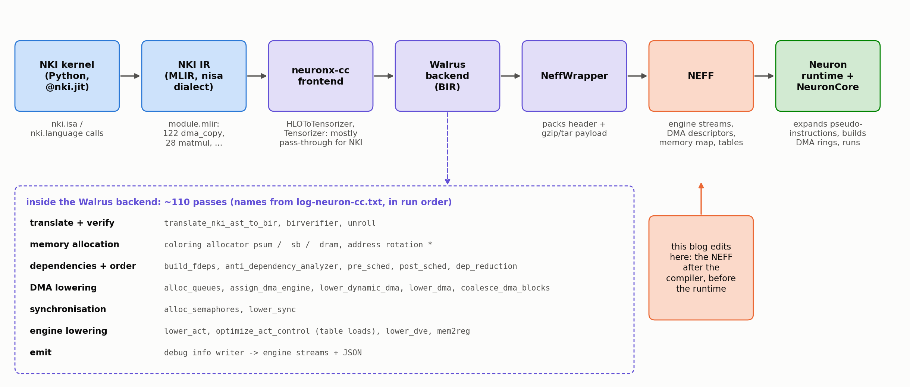
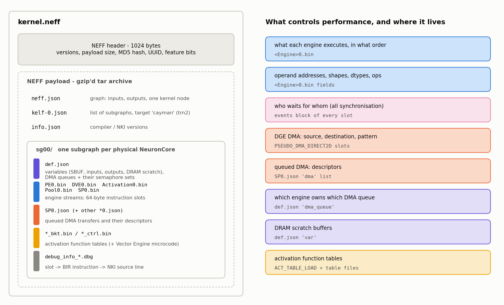

## Accelerate Below Kernel Level: NEFF-based Performance Optimization on AWS Trainium

> Disclaimer: Every conclusion and experiment in this blog comes from the Neuron SDK 2.32.0 toolchain and open-source AWS Neuron repositories, run and measured on a single trn2.3xlarge instance. Part of the information was inferred by reverse engineering, so treat all of it as reference only. It does not necessarily reflect how AWS implements things internally.

#### High-level Summary

- **NEFF is readable and modifiable.** Like SASS for NVIDIA GPUs, the NEFF holds the real instructions and their control information. Although not publically documented, NEFF is editable. A NEFF is a header plus a tar archive with one program per NeuronCore: one instruction stream of 64-byte slots per engine, DMA descriptors, and a definition of memory and DMA queues. The whole instruction schedules are also encoded by a sequence of semaphore waits and updates.
- **NKI is not enough for performance optimization.** Engineers can use NKI to control how the computations are implemented: which operator should be on which engine. However, the compiler decides how the engines coordinate. The schedule can be suboptimal, even with the recent Neuron SDK 2.32. Semaphore waits, DMA queue assignment and activation-table loads are out of NKI's reach but editable in the NEFF. Even for optimizations that are reachable from NKI, operating directly on NEFF can relief the burden of investigating the compiler behavior on NKI maps to NEFF.
- **NEFF-based optimization speeds up a GDN kernel by 4.9x.** Editing only the compiled NEFF of nkilib's Gated DeltaNet decode block took it from 217.5 µs to 44.4 µs, with bit-identical outputs. The gains came from data movement and synchronisation, not arithmetic. The same method sped up 11 more nkilib kernels by 1.05x–2.52x.

---

### Introduction: Trainium, NKI, Neuron Compiler, and NEFF

Profile an NKI kernel on Trainium and you may find the engines idle for long stretches, with nothing obviously wrong in the source. Much of what decides latency is settled by the compiler *after* the NKI source is fixed: which engine waits for which event, which DMA queue carries a transfer, when an activation table is swapped. All of these decisions end up in one file, the NEFF, and that file is the last place where they can still be changed. This post is about reading that file and editing it.

We start with just enough background on Trainium2, NKI and the compiler. We then tour the NEFF format (container, metadata, instructions, memory and DMA, synchronisation), compare what the NEFF and NKI can each control, and distil a playbook from 12 kernels. The last part walks through one kernel, a Gated DeltaNet decode block, one optimization at a time.

**Trainium2.** A trn2.3xlarge has one Trainium2 chip. Its physical NeuronCores are grouped into Logical NeuronCores (LNC=2 by default); our case study runs on a single physical core (LNC=1). Each NeuronCore has five *engines*, independent instruction processors that each run their own instruction stream:

| Engine | Instruction stream in the NEFF | Does |
|---|---|---|
| Tensor Engine | `PE0.bin` | 128x128 systolic array: `LDWEIGHTS` + `MATMUL` into PSUM |
| Scalar Engine | `Activation0.bin` | `ACTIVATE` = func(x·scale + bias) from piecewise-polynomial tables; copies and casts; can issue DMAs |
| Vector Engine | `DVE0.bin` | element-wise ops, reductions, shuffles |
| GPSIMD Engine | `Pool0.bin` | general-purpose ops, register arithmetic, software-generated DMAs, collectives |
| Sync Engine | `SP0.bin` | starts DMA transfers and waits on semaphores |

Inside the NEFF, streams and DMA queues keep the compiler's internal engine names (PE, Activation, DVE, Pool, SP), which is why they appear in file and queue names such as `SP0.json` or `qActDynamicHW`. Everywhere else this post uses the public names. neuron-explorer, the profiler UI, labels its rows Tensor, Scalar, Vector, GpSimd and Sync.

**Memory and synchronisation.** The engines compute out of two on-chip memories. The **state buffer (SBUF)** is organised as 128 *partitions*, each with its own address window, and **PSUM** holds matmul accumulators. HBM (DRAM) is reachable only through DMA. Because the five engines and the DMA engines all run in parallel, something has to order them. That is the job of **semaphores**: hardware counters that instructions wait on and add to. They come back in almost every section of this post.

**NKI** (Neuron Kernel Interface) is a Python-embedded kernel language. Each `nki.isa` call corresponds closely to one engine instruction (`nc_matmul`, `activation`, `tensor_tensor`, `dma_copy`, …), and `nl.ndarray(..., buffer=...)` places a tensor in SBUF, PSUM or HBM. **nkilib** is AWS's library of NKI kernels. Every kernel in this post comes from it, compiled with `@nki.jit` at default settings.

**From NKI to NEFF** (Figure 1). `@nki.jit` traces the kernel into MLIR in the `nisa` dialect; our kernel has 122 `dma_copy`, 28 `matmul` and 28 `activation` operations. neuronx-cc then runs the pipeline `HLOToTensorizer → Frontend → StaticIOTranspose → WalrusDriver → NeffWrapper`. For an NKI kernel the frontend does very little: only 6 of its 126 passes change anything.

The real work happens in the **Walrus backend**: about 110 passes over BIR, the backend's intermediate representation. These passes allocate memory, work out dependencies, turn DMAs into queues and descriptors, allocate semaphores and insert the waits, place activation-table loads, and emit one instruction stream per engine. For nkilib kernels, instruction order and SBUF placement largely follow NKI's own scheduling and allocation. Finally, **NeffWrapper** packs everything into a single `.neff` file, which the Neuron runtime loads, patches and runs.


*Figure 1. The compile pipeline for an NKI kernel, with the backend pass names from `log-neuron-cc.txt`. Everything below the NKI source line is decided by the compiler. This post edits the artefact at the orange box.*

---

### NEFF Container Structure

**A NEFF is an ordinary archive: you can unpack it, edit any file inside, and pack it again without involving the compiler.**

On disk, a NEFF is a **1024-byte header followed by a gzip-compressed tar archive**, the payload. Figure 2 shows what the archive contains and where each performance-relevant decision lives.


*Figure 2. Left: the members of a NEFF (the GDN kernel has 46). Right: where each performance-relevant decision is stored.*

Only a handful of header fields matter in practice:

| Offset | Field | Notes |
|---|---|---|
| 0x010 | `data_size` | must equal the payload length |
| 0x0AC / 0x0CC | `hash` / `uuid` | both are the MD5 of the payload |
| 0x0DC | `network_name` | the compile working directory |
| 0x220 | feature word | one bit per runtime capability the program uses (`dge`, `coalesced-cc`, `vector-dge`, …) |
| 0x228 | `pcore_count_per_lnc` | physical cores per logical core |

The payload is a plain POSIX tar archive with fixed metadata (mode 0644, uid 0, mtime 0, no directory entries), compressed at deflate level 1. Reproducing those settings is enough to rebuild every NEFF we studied byte for byte (`tools/neff.py unpack/pack`). Two findings make editing easy:

- **The runtime does not check the MD5.** A NEFF with a zeroed hash loads and runs, and its output is bit-exact. Our packer still rewrites both MD5 copies, because neuron-explorer uses the UUID to pair a NEFF with its profile (NTFF). In practice, every edited NEFF needs a fresh profile.
- **Debug info is optional.** Removing every `debug_info_*.dbg` file changes neither loading, results nor profiling. When the files are present, they map each instruction back to the BIR instruction and the NKI source line it came from, which is invaluable when deciding what to edit.

---

### Graph and Subgraph Metadata

**The metadata says what every instruction refers to, and it declares the DMA queues and their semaphores, which several of our optimizations rearrange.**

Three small JSON files at the top of the payload describe the program from the outside:

- **`neff.json`**: a TVM-style graph listing the inputs, the outputs and one kernel node. Shapes are flattened to 2-D, and inputs are numbered by the compiler, not in the kernel's parameter order.
- **`kelf-0.json`**: the list of **subgraphs**, one per physical NeuronCore of the logical core (`sg00`, `sg01` at LNC=2), and the target name: `"cayman"` is Trainium2.
- **`sgNN/tensor_map.json`**: maps each `inputN` back to the NKI kernel parameter it came from.

Below them, each subgraph directory is a complete program for one physical core. Its **definition file, `def.json`**, declares everything the instructions refer to. Here is an excerpt from the GDN kernel:

```json
"var": {
  "SB":            {"type": "state-buffer", "var_id": 0},
  "W_in_qkv":      {"type": "input",  "var_id": 2, "size": 262144},
  "inst__I-16-0:_mem_6_1_sg0000": {"type": "tmp-buf", "var_id": 15, "size": 2048},
  "DGETable0":     {"type": "dge-table", "var_id": 25, "list": [2, 1, 7, 6, 4, 3, 5, 11, 13, 14]}, ...
},
"dma_queue": {
  "qActDynamicHW":   {"type": "dynamic", "owner": "act",  "num_queues": 16, "semaphore_set": [72, ..., 87]},
  "qPoolDynamic":    {"type": "dynamic", "owner": "pool", "num_queues": 16, "semaphore_set": [8, ..., 23]},
  "qSPDynamicHW":    {"type": "dynamic", "owner": "sp",   "num_queues": 16, "semaphore_set": [56, ..., 71]},
  "qSPIO0":          {"type": "in",      "owner": "sp",   "num_queues": 16, "semaphore_set": [40, ..., 55]},
  "qSPSpillReload0": {"type": "data",    "owner": "sp",   "num_queues": 16, "semaphore_set": [24, ..., 39]}
}
```

Instructions refer to memory by `var_id`. Variable 0 is always the state buffer, inputs and outputs live in DRAM, and `tmp-buf` (or `virtual`) variables are DRAM scratch buffers that the compiler created. The `dge-table` lists the variables that DMA instructions refer to by position.

The `dma_queue` block deserves a second look: **each DMA queue is owned by one engine and comes with its own 16 semaphores**. Choosing a queue for a transfer is therefore also choosing which engine issues it and which semaphore reports it, and that choice becomes a lever in the case study.

The rest of the subgraph holds:

- one **instruction stream** per engine (`PE0.bin`, `DVE0.bin`, `Activation0.bin`, `Pool0.bin`, `SP0.bin`), each a sequence of 64-byte slots;
- engine descriptions, of which `SP0.json` matters most: it lists the queued DMA transfers;
- **activation table sets** (`silu_and_others`, `reciprocal_sqrt_and_small`, …), byte copies of files shipped with the compiler. The Scalar Engine can hold only one set at a time;
- the Vector Engine's microcode tables, and the debug info.

---

### Instruction and Pseudo Instruction

**Every instruction carries exactly one semaphore wait and one semaphore update. Most of the optimizations later in this post follow from that one fact.**

**Every instruction is one 64-byte slot.** Byte 0 is the opcode, which selects one of about 190 layouts. We did not have to guess these layouts. AWS's `neuron-dbg` tool ships the ISA definitions as Go structs with DWARF debug info, plus one compiled C accessor per field, and we read the field offsets out of both. As a check, we decoded 2 million slots from 14 compiled kernels and compared every field with the profiler's own disassembly: every non-pseudo opcode matches. `tools/isa.py` decodes and re-encodes slots by field name.


*Figure 3. Two of the layouts. Bytes 4-11 (the events block) are the same for every instruction: one semaphore wait, one semaphore update, and **one** shared 32-bit value.*

A compute instruction is an opcode, its ALU operations and data types, and its tensor operands. Each operand is a 32-bit **address** plus an **access pattern**: a step and a count per dimension, in elements. The partition range is given separately, by `num_active_channels`. Most NKI calls map one to one onto instructions:

| NKI call | Instructions |
|---|---|
| `nisa.nc_matmul` | Tensor Engine `LDWEIGHTS` + `MATMUL` |
| `nisa.activation` | Scalar Engine `ACTIVATE` (+ `ACTIVATION_TABLE_LOAD` inserted by the compiler) |
| `nisa.tensor_tensor` / `tensor_scalar` | Vector / GPSIMD / Scalar Engine `TENSOR_TENSOR_ARITH_OP` / `TENSOR_SCALAR_ARITH_OP` |
| `nisa.tensor_copy` | `COPY` / `CAST` on the Vector, Scalar or GPSIMD Engine |
| `nisa.dma_copy` | a queued DMA (Sync Engine trigger + `SP0.json` entry) or a DGE DMA (`PSEUDO_DMA_DIRECT2D`) |
| every call with more than one dependency | extra `EVENT_SEMAPHORE` slots, because a slot holds only one wait |

**Pseudo-instructions** are the exception to "what you see is what runs". Their opcodes start with `PSEUDO_`, and the runtime rewrites them when it loads the NEFF, because only then are physical addresses, DMA ring registers and the rank id known:

| Pseudo-instruction | Becomes at load time | Purpose |
|---|---|---|
| `PSEUDO_DMATRIGGER` | `WRITE`s to DMA ring registers | start queued transfer *k* of a queue |
| `PSEUDO_DMA_DIRECT2D` (+ `PSEUDO_EXTENSION`) | `DMA_DIRECT2D` / `DMA_INDIRECT` | a DMA whose descriptors hardware generates at run time |
| `PSEUDO_SYNC_BARRIER` / `PSEUDO_CORE_BARRIER` | `DRAIN` + `EVENT_SEMAPHORE` (+ `WRITE` to the other core) | barrier between engines / between cores |
| `PSEUDO_GID_LOAD` | `MOVE $R[61] = rank` | rank-dependent code |
| `PSEUDO_BRANCH_LABEL`, `..._PREFETCH_HINT` | nothing / hint | loops: branch targets are label ids |

Since the rewrite happens at load time, you edit a pseudo-instruction like any other slot. The runtime also wraps each stream in its own prologue and epilogue, which synchronise the engines and reset the semaphores for the next run. In a profile they show up as instructions without a `compiler_pc`, before slot 0.

---

### Memory Management and DMA

**On small kernels, a DMA costs more to issue and to report as complete than to actually move its bytes.**

**Addresses.** An SBUF operand address is `partition × 0x40000 + offset`. Kernels use offsets from 0x4000 up, the runtime reserves 8 bytes at 0x37FF8, and start partitions are multiples of 32. PSUM addresses are `0x2000000 + offset`, handed out in 2 KiB banks with 16 KiB per partition. Compute instructions never touch DRAM. One detail turned out to matter later: **the source and destination addresses each carry their own partition**, so a single compute instruction can read partition 0 and write partition 32.

**Two kinds of DMA** (Figure 4). A DMA transfer is described by *descriptors*, each covering one contiguous run of bytes. The two kinds of DMA differ in when those descriptors are made.


*Figure 4. Queued DMAs are described in JSON and turned into hardware descriptors when the NEFF is loaded. DGE DMAs are single instructions whose descriptors hardware generates at run time.*

- **Queued DMA.** Every transfer is listed in advance in `SP0.json`, with its queue, block id, semaphore and descriptors: source and destination variable, byte offsets, byte-based sizes and steps, and an operation (`copy`, `cast` or `add`). The runtime turns them into hardware descriptors at load time. During the run, a `PSEUDO_DMATRIGGER` on the Sync Engine starts block *k*, and when the block finishes, the queue's semaphore `semaphore_set[k % 16]` grows by 16.
- **DGE DMA** (descriptor-generation engine). A single `PSEUDO_DMA_DIRECT2D` instruction on the Sync, Scalar or GPSIMD Engine carries a 2-D source and destination pattern in bytes, the element sizes and data types (so it can cast on the way), and the semaphore to add 16 to when it finishes. Hardware generates the descriptors at run time. **That semaphore also selects the queue**, so it must belong to the issuing engine's queue group in `def.json`.

Here is what DMAs cost, measured on the case-study profiles (Figures 12a and 13a). For the small transfers typical of a decode kernel, the fixed costs dominate:

| Item | Cost |
|---|---|
| issuing a DGE DMA | **0.56 µs + 0.74 ns × descriptors** of engine time (fit over 312 issues) |
| issuing a queued trigger | 0.09–0.12 µs |
| DGE completion reported after the data lands | ~1.3–4 µs, fixed latency (halving the bytes did not change it) |
| SBUF→DRAM DGE write of 128 **2-byte** elements | completion after **17–22 µs** (~135 ns per element), and everything queued behind it waits too |
| a partition→row transpose by DMA | one descriptor per partition per column |
| `ACTIVATION_TABLE_LOAD` | 1.283 µs |

A few rules we confirmed on the device:

- Descriptors inside one queued transfer run in order.
- **A queue's blocks must be triggered as a prefix of block-id order.** Skipping a block in the middle hangs the device; leaving trailing blocks untriggered is fine.
- Concurrent DMA writes less than a word apart corrupt each other.
- Free SBUF above the compiler's highest offset is usable only up to about 245 KB per partition.

---

### Synchronization

**Semaphores are the whole schedule: they are the only thing that orders the five engines and the DMAs.** Figure 5 shows the model.


*Figure 5. Engines and DMAs add to semaphores; instructions wait for thresholds. A threshold counts producers since the start of the kernel.*

- **Who counts what.** A NeuronCore has 256 semaphores, and the runtime reserves S[0..2]. S[3], S[4], S[5] and S[6] count finished instructions on the GPSIMD, Scalar, Tensor and Vector Engines: an instruction marked `SEM_INC_COMPLETE` adds 1 when it finishes. DMA queue semaphores grow by 16 per finished transfer.
- **Waits are absolute.** A wait `S[i] >= v` means "the v-th increment of S[i] has happened", counted from the start of the kernel, never as a delta. Within one engine, instructions complete in program order, and the compiler relies on that.
- **One wait and one update per slot.** When an instruction depends on two producers, the compiler adds an `EVENT_SEMAPHORE` slot that does nothing but wait. The wait threshold and the add amount share one value field.
- **An unused primitive.** The compiler uses exactly one wait mode (`>=`) and one update mode (+1 on completion), although the ISA defines more. **`SEM_ADD_IMM_COMPLETE` (+N on completion) works on the device but is never emitted**, and it became one of our most useful tools.

Editing rules, each tested on the device against exactly predicted outputs:
1. **Think in producers, not numbers.** Before an edit, write down which instruction or DMA produces each increment a wait counts. After the edit, recompute the thresholds.
2. **Removing an instruction:** replace it with an `EVENT_SEMAPHORE` that keeps its wait and update, or delete it and lower every later threshold that counted it, in all five engines.
3. **Adding an instruction** raises later thresholds, *and* its consumer must now wait for it.
4. **Never remove waits on an engine's own completion semaphore.** Engines start the next instruction before the previous one has finished writing. Removing the Vector Engine's self-waits gave wrong numbers; removing the GPSIMD Engine's self-waits gave out-of-bounds DMAs.
5. **A single compiler wait often guarantees several things.** Before deleting a DMA, check what its semaphore was *transitively* ordering, and which other thresholds can now be reached early.

Getting synchronisation wrong fails in two ways. A wait that can never be met hangs the core (`NRT_TIMEOUT`). A wait that is met too early does not hang: it produces wrong numbers, sometimes only under the profiler's timing. That is why we verify every edit with several runs *and* profile it with repeats before trusting it.

---

### What can we do in NEFF but not NKI?

Writing better NKI is always the first step, and much of what we did *could* be expressed in NKI by restructuring the source. But a whole class of decisions is made by the compiler **after** the NKI source is written, and NKI 0.6.0 has no construct for them. Figure 6 and the table below compare the two levels.


*Figure 6. What NKI 0.6.0 lets you express, what the compiler decides, and what a NEFF edit controls. Red = no handle at that level.*

| Decision | NKI 0.6.0 | NEFF |
|---|---|---|
| ISA op, operands, dtypes, tile shapes | ✅ `nki.isa` calls | ✅ slot fields |
| Where a tensor lives, SBUF address | ✅ `buffer=`, `address=` (but reused standalone kernels take and return HBM tensors) | ✅ any address |
| Which engine runs a compute op | ✅ `engine=` on most ops | ✅ any engine that implements the opcode |
| Which engine issues a DMA | ⚠️ `dge_mode` + `engine=sync\|scalar` (HWDGE) or gpsimd (SWDGE) | ✅ plus *where* in that engine's stream |
| Which DMA queue / semaphore a transfer uses | ❌ | ✅ `semaphore` field, `def.json` queues |
| Queued-DMA descriptors and block triggering | ⚠️ access pattern only | ✅ `SP0.json`, trigger slots |
| Instruction order on one engine | ⚠️ program order (`nl.no_reorder`), not relative to compiler-inserted instructions | ✅ exact |
| **Which semaphore each instruction waits on, and the threshold** | ❌ derived by the compiler from dependencies | ✅ events block, bytes 4-11 |
| **Signal "done" without moving data** (`SEM_ADD_IMM_COMPLETE`) | ❌ never emitted | ✅ |
| **Activation-table loads: how many, where** | ❌ inserted by `optimize_act_control` | ✅ delete or move `ACTIVATION_TABLE_LOAD` |
| Compiler-inserted barriers, queue-guard waits, dummy transfers | ❌ | ✅ |

**These NEFF-only levers matter in practice.** Across the 12 kernels in this study, they produced some of the best gains per byte changed:
- **gdn_tkg (LNC=2):** 12 Tensor Engine waits were re-pointed at the Scalar Engine cast that actually produces each operand. 4 of the 12 producers did not signal the semaphore the Tensor Engine waited on, so the Tensor Engine sat idle for up to 2 µs after its data was ready. No instruction moved; only waits were renumbered.
- **gdn_tkg (LNC=1):** deleting 18 do-nothing `EVENT_SEMAPHORE` slots (no wait, no update) on the Vector Engine's critical cycle saved 0.72 µs. Even a slot that synchronises nothing costs queue time.
- **selective_scan:** 170 redundant self-waits were stripped after moving additions from the Vector Engine to the GPSIMD Engine.
- **gdn_cte (b1 s128):** output stores were moved onto **new DMA queues added to `def.json`**.
- **gdn_block_tkg:** activation-table loads went from 13 to 7, and one gate was re-pointed in a single byte (3.0 µs, see the case study).

What about NKI's own escape hatches? NKI 0.6.0 does contain an internal, unexported `inline_asm_bytes` hook, used by an experimental dequantize kernel, that emits a raw instruction body. Even there you only declare the instruction's memory reads and writes, and the compiler still decides its semaphores (`sync_type.datapath`). The synchronisation rows of the table stay out of reach.

Finally, the two levels **depend on each other**. Several NKI-expressible edits in the case study paid nothing until a NEFF-only edit removed the gate in front of them. In step 3, converting DMAs into compute instructions was worth exactly 0.0 µs on its own, and 3.6 µs together with the queue move.

---

### Design Scope: What should we modify for better performance

**Find the binder first.** We use *binder* for whatever sets the latency: the busiest unit, or a chain of waits on the critical path. Engine utilisation tells you where to look, not how much there is to gain. `selective_scan` had its Vector Engine 99% busy and gained only 1.20x, because that busy work *was* the scan. `gdn_block_tkg` had no unit above 24% busy and gained 4.9x, because it spent its time waiting for DMA completions.

The tool that worked best was a **backward critical-path walk** over the profile. Start from the last instruction. For each instruction, decide whether it was held up by the previous instruction on its engine or by a semaphore wait (the profiler's `SemaphoreUpdate` table records when each threshold was reached). Jump to whichever came later, and repeat. Every step of the resulting chain has about 0.02 µs of slack, and every long hop in it is a candidate edit.

**The playbook.** These are the levers used across the 12 kernels, where each one lives in the NEFF, and whether NKI could express it:

| Lever | Where in the NEFF | Measured effect (examples) | In NKI? |
|---|---|---|---|
| Remove SBUF→DRAM→SBUF staging that only reshapes data | DGE slot bytes 16-63 or `SP0.json` descriptors | gdn_block_tkg −122 µs; gdn_cte b32 s64 1.36x in one step | by restructuring (reused kernels have HBM inputs and outputs) |
| Replace a redundant DMA with a semaphore increment | events block of the DMA slot | ~0.6 µs issue + 2-7 µs completion hop → 0.03 µs | ❌ (`SEM_ADD_IMM` never emitted) |
| Turn a small DMA into a compute `CAST`/`COPY` (also across partitions) | new slot from a template + waits | −1.5 to −2.9 µs each | ✅ `tensor_copy` |
| Move work to an idle engine (DGE issue, Scalar→Vector Engine, Vector→GPSIMD Engine) | move slots between streams; an `EVENT_SEMAPHORE` relay keeps counts | gdn_tkg: 36 scale ops Scalar→Vector Engine; selective_scan: 170 adds Vector→GPSIMD Engine | ⚠️ engine choice only |
| Re-point / relax / split semaphore waits | `events_wait_idx`, value | one byte = 3.0 µs; dropped stale waits −3.5 µs | ❌ |
| Delete no-op sync slots on the critical cycle | `EVENT_SEMAPHORE` slots | 18 slots −0.72 µs (gdn_tkg) | ❌ |
| Fewer activation-table loads | `ACTIVATION_TABLE_LOAD` + moving `ACTIVATE`s | 13→7 (gdn_block_tkg), 46→6 (gdn_tkg); ssd removed 1,266 of 1,531 reloads by computing `exp(-x)` instead of `1/exp(x)` | ⚠️ only by reordering or rewriting activations |
| Fewer, larger DMAs; fewer descriptors | DGE `num_elem`/`step_elem` dims; descriptors | 8 tile loads 5.5→1.3 µs of issue; 512→128 descriptors | mostly |
| Hoist work stuck behind unrelated instructions | permute slots, re-point waits by producer | −1.56 µs (CASTs above unrelated DMAs) | ⚠️ program order only |
| Wider instructions (merge runs of identical ops) | access-pattern dims | 993 runs merged (gdn_cte, −1.1%); 24 per-head silu → 1 (gdn_tkg) | ✅ |


*Figure 7. NEFF-only optimisation of 12 nkilib kernel configurations: 79 loop iterations, none rejected by the verifier.*

**What does not work.** Each of these is tempting, and each was measured:
- removing waits on an engine's own completion semaphore (wrong numbers, or out-of-bounds DMAs);
- relaxing a wait so a DMA starts earlier while the DMA engine is saturated (correct, and slower);
- merging transfers that already run on separate queues (the queues *were* the parallelism);
- splitting a big store (its completion latency is fixed);
- overlapping two DGE transfers from the Sync Engine (passes verification, then hangs the device);
- moving a DGE DMA into another engine's stream (wrong results);
- moving a dtype-converting Scalar Engine op across a table load (it reads the active table);
- setting the `dma_transpose_2d_tile` bit (no effect);
- deleting 707 provably redundant waits in gdn_cte (correct, but worth 0 µs: they were not on the critical path).

**How we kept it correct.** Every iteration had to pass a verifier that runs the NEFF on the device with fixed inputs and requires each output to stay within 1.2x of the *unedited* NEFF's own error against PyTorch. The verifier also pins the launch shape: same core count, no collectives, same interface. Latency is the device's own `total_exec_time`, taken as the median of several captures, with candidates interleaved (A B A B) because the device drifts by a few percent over minutes. Twice an edit passed the verifier and then hung under the profiler, so profiling with repeats became part of the correctness check.

---

### Case Study: Optimize Gated DeltaNet (GDN) in NKILib

**The kernel.** `gdn_block_tkg` is a fused decode step (one token) of a Qwen3.5-style Gated DeltaNet layer. Here it is configured with hidden size 128, 2 key heads repeated to 4 value heads, and head dimension 128 (`gdn_block_tkg_b1_h128_vh4`). It reuses two validated components unchanged, `gdn_conv1d_decode` and `gdn_tkg`, as nested `@nki.jit` calls, and data passes between its four stages through HBM tensors (Figure 8).


*Figure 8. The four stages and the HBM tensors between them. In the compiled NEFF these hand-offs become ten small DRAM `tmp-buf` variables.*

**The baseline is the opposite of compute-bound.** The busiest unit, DMA, is active 24% of the time; the Scalar Engine 19%; the Tensor Engine 3%. About 127 µs of the ~215 µs is spent with engines waiting on DMA completion semaphores. The baseline executes 95 DGE DMAs and 13 activation-table loads.

Figure 9 shows the baseline as neuron-explorer draws it, with each region framed by the step that later removes it. Most of the trace sits inside the dashed frame ①. From 38 to 204 µs the engines are mostly idle, apart from a few short compute bursts and the DMA bursts on the Sync, Scalar and GPSIMD Engines. Those bursts are 2-byte writes into DRAM, each followed by a 17–22 µs wait for its completion report. Before that stretch, the GPSIMD Engine spends 21 µs issuing 32 load DMAs back to back (③⑦). After it, the Scalar Engine spends its tail switching activation tables seven times (④⑤), and the 1 KB output leaves through nine queued DMAs (⑤).


*Figure 9. The baseline in neuron-explorer (`gdn-block-tkg-0-baseline`). The axis covers the whole capture, 232 µs including the runtime's own prologue and epilogue (the bars before ~12 µs); the kernel itself takes 217.5 µs. Frame numbers are the optimization steps below.*

**The trajectory** (Figure 10). We optimized the kernel in seven iterations of an automated edit-verify-measure loop. An agent proposed and applied NEFF edits, the verifier checked each one on the device, and a second model reviewed every iteration and ranked the next candidates. For this post we re-measured all eight NEFFs back to back, with 7 interleaved captures each.


*Figure 10. Latency after each step on one Trainium2 NeuronCore (trn2.3xlarge, LNC=1): median of 7 interleaved device captures, whiskers min-max; lower is better.*

| Step | Latency | Step gain | Cumulative | Main lever | Could NKI do it? |
|---|---|---|---|---|---|
| 0 | 217.5 µs | | 1.00x | as compiled | |
| 1 | 95.4 µs | 2.28x | 2.28x | DRAM round trips → SBUF→SBUF | only by un-composing the kernels |
| 2 | 83.2 µs | 1.15x | 2.61x | delete redundant DMAs, merge tiny tile loads | outcome yes; the mechanism is NEFF-only |
| 3 | 75.0 µs | 1.11x | 2.90x | re-host 8 DMAs on the Scalar Engine's idle queues; drop stale waits | **partly / NEFF-only** |
| 4 | 60.0 µs | 1.25x | 3.63x | DMAs → compute `CAST`s; split a wait; delete 4 table loads | mixed |
| 5 | 51.0 µs | 1.18x | 4.26x | 512→128 transpose descriptors; delete 2 table loads | mixed |
| 6 | 47.7 µs | 1.07x | 4.56x | **one byte**: re-point a gate | **NEFF-only** |
| 7 | 44.4 µs | 1.07x | 4.90x | merge tile loads; hoist work past unrelated DMAs | mostly |

The final NEFF differs from the baseline in only 6 of its 46 members: `Activation0.bin` (105→114 slots), `DVE0.bin` (114→127), `Pool0.bin` (71→75), `PE0.bin`, `SP0.bin` and `SP0.json`. Its outputs are **bit-identical** to the baseline's, which we checked again on the device for this post.


*Figure 11. One profiled execution before and after, on the same time axis. Orange = DMA issue, yellow = table loads, green = DMA data in flight.*

#### Step 1 — Route the DRAM round trips through SBUF (217.5 → 95.4 µs, 2.28x)

**Rerouting six DRAM round trips through SBUF removed 122 µs, without changing a single semaphore.**

*The problem.* Every HBM hand-off in Figure 8 became DRAM traffic in the NEFF: one DMA writes small per-partition values into a DRAM `tmp-buf`, and another reads them back. Joining each DGE DMA with the semaphore increments that report its completion shows what that costs (Figure 12a).

Reads from DRAM complete in about 1.6 µs. **Writes of 128 two-byte elements into DRAM take 17–22 µs to report completion**, and anything queued behind them waits too, up to 38 µs. The bytes themselves land within 0.6 µs; it is the completion report that is slow. With about 30 such transfers in 5–6 serial rounds, most of the kernel was spent waiting.


*Figure 12a. Every DGE DMA of the baseline: time from issue until its completion semaphore is reached, from one profiled execution. The bar marks the median.*

*The fix, in the NEFF* (Figure 12b). Each writer/reader pair is really a per-partition copy, sometimes with a bf16→fp32 cast. So we give the **writer the reader's destination** and the **reader the writer's source**. Now both perform the same SBUF→SBUF copy (a DGE DMA can cast on the way), the writer's completion means "the data is in place", and the reader becomes a harmless repeat. **No semaphore and no wait changes**, so the edit cannot break synchronisation.

Concretely, we rewrote bytes 16–63 of the `PSEUDO_DMA_DIRECT2D` slots in `SP0.bin`, `Pool0.bin` and `Activation0.bin`, plus the matching queued descriptors in `SP0.json`. One wait was re-pointed; no slot was inserted or deleted.


*Figure 12b. A DRAM round trip becomes an SBUF→SBUF copy by swapping address fields between the two DMAs.*

*The result.* Engine busy times barely moved (Scalar Engine 42.0→42.3 µs, GPSIMD Engine 35.8→35.8 µs), but DMA activity fell from 53 to 35 µs, and **all 122 µs came out of idle time**. No DGE DMA now takes more than 6.6 µs from issue to completion; before, the worst took 37 µs.

*Could NKI do it?* Yes, but only by giving up composition. The round trips trace to specific source lines: `gdn_block_tkg.py:96` stores `mixed`, `gdn_conv1d.py:191/221` loads and stores, `gdn_block_tkg.py:325-336` splits per head, and `gdn_tkg.py:169-170` loads. They exist because the block reuses `gdn_conv1d_decode` and `gdn_tkg` unchanged, and those kernels take and return HBM tensors. To avoid them in NKI, you would rewrite both as helpers that pass SBUF tiles, as the block already does for its own `in_proj` code. The NEFF edit gets the same result and leaves the source modular.

*Pitfall.* Our first attempt split a gather across concurrent DMAs that wrote 2 bytes apart, and the writes corrupted each other. Concurrent destinations must be at least a word (in practice 256 B) apart, or be ordered inside one queued transfer.

#### Step 2 — Delete DMAs, not just shrink them (95.4 → 83.2 µs, 1.15x)

**Replacing redundant DMAs with semaphore increments cut another 12 µs.**

*The problem.* Step 1 left 16 DMAs that repeat a copy someone else already made, plus 5 "signal-only" DMAs. Shrinking them does not help, because **a DGE DMA costs about 0.56 µs of engine time almost regardless of its size** (Figure 13a). Together, the 95 DGE DMAs took about 60 µs of issue time on the GPSIMD, Sync and Scalar Engines.


*Figure 13a. Engine time to issue a DGE DMA against its descriptor count, all 312 issues in the 8 profiles.*

*The fix, in the NEFF.* We overwrite the DMA slot with an `EVENT_SEMAPHORE` that waits for the real producer and then does **`SEM_ADD_IMM_COMPLETE` +16 on the DMA's own semaphore** (Figure 13b). Every waiter stays as it was. The cost drops from 0.55 µs, plus a 2–7 µs completion hop, to 0.03 µs, and the semaphore moves the moment the real data is ready.

In the same iteration, 8 per-partition Scalar Engine DMAs became compute `CAST`s (0.25 µs, with the result visible immediately), and the 8 tiny `conv_weight` tile loads (2 KB each) became one 2-D DMA with a negative tile stride.


*Figure 13b. Removing a DMA without touching any wait in the program.*

*The result.* GPSIMD Engine busy time fell from 35.8 to 26.9 µs, Sync Engine from 28.0 to 20.3 µs, and DMA from 34.6 to 29.1 µs.

*Lesson.* Merging only pays for small tiles. Merging the 32 KB `W_in_z`/`W_in_qkv` tiles was correct but **slower** (+0.9 to +1.5 µs), because it moved bytes that used to stream over several queues in parallel onto a single queue.

*Could NKI do it?* An NKI rewrite would never emit these duplicate DMAs, and `tensor_copy` and a 3-D `dma_copy` exist. The **mechanism**, however, a semaphore increment that stands in for a transfer, has no NKI equivalent, and later steps reuse it constantly.

#### Step 3 — Re-host DMAs on idle queues, drop stale waits (83.2 → 75.0 µs, 1.11x)

**Moving eight weight loads onto the Scalar Engine's unused DMA queues, and dropping waits that guarded nothing, cut 8.2 µs.**

*The problem.* The critical-path walk put **the GPSIMD Engine's prologue of 25 back-to-back weight-load DMAs** (~17 µs of pure issue) at the head of the kernel, followed by ~27 µs of chained DMA-completion waits.

*The fix, in the NEFF.* `def.json` gives the Scalar Engine 16 DGE queues (semaphores 72-87), but the compiler used only 72-79. So we **inserted** 8 slots into `Activation0.bin`. Inserting works: nothing records a stream's length, and this kernel has no branches. Each new slot is a verbatim copy of a GPSIMD Engine DMA with only its `semaphore` field changed to 80-87.

The vacated GPSIMD Engine slot becomes `EVENT_SEMAPHORE wait S[80+j] >= 16, SEM_ADD_IMM S[old] += 16`, a cheap relay that keeps **every downstream wait byte-identical**. Then:
- the compiler's queue-guard waits (`own semaphore >= 16`) on the moved DMAs no longer guarded anything and were dropped (−1.4 µs);
- the waits on 7 queued-DMA triggers whose blocks had become duplicates or dummies were dropped (−2.1 µs);
- the DMA whose completion gates the kernel's first instruction is now issued first.


*Figure 14. The first 36 µs of iterations 2 and 3. The GPSIMD Engine's serial DMA issue (orange) is shared with the Scalar Engine, and the Scalar Engine's dense head finishes ~5 µs earlier.*

*Lesson.* The `CAST` conversions in this step were worth exactly **0.0 µs on their own** and 3.6 µs together with the queue move: on their own, the binder simply moved somewhere else. Where the inserted DMAs sit in the Scalar Engine's stream also mattered more than how many we moved. Placing them in front of the Scalar Engine's first `ACTIVATE` delayed the root of the whole dependency graph.

*Could NKI do it?* Only in part. `dma_copy(dge_mode=hwdge, engine=scalar)` can ask the Scalar Engine to issue a DMA, but **choosing the queue and semaphore, the relay, and dropping guard and trigger waits are NEFF-only**. Those NEFF-only levers account for about 3.4 of the 8.2 µs gained in this step, and the engine move and DMA issue order (NKI-indirect) for another 3.9 µs.

#### Step 4 — DMAs become compute; activation tables stop thrashing (75.0 → 60.0 µs, 1.25x)

**Turning DMAs into compute instructions and deleting four activation-table loads cut 15 µs, the largest step after the first.**

*The problem.* Between ~34 and ~50 µs, the DMA engine was a **serial bottleneck**, retiring ~1,500 two-byte transpose descriptors at ~15 ns each. Three edits that let transfers *start earlier* were correct, and all of them lost time. Only removing descriptors from the DMA engine could help.

*The fix, in the NEFF.*
- **Compute instead of DMA.** The compiler's own Vector Engine slot 88 reads partition 0 and writes partition 32, which showed that a compute address carries its own partition. A queued p0→p32 cast became 4 Scalar Engine `CAST`s (−2.9 µs), a queued gather became 4 `CAST`s (−1.8 µs), and a 512-descriptor within-partition gather became 4 GPSIMD Engine `CAST`s (−1.5 µs).
- **Split a wait that carried four guarantees.** One gate waited for the *latest* of four DMAs, but only one consumer, ~9 µs later, needed that last DMA. Moving the late guarantee onto that consumer, as an inserted `EVENT_SEMAPHORE`, saved 1.3 µs.
- **Delete redundant activation-table loads** (Figure 15). The Scalar Engine holds one table set at a time, and the per-head tail alternated silu (table 2) and rsqrt (table 4): `4,2,4,2,4,2,4`, at 1.283 µs per switch. An `ACTIVATION_TABLE_LOAD` whose table is already resident can be replaced by a no-op, as long as **no instruction's resident table changes**. Moving one silu `ACTIVATE` into the previous table-2 region deleted 2 loads (−1.6 µs), and giving another op a private in-place destination deleted 2 more (−1.7 µs). Step 5 finished the job.
- The last DRAM round trips, including the output epilogue's, were made direct (−1.5 µs).


*Figure 15. Tail of the per-head loop, illustrative. Loads go 4,2,4,2,4,2,4 → 4,2,4; the kernel total goes 13 → 7.*

*Could NKI do it?* The `CAST`s, yes (`tensor_copy`). The table loads, **only indirectly**: NKI has no table-load API, so the best it can do is reorder activations and hope the backend's `optimize_act_control` pass coalesces them. Splitting a wait is **NEFF-only**.

#### Step 5 — Fewer descriptors, the last table loads (60.0 → 51.0 µs, 1.18x)

**Packing four columns per descriptor cut transpose descriptors by 4x; with two more table loads gone, latency dropped another 9 µs.**

*The problem.* A partition→row transpose of 4 columns costs 4 × 128 descriptors, and the DMA engine retires them one after another.

*The fix, in the NEFF* (Figure 16). We first pack the 4 two-byte columns into **8 contiguous bytes per partition** with 4 compute `CAST`s, then move them with **one 128-descriptor DMA of 8-byte elements**. The consumers read the interleaved row with a stride of 4. That includes the Tensor Engine's reverse-stride `LDWEIGHTS`, which accepts all of its strides scaled by 4. Applied to two transpose groups, this saved 1.4 and 2.8 µs.


*Figure 16. 512 → 128 descriptors per transpose group.*

The biggest single win of the iteration (−2.9 µs) removed the last two redundant table loads. It had failed in step 4 for a subtle reason. An fp32 `[128,1]` result is 512 bytes, and it overlapped a 256-byte bf16 matmul operand that **the Tensor Engine reads with no semaphore in between**, so moving the op earlier overwrote live data. Static analysis cannot see this; scanning the profile's operand strings for the whole byte range can. A private destination fixed it. In the same iteration, the 9 queued DMAs of the output epilogue became a single 1 KB store (−1.7 µs).

*Hazard.* Replacing a DMA with a semaphore add can let a **third, untouched** wait pass early. Here, a threshold of 32 became reachable from two `EVENT_SEMAPHORE` adds alone. That NEFF passed the verifier and then hung under the profiler.

*Could NKI do it?* Packing and the single store, yes. The table loads, only indirectly. Leaving trailing queue blocks untriggered is NEFF-only.

#### Step 6 — One byte (51.0 → 47.7 µs, 1.07x)

**Changing one byte, the semaphore that one instruction waits on, saved 2.4 µs.**

*The problem.* The Scalar Engine sat idle for 3.7 µs in front of slot 54, an `EVENT_SEMAPHORE` waiting on `S[28]`. That semaphore belonged to a queued block that, after step 1, only writes 2 bytes into a dead buffer. The block worked as a *proxy*: the Sync Engine triggered it only after the real transfer (`S[67]`) had completed, so it landed ~2.6 µs after the data (Figure 17).

*The fix, in the NEFF.* Change `events_wait_idx` of that slot from **28 to 67**: byte 5 of one 64-byte slot.


*Figure 17. The gate waited on a dummy transfer that is always triggered after the real one completes.*

*The result.* −2.4 µs. The rest of the iteration moved 8 Scalar Engine `CAST`s to the Vector Engine (−0.3 µs), and hoisted 4 silu `ACTIVATE`s above two compiler barriers that only gate the Vector Engine's reads (−0.6 µs).

*Lesson.* The `CAST` move taught us that when same-shaped Scalar Engine ops already overlap (each starts 0.39 µs after the previous one starts), making them shorter buys nothing. Measure the *union* of instruction intervals, not the sum of their durations.

*Could NKI do it?* No. NKI has no way to choose which semaphore an instruction waits on. To be fair, this particular proxy was a leftover of our own step 1, but the lever itself, choosing which event an instruction waits on, is exactly what NKI does not expose.

#### Step 7 — Merge for issue time, split for latency (47.7 → 44.4 µs, 1.07x)

**Merging eight tile loads into one DMA, then splitting it where consumers need it, cut the last 3.2 µs.**

*The problem and the fix* (Figure 18). The 8 `in_proj` weight tiles were loaded by 8 DMAs of 128 descriptors each. By the measured cost model (≈0.6 µs fixed + 0.7 ns per descriptor), that is 5.5 µs of issue, whereas **one DMA of 1024 descriptors** costs 1.3 µs. The tile index goes into dimension 1 of the DGE access pattern, and 8 relay `EVENT_SEMAPHORE`s restore the semaphore counts that the dropped DMAs used to provide. Then:
- the merged table-2 tile load was **split again along its consumer boundary** (4 + 4 tiles), so the Vector Engine's tiles land 1.2 µs sooner (−0.5 µs);
- the GPSIMD Engine's 8-`CAST` packing run was **hoisted above three DRAM spill DMAs it does not depend on**, which removed the Scalar Engine's 2.2 µs wait on the transpose it feeds (−1.6 µs);
- the first table load was hoisted above a barrier, so it now runs during the stall (−0.4 µs).


*Figure 18. Issue-time cost model for the 8 tile loads.*

*Lessons.* On its own, the merge was a **+0.6 µs regression**: the binder moved to the Sync Engine's transposes, whose completion reports got slower when issued back to back. A win can look like a loss until the next binder is fixed.

A merge can also **silently drop a program-order dependency**. Merging two Sync Engine transposes made one of them read a buffer ~0.2 µs before the Scalar Engine wrote it, and the verifier still passed (bit-identical, by luck of timing). Reverting that merge was both correct and 0.45 µs faster.

#### Before and after in neuron-explorer

Figure 19 shows the optimized NEFF in the same view, with each step framed where it shows up. Note that the axis is about four times shorter than in Figure 9. The long idle stretch is gone (①). The Scalar Engine now issues the weight loads itself, as three merged DMAs (③⑦), while the GPSIMD Engine starts with the merged `conv_weight` load and then mostly runs cheap semaphore relays (②③). GPSIMD Engine `CAST`s take over the per-partition copies and pack columns for the transposes (④⑤). The Sync Engine is left with five SBUF→SBUF DGE DMAs (①⑤). The one-byte gate releases the Scalar Engine's scale ops as soon as the transpose lands (⑥), the tail needs two table loads instead of seven (④⑤), and the output leaves in a single store (⑤).


*Figure 19. The optimized NEFF in neuron-explorer (`gdn-block-tkg-7-optimized`). The capture is 59 µs, including the runtime's prologue and epilogue; the kernel takes 44.4 µs. The bars before ~12 µs belong to the runtime.*

Figure 20 compares neuron-explorer's utilisation panels for the two profiles, each as a share of its own capture:
- **DMA engines.** The 16 DMA engines (64–79) are about 5% busy each in the baseline: the kernel moves very little data and spends its time waiting for completion reports. After optimization they are 8–41% busy, and engines 64–71 carry the Scalar Engine's merged weight loads (278 KB between 13.9 and 19.2 µs).
- **Compute engines.** Active time rises for every engine (Tensor 3→11%, Vector 8→31%, Scalar 18→60%, GPSIMD 15→31%), because roughly the same instructions now run in a quarter of the time. The Scalar Engine ends up as the binding engine.


*Figure 20. neuron-explorer's DMA-utilisation (per DMA engine) and FLOPs-utilisation (per compute engine) panels. Left: baseline. Right: optimized.*


*Figure 21. All eight versions on one time axis.*

**Where it ends.** At 44.4 µs the Scalar Engine is the binder: 80% busy (union of intervals), with 6.2 µs of idle time left in 8 gaps, and its remaining 7 table loads are on the critical path. Five loads is the floor, because no shipped table set holds both silu and rsqrt. Per-engine active time, baseline → optimized: Tensor Engine 7.6→6.6, Scalar Engine 42.0→35.6, Vector Engine 19.1→18.3, GPSIMD Engine 35.8→18.6, Sync Engine 26.9→6.4, DMA 53.0→17.7 µs.

#### NKI vs NEFF in this case study

We tagged each of the 34 edit groups by whether NKI could express it. Figure 22 shows how much latency each kind removed, using the loop's own per-edit A/B measurements scaled to the re-measured per-step totals.


*Figure 22. Latency removed by lever type. Blue: expressible in NKI by restructuring the source. Purple: NKI has only a coarse or indirect knob. Orange: no NKI construct.*

- **Step 1 (122 µs) is NKI-expressible**, at the price of rewriting three composed kernels into one.
- **Of the 51 µs removed after step 1, 22.5 µs (44%) needed a lever NKI cannot express directly**: 9.3 µs NEFF-only (waits, semaphore adds, queue triggering, barrier placement) and 13.2 µs NKI-indirect (queue choice, table loads, order relative to compiler-inserted instructions).
- If these effects simply added up, an NKI-only route would stop somewhere between ~53 and ~67 µs, while the NEFF reaches 44.4 µs: another 1.2–1.5x. Edits interact, so read this as an estimate rather than a bound.

To check that NEFF-only edits carry real weight in the *final* kernel, we reverted two of them in the optimized NEFF and measured again (7 interleaved captures each; all outputs bit-identical):

| NEFF | Change vs the optimized NEFF | Median | Min-max | Δ |
|---|---|---|---|---|
| optimized | — | 44.42 µs | 43.52-44.69 | — |
| step 6 reverted | **1 byte**: Scalar Engine slot 49 `events_wait_idx` 67 → 28 | 47.43 µs | 47.00-48.43 | **+3.01 µs (+6.8%)** |
| step 7 table-load hoist reverted | 2 slots swapped (Scalar Engine slots 4 ↔ 5) | 44.65 µs | 44.47-44.91 | +0.23 µs (+0.5%, marginal) |

One byte of synchronisation, invisible at the NKI level, is worth 7% of this kernel's latency.

#### Reproducing and browsing the profiles

Every NEFF in the trajectory and its profile (median capture) is in [`experiments/gdn_block_tkg_b1_h128_vh4_lnc1/blog_profiles/`](experiments/gdn_block_tkg_b1_h128_vh4_lnc1/blog_profiles/) (`iter0` = baseline … `iter7` = optimized, plus the one-byte ablation). Open any pair with `neuron-explorer view -n iterN.neff -s iterN.ntff`. The per-iteration notes, including every refuted lever and the measurement that closed it, are in [`experiments/gdn_block_tkg_b1_h128_vh4_lnc1/logs/`](experiments/gdn_block_tkg_b1_h128_vh4_lnc1/logs/). The figures are regenerated from [`figs/data/`](figs/data/) by the scripts in [`figs/src/`](figs/src/).
