## Accelerate Below Kernel Level: NEFF-based Performance Optimization on AWS Trainium

> Disclaimer: Every conclusion and experiment in this blog comes from the Neuron SDK 2.32.0 toolchain and open-source AWS Neuron repositories, run and measured on a single trn2.3xlarge instance. Part of the information was inferred by reverse engineering how NKI maps to NEFF, so treat all of it as reference only. It does not necessarily reflect how AWS implements things internally.

#### High-level Summary

- **NEFF is readable and modifiable.** Like SASS for NVIDIA GPUs, the NEFF holds the real instructions and their control information. Although not publically documented, NEFF is editable. A NEFF is a header plus a tar archive with one program per NeuronCore: one instruction stream of 64-byte slots per engine, DMA descriptors, and a definition of memory and DMA queues. The whole instruction schedules are also encoded by a sequence of semaphore waits and updates.
- **NKI is not enough for performance optimization.** Engineers can use NKI to control how the computations are implemented: which operator should be on which engine. However, the compiler decides how the engines coordinate. The schedule can be suboptimal, even with the recent Neuron SDK 2.32. Semaphore waits, DMA queue assignment and activation-table loads are out of NKI's reach but editable in the NEFF. Even for optimizations that are reachable from NKI, operating directly on NEFF can relief the burden of investigating the compiler behavior on NKI maps to NEFF.
- **NEFF-based optimization speeds up a GDN kernel by 4.9x.** With the same parallelization constraints, editing only the compiled NEFF of nkilib's Gated DeltaNet decode block took it from 217.5 us to 44.4 us. The gains came from optimizing data movement and synchronization at the NEFF level. The same method improves the performance of Mamba and Selective Scan nkilib kernels by 1.05x–2.52x.

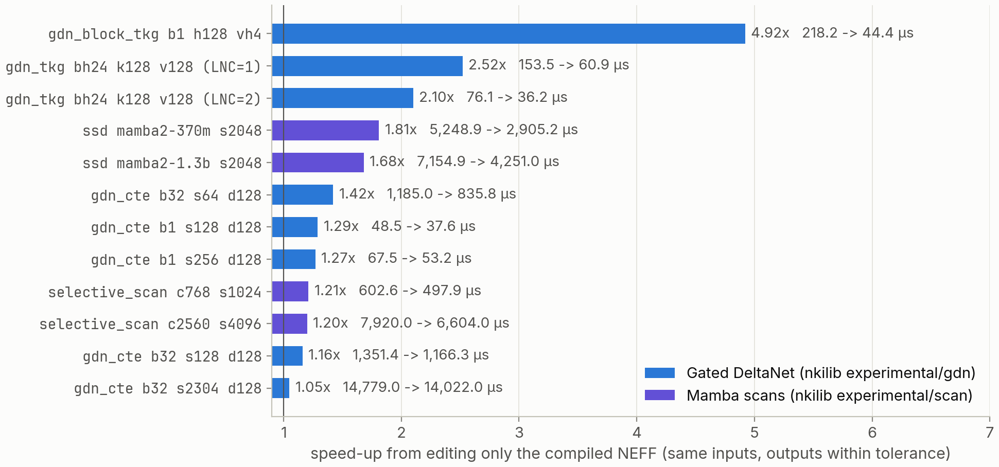
*Figure 1. NEFF-based optimization of Gated DeltaNet and Mamba kernels in [NKI Library](https://github.com/aws-neuron/nki-library).*

#### Table of Contents

- [Introduction: Trainium, NKI, Neuron Compiler, and NEFF](#introduction-trainium-nki-neuron-compiler-and-neff)
- [NEFF Container Structure and Metadata](#neff-container-structure-and-metadata)
- [Instructions and Pseudo-Instructions](#instructions-and-pseudo-instructions)
- [Memory Management and DMA](#memory-management-and-dma)
- [Synchronization](#synchronization)
- [What Can We Do in NEFF but Not in NKI?](#what-can-we-do-in-neff-but-not-in-nki)
- [What Should We Modify for Better Performance?](#what-should-we-modify-for-better-performance)
- [Case Study: Optimizing Gated DeltaNet (GDN) in the NKI Library](#case-study-optimizing-gated-deltanet-gdn-in-the-nki-library)
  - [Step 1: Reduce the SBUF-HBM round trips for data access](#step-1-reduce-the-sbuf-hbm-round-trips-for-data-access-2175-µs-to-954-µs-228x)
  - [Step 2: Remove DMAs that are duplicated or only signal completion](#step-2-remove-dmas-that-are-duplicated-or-only-signal-completion-954-µs-to-832-µs-115x)
  - [Step 3: Balance DGE DMAs from the GPSIMD Engine onto the Scalar Engine's idle queues](#step-3-balance-dge-dmas-from-the-gpsimd-engine-onto-the-scalar-engines-idle-queues-832-µs-to-750-µs-111x)
  - [Step 4: Reduce activation-table loading](#step-4-reduce-activation-table-loading-750-µs-to-600-µs-125x)
  - [Step 5: Data packing for aggregated SBUF access](#step-5-data-packing-for-aggregated-sbuf-access-600-µs-to-510-µs-118x)
  - [Step 6: Modify the semaphore wait condition in the Scalar Engine](#step-6-modify-the-semaphore-wait-condition-in-the-scalar-engine-510-µs-to-477-µs-107x)
  - [Step 7: Merge the DMAs for projection weights and reorder instructions](#step-7-merge-the-dmas-for-projection-weights-and-reorder-instructions-477-µs-to-444-µs-107x)
  - [Profile of the optimized NEFF](#profile-of-the-optimized-neff)
  - [Contribution of NEFF-only and NEFF-friendly optimizations](#contribution-of-neff-only-and-neff-friendly-optimizations)
- [What Still Limits the Optimized Kernel](#what-still-limits-the-optimized-kernel)
- [Generalizing to Other Kernels](#generalizing-to-other-kernels)

---

### Introduction: Trainium, NKI, Neuron Compiler, and NEFF

Although GPUs still run most AI training and inference, the largest cloud providers increasingly build their own accelerators. One example is **AWS Trainium**, a family of AI chips designed by Annapurna Labs. The key advantage of Trainium is its cost-efficiency. For example, Trainium 2 has [30 to 40% better price performance](https://aws.amazon.com/ec2/instance-types/trn2/) than GPU-based P5E instances (NVIDIA H200). As a result, big AI companies such as Anthropic train and serve their Claude models on Trainium 2 in [Project Rainier](https://www.aboutamazon.com/news/aws/aws-project-rainier-ai-trainium-chips-compute-cluster). Other customers AWS lists for Trainium include [Databricks, OpenAI and Uber](https://aws.amazon.com/ai/machine-learning/trainium/).

A Trainium 2 device has eight compute cores called **NeuronCores**. They are grouped in 2-core chips, each assigned a dedicated HBM stack shared across the cores. Cores in a 2-core chip communicate through a die-to-die fast interconnect, and communication between chips is handled by NeuronLink. Unlike GPUs, the Trainium NeuronCore is a heterogeneous NPU: the **Tensor Engine** is a 128x128 systolic array that computes matrix multiplications; the **Vector Engine** and **Scalar Engine** operate on vectors for vector and scalar operations, such as reductions and activation functions; and the **GPSIMD Engine** is a general-purpose SIMD core that can compute arbitrary operations, including DMA operations. Engines communicate through two types of SRAM: SBUF, used to store any intermediate data, and PSUM, which is dedicated to the accumulation buffer of the Tensor Engine. Additionally, there is a **Sync Engine** that handles synchronization between instructions.


*Figure 2. Trainium 2 device diagram and the architecture of NeuronCore-v3, from the [Neuron SDK documentation](https://awsdocs-neuron.readthedocs-hosted.com/en/latest/about-neuron/arch/neuron-hardware/trainium2.html).*

Most Trainium users can run a model without worrying about the architecture. Trainium supports `torch_xla` to trace and compile the model graph from PyTorch code, convert it into Neuron IR with the graph compiler, and generate the executable, the Neuron Executable File Format (NEFF), with the Neuron Compiler backend (Figure 3). However, such direct deployment often leads to suboptimal performance. As a result, Trainium supports the **Neuron Kernel Interface (NKI)**, a Pythonic kernel language for writing optimized compute kernels for Trainium. It is similar to Triton or CUDA for GPUs, where you can define fine-grained instructions and memory access controls. To support the heterogeneity, many functions in NKI allow defining `engine=` to execute operations on different engines and `buffer=` to allocate different SRAM/HBM buffers.


*Figure 3. Model graphs enter through the graph compiler (left) and NKI kernels through the NKI compiler (right). Both meet in the compiler backend, whose output is a NEFF file. Diagram from the AWS Neuron documentation ([About NKI](https://awsdocs-neuron.readthedocs-hosted.com/en/latest/nki/get-started/about/index.html)).*

However, NKI does not expose everything underneath the compiler. NKI does not let you control how the engines and instructions actually coordinate in finer-grain: which semaphore each instruction waits on, which DMA queue carries a transfer, and when the Scalar Engine reloads its activation-function tables. The compiler backend makes these decisions and writes them into its output, the **NEFF**, alongside one instruction stream per engine, the DMA descriptors and the memory map. Because the NEFF is the program that the Neuron runtime actually loads and runs, editing it directly gives us the direct control of hardware. Hardcore GPU optimizers will recognize this programming layering (table below): as NKI is the equivalent of Triton for GPUs, NEFF resembles [SASS](https://docs.nvidia.com/cuda/cuda-binary-utilities/index.html), which is the assembly-based compiler output for NVIDIA GPUs.

|  | NVIDIA GPU | AWS Trainium |
|---|---|---|
| Kernel language | CUDA C++, Triton | NKI |
| Intermediate representation | PTX | HLO / NKI IR |
| Executable | cubin (SASS) | NEFF |

This leaves real room for improvement. In a profile, the engines of an NKI kernel often sit idle for reasons the source does not show: an engine waiting on the wrong event, a transfer queued behind unrelated ones, a function table reloaded again and again. This motivates us to do NEFF-based performance optimization: directly modify the NEFF to manage the instructions and memory access for lower latency of certain computations. We evaluated on various kernels in [NKI Library](https://github.com/aws-neuron/nki-library), AWS's open-source collection of optimized NKI kernels, and achieved 1.05x to 4.9x speedup (Figure 1). We will show a case study for Gated DeltaNet kernel, which is a core computation in Qwen 3.5 models.

Editing a NEFF requires knowing what a NEFF contains. In the next section, we will start with illustrating the content of NEFF: how a NEFF is laid out on disk, and how to unpack, edit and repack it without the compiler.

---

### NEFF Container Structure and Metadata

A NEFF is a container for compiler artifacts: a 1024-byte header followed by the payload, a gzip-compressed tar archive. A NEFF has the following structure:

```text
kernel.neff
├── [header, 1024 B]          Basic metadata and flags of the NEFF
└── [payload, tar.gz]
    ├── neff.json             Top-level graph connecting inputs, kernel and outputs
    ├── kelf-0.json           List of subgraphs, one per physical NeuronCore
    ├── info.json             Compiler versions and configuration
    ├── sg00/                 Subgraph for physical core 0
    │   ├── def.json          Definition of the subgraph: memory, DMA queues, semaphores
    │   ├── tensor_map.json   Metadata of the input and output tensors (dtype, shape, layout)
    │   ├── PE0.bin           Tensor Engine instruction stream
    │   ├── Activation0.bin   Scalar Engine instruction stream
    │   ├── DVE0.bin          Vector Engine instruction stream
    │   ├── Pool0.bin         GPSIMD Engine instruction stream
    │   ├── SP0.bin           Sync Engine instruction stream
    │   ├── {PE0,Activation0,DVE0,Pool0,SP0}.json      Metadata of each engine
    │   ├── act_info.json     Catalogue of activation tables for polynomial approximation
    │   ├── silu_and_others.json, silu_and_others_bkt.bin, silu_and_others_ctrl.bin
    │   ├── ...               Lookup tables of the other activation functions used
    │   └── default_{opcode,datapath,control_fast,control_slow}_table.bin
    │                         Vector Engine microcode tables
    └── sg01/                 Subgraph for physical core 1 (LNC=2 only)
```

A kernel compiled with `LNC=2` in the compiler option has two subgraph directories, `sg00` and `sg01`, one per physical core. On Trainium 2 a logical core spans at most two physical cores, so such a NEFF never has more than two subgraphs.

The **header** holds what the runtime and tools need before they open the payload: the package version, the header size, the payload size, the number of logical cores and the number of physical cores per logical core. It also has feature flags, one bit per feature the program needs, such as `dge` (descriptor generation engine for issuing DMA requests) or `coalesced-cc` (coalesced collectives). Whenever the payload changes, the header must be updated to match.

In the unpacked payload, there are three top-level JSON files. The most important is **`neff.json`**, which describes the NEFF as a dataflow graph. Each node is either a placeholder for an input tensor (`"op": "null"`) or a compute node (`"op": "tvm_op"`). Usually there is only one `tvm_op` node, which is the top-level NKI kernel. Each `tvm_op` node lists its input arguments in `inputs`, and the top-level `heads` lists the graph's outputs. Both are lists of `[node, output index, version]` triples. For each input and output, the NEFF records the data type, shape and storage id in `attrs`, and further metadata in `metadata`.

```jsonc
// neff.json
{"nodes": [
   {"op": "null", "name": "hidden",   "inputs": [], "output_names": ["hidden"]},      // node 0: input placeholder
   {"op": "null", "name": "W_in_qkv", "inputs": [], "output_names": ["W_in_qkv"]},    // node 1
   ...,                                                                               // nodes 2-10
   {"op": "tvm_op", "name": "sg_coreV10",                                             // node 11: the kernel
    "inputs": [[0, 0, 0], [1, 0, 0], ..., [10, 0, 0]],          // edges: [node, output index, version]
    "output_names": ["output_0", "output_1", "output_2"],
    "attrs": {"func_name": "__kelf", "kelf": "kelf-0.json", "num_inputs": "11", "num_outputs": "3"}}],
 "arg_nodes":    [0, 1, ..., 10],                               // the graph's inputs
 "heads":        [[11, 0, 0], [11, 1, 0], [11, 2, 0]],          // the graph's outputs
 "node_row_ptr": [0, 1, 2, ..., 11, 14],                        // node i produces entries ptr[i] .. ptr[i+1]-1
 "attrs": {                                                     // one value per entry
   "dltype":     ["list_str",   ["bfloat16", "bfloat16", ..., "float32"]],
   "shape":      ["list_shape", [[1, 128], [128, 1024], ..., [4, 16384]]],
   "storage_id": ["list_int",   [0, 1, ..., 13]]},
 "metadata": {"signatures": {"default": {"inputs": {"hidden": {"id": 0, "dtype": "bfloat16", "shape": [1, 128]}, ...}}}}}

// kelf-0.json
{"graphs": [{"definition": "sg00/def.json", "name": "sg00"}], "version": "0.5", "target": "cayman"} // cayman = Trainium 2

// info.json
{"tool_version": "2.27.5334.0+f702b353", "nki_version": "0.6.0+31049202112.g85070674", "num_tpb": 1, ...}
```

The other two are metadata that rarely change across kernels. **`kelf-0.json`** lists the kernel's subgraphs, each with the path of its definition file, and the target device. **`info.json`** records the compiler and NKI versions and the number of logical cores (`num_tpb`). Following the references from `neff.json` to `kelf-0.json` to each `sgNN/def.json` leads from the graph down to the programs.

Each **subgraph folder** holds the complete program for one physical core. **`tensor_map.json`** describes the program's interface, with one entry per input and output tensor. Unlike `neff.json`, it keeps each tensor's shape and layout as the framework passed it (`tf_shape`, `tf_format`). In NEFFs where the compiler renames the inputs (`input0`, `input1`, ...), each entry also records the kernel parameter it came from (`kernel_param_name`), which is how you find the tensor you care about.

```jsonc
// sg00/tensor_map.json
{"hidden":   {"kind": "input",  "dtype": "bfloat16", "tf_shape": [1, 1, 128], "tf_format": "NHC", ...},
 "output_0": {"kind": "output", "dtype": "bfloat16", "tf_shape": [1, 1, 512], "tf_format": "NHC", ...}, ...}
```

The definition file, `def.json`, declares everything the instructions refer to:

```jsonc
// sg00/def.json (abbreviated)
{"pe_instr": "PE0.bin", "act_instr": "Activation0.bin", ...,        // which stream belongs to which engine
 "runtime_semaphore_count": 3,                                       // S[0]..S[2] belong to the runtime
 "var": {
   "SB":        {"type": "state-buffer", "var_id": 0},
   "hidden":    {"type": "input",  "var_id": 1,  "size": 256},
   "W_in_qkv":  {"type": "input",  "var_id": 2,  "size": 262144},
   "output_0":  {"type": "output", "var_id": 12, "size": 1024},
   "inst__I-16-0:_mem_6_1_sg0000": {"type": "tmp-buf", "var_id": 15, "size": 2048},
   "DGETable0": {"type": "dge-table", "var_id": 25, "list": [2, 1, 7, 6, 4, 3, 5, 11, 13, 14]}, ...},
 "dma_queue": {
   "qActDynamicHW":   {"type": "dynamic", "owner": "act",  "num_queues": 16, "semaphore_set": [72, ..., 87]},
   "qPoolDynamic":    {"type": "dynamic", "owner": "pool", "num_queues": 16, "semaphore_set": [8, ..., 23]},
   "qSPDynamicHW":    {"type": "dynamic", "owner": "sp",   "num_queues": 16, "semaphore_set": [56, ..., 71]},
   "qSPIO0":          {"type": "in",      "owner": "sp",   "num_queues": 16, "semaphore_set": [40, ..., 55]},
   "qSPSpillReload0": {"type": "data",    "owner": "sp",   "num_queues": 16, "semaphore_set": [24, ..., 39]}}}
```

DMA instructions refer to memory buffers by `var_id`; e.g., a DMA that names `var_id=0` accesses SBUF. Variable 0 is always the SBUF, inputs and outputs live in HBM, and `tmp-buf` (or `virtual`) variables are HBM scratch buffers that the compiler created. The `dge-table` lists the variables that DMA instructions access. Each DMA queue is owned by one engine and comes with its own 16 semaphores, which signal when its transfers complete. Choosing a queue for a transfer is therefore also **choosing which engine issues it and which semaphore reports it**, and that choice becomes a lever in the case study.

After the definition, there are several instruction streams and description JSON files. Most descriptions are one line (`{"instr": "PE0.bin", "dma": []}`), but two carry real content. `Activation0.json` lists the activation-table sets the program uses. `SP0.json` lists every queued DMA transfer, described in advance and later started by the Sync Engine:

```jsonc
// sg00/Activation0.json
{"instr": "Activation0.bin", "act_info": "act_info.json",
 "activation_function_sets": ["softplus_and_others", "natural_log_exp_and_others", "silu_and_others",
                              "sigmoid_and_others", "reciprocal_sqrt_and_small"]}

// sg00/SP0.json: one entry per queued transfer
{"instr": "SP0.bin", "dma": [
  {"id": 5, "queue": "qSPIO0", "semaphore": 45,
   "desc": [{"op": "copy",
             "from": "SB",       "from_dtype": "bfloat16", "from_off": 25283328,    // partition 96, byte 117504
             "from_sizes": [256, 1], "from_steps": [1, 1],
             "to":   "output_0", "to_dtype": "bfloat16",   "to_off": 768,
             "to_sizes":   [256, 1], "to_steps":   [1, 1]}]},
  ...]}
```

The **activation tables** are how the Scalar Engine evaluates non-linear functions: as piecewise polynomials whose coefficients it reads from a loaded table set. `act_info.json` is a catalogue of all 21 sets the compiler knows, and each set bundles one or a few main functions with a dozen simple ones. `silu_and_others`, for example, also covers tanh, sin, ReLU, square, copy and identity. Each set the program uses is stored as three files: `<set>.json` with per-function parameters (input thresholds, symmetry, special values), `<set>_bkt.bin` with the polynomial coefficients, and `<set>_ctrl.bin` with the control table. These are fixed tables shipped with the compiler. The Scalar Engine holds one set at a time, and an `ACTIVATION_TABLE_LOAD` instruction switches the loaded table. Each switch costs about 1.3 µs.

```jsonc
// sg00/act_info.json: every table set and the functions it covers
{"act_func_sets": [..., {"name": "silu_and_others", "profile_json": "silu_and_others.json",
                         "bkt_bin": "silu_and_others_bkt.bin", "ctrl_bin": "silu_and_others_ctrl.bin",
                         "act": {"silu": 32, "tanh": 4, "sin": 4, "relu": 1, "square": 1, "copy": 1, ...}}, ...]}
```

We have not yet covered the most important part: the **instruction streams**. Each `<engine>0.bin` is plainly an array of 64-byte slots, one instruction per slot, in program order. Most of what the compiler decided about an engine's work, down to which semaphore each instruction waits on, is encoded in those slots. To read and edit them, we need to know what the 64 bytes of each slot mean, which is the subject of the next section.

---

### Instructions and Pseudo-Instructions

Trainium 2 has 128 instruction opcodes that share 82 instruction layouts. All of them follow a similar general pattern (Figure 4). Bytes 0–3 are a header whose first byte is the opcode, which decides how the rest of the slot is read. Bytes 4–11 are the events block, and bytes 12–63 hold the operands and the settings of the specific operation.

The **events** block is how an instruction synchronizes with the rest of the core. It contains the semaphore that this instruction waits for, the condition under which it may start (the semaphore must reach a threshold), and the semaphore that it updates when it finishes. The **operands** are tensors, each described by an address and an access pattern, the hardware form of NKI's `.ap(pattern=[[stride, count], ...], offset=...)`. The address encodes the start partition and the offset within it (`partition × 0x40000 + offset` for SBUF), and up to three `[step, count]` pairs (`step[3] num[3]` in Figure 4) walk the free dimensions, in elements. The partition dimension is not part of the pattern: the number of partitions is a separate field, such as `num_active_channels` in `ACTIVATE`. DMA instructions use the same idea with byte-based patterns and addresses that can also point into HBM. The meaning of the remaining bytes varies by opcode. The full list of instruction layouts and the opcode catalogue are in this repository: [`docs/generated/opcodes.md`](docs/generated/opcodes.md) lists every opcode and its layout, and [`docs/generated/structs.md`](docs/generated/structs.md) gives the byte offset of every field in each layout.


*Figure 4. Three of the 82 layouts: a Tensor Engine `MATMUL`, a Scalar Engine `ACTIVATE` and a DGE DMA. Bytes 4–11 (the events block) are the same for every instruction: one semaphore wait, one semaphore update, and **one** shared 32-bit value.*

Most NKI calls map one-to-one onto instructions. However, some NKI calls become several instructions, and the scheduling and synchronization between them are not controlled by NKI:

| NKI call | Instructions in the NEFF |
|---|---|
| `nisa.nc_matmul` | Tensor Engine `LDWEIGHTS` + `MATMUL` |
| `nisa.activation` | Scalar Engine `ACTIVATE`, plus an `ACTIVATION_TABLE_LOAD` inserted by the compiler when the table changes |
| `nisa.tensor_tensor` / `tensor_scalar` | `TENSOR_TENSOR_ARITH_OP` / `TENSOR_SCALAR_ARITH_OP` on the chosen engine |
| `nisa.tensor_copy` | `COPY` / `CAST` on the Vector, Scalar or GPSIMD Engine |
| `nisa.dma_copy` | a queued DMA or a DGE DMA (`PSEUDO_DMA_DIRECT2D`) |
| any call with more than one dependency | extra `EVENT_SEMAPHORE` slots, because a slot holds only one wait |

Some instructions are **pseudo-instructions**, with opcodes that start with `PSEUDO_`. A regular instruction is executed exactly as it is stored. A pseudo-instruction is a placeholder that still contains symbolic information, such as a queue name or a variable id, because physical addresses, DMA ring registers, and the rank id are known only at runtime. The Neuron runtime therefore rewrites every pseudo-instruction into regular instructions at load time.

---

### Memory Management and DMA

Compute instructions only touch on-chip memory. An SBUF address is `partition × 0x40000 + offset`, and PSUM addresses start at `0x2000000`. The compiler writes these addresses directly into the instructions, so in a NEFF, accessing SBUF or PSUM is nothing but changing the address. The source and destination operands also carry their own partitions, so a single compute instruction can read partition 0 and write partition 32. Everything else, including every access to HBM, is a **DMA** (including transposing a matrix using the DMA engine).

In Trainium, there are two kinds of DMA (Figure 5). A **queued DMA** is listed in advance in an engine description (`SP0.json`), and the runtime turns it into hardware descriptors to issue the DMA directly. A `PSEUDO_DMATRIGGER` instruction on the Sync Engine issues the DMAs sequentially at runtime. A **DGE DMA** handles more dynamic data access on the Sync, Scalar or GPSIMD Engine. For a DGE DMA, the compiler may not know the address to access, as it is a runtime variable. Its completion semaphore also selects the DMA queue, so it must belong to one of the issuing engine's queues in `def.json`.


*Figure 5. Queued DMAs are described in JSON and turned into hardware descriptors when the NEFF is loaded. DGE DMAs are single instructions whose descriptors are generated at run time.*

What makes DMAs expensive in small kernels is not the bytes they move but their fixed costs. These are the costs we measured in our profiles:

| Item | Cost |
|---|---|
| issuing a DGE DMA | 0.56 µs + 0.74 ns per descriptor of the issuing engine's time |
| issuing a queued trigger | 0.09–0.12 µs |
| completion of a queued DMA | ~1.2 µs |
| completion of a DGE DMA | 1.3–4 µs |

Although DGE DMAs seem slower and less preferable, they have several advantages over queued DMAs: (1) they can handle indirect DMA, where you want to access non-consecutive data; and (2) they can be issued by the Sync, Scalar, and GPSIMD Engines instead of restricted to the Sync Engine, which allows load-balancing DMA issue.

---

### Synchronization

The five engines and the DMA queues all run independently. The only thing that synchronizes them and avoids race conditions is **semaphores**. In other words, the semaphores define the schedule of execution across engines.


*Figure 6. Engines and DMAs add to semaphores; instructions wait for thresholds. A threshold counts producers since the start of the kernel.*

A NeuronCore has 256 semaphores (S[0–255]), and the runtime reserves S[0..2]. S[3..6] are for instructions on the GPSIMD, Scalar, Tensor and Vector Engines: when an instruction completes on an engine, it increases the corresponding semaphore counter by 1. A DMA queue's semaphore grows by 16 per finished transfer. As mentioned in the instruction section, each instruction has a field for the condition under which it can execute based on a semaphore counter: `S[i] >= v` means "the *v*-th increment of S[i] has happened since the start of the kernel".

In some cases, there is an `EVENT_SEMAPHORE` instruction, usually used for waiting on DMA instructions. This is mainly used as a complement to the semaphore of an instruction: each instruction can only hold one semaphore condition, so if an instruction has two producer instructions, it needs an `EVENT_SEMAPHORE` to wait on the other data.

Figure 6 illustrates an example timeline of execution controlled by semaphores. The GPSIMD Engine starts the DGE DMA, which the first activation function on the Scalar Engine relies on. It uses `EVENT_SEMAPHORE` to gate the execution, as the activation function needs both the vector and the scalar value. After the two activation functions execute, all data required for the `TENSOR_TENSOR` operation are ready with the semaphore condition `S[4] >= 2`. This instruction then triggers the DMA write on the Sync Engine to output the data.

---

### What Can We Do in NEFF but Not in NKI?

Writing better NKI is always the first step to get a fairly good baseline. But many scheduling decisions are made by the compiler **after** the NKI source is written. The table below compares the two levels.

<!-- 
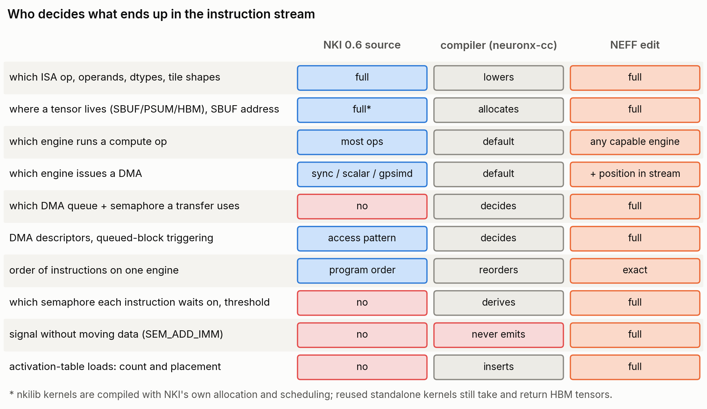
*(unused) What NKI 0.6.0 lets you express, what the compiler decides, and what a NEFF edit controls. Red = no handle at that level.* -->

| Decision | NKI 0.6.0 | NEFF |
|---|---|---|
| ISA op, operands, dtypes, tile shapes | `nki.isa` calls | Instruction opcodes |
| Where a tensor lives, SBUF address | `buffer=`, `address=` | Change address |
| Which engine runs a compute op | Only a limited number of engines | Any engine that implements the opcode |
| Which engine issues a DMA | `dge_mode`, `engine=` | As fine-grained as which DMA queue |
| Which DMA queue / semaphore a transfer uses | N/A | `semaphore` field, `def.json` queues |
| Instruction order on one engine | No guarantee from NKI | Modifiable through the instruction stream |
| Which semaphore each instruction waits on, and the threshold | N/A | Events block, bytes 4–11 in the instruction |
| Send a finishing signal to an instruction | N/A | Manually add instruction to increment the semaphore |
| Activation-table loads | N/A | Delete or move `ACTIVATION_TABLE_LOAD` |
| Compiler-inserted barriers, guard waits, dummy transfers | N/A | Modifiable through `def.json` |

These NEFF-only levers matter in practice. Across the 12 kernels we studied, they include re-pointing a wait to the instruction that actually produces the data, deleting `EVENT_SEMAPHORE` slots that synchronize nothing, moving transfers onto unused DMA queues (or new queues added to `def.json`), and deleting activation-table loads whose table is already resident. They are often the best gains per byte changed: a single change of instruction wait condition can be worth several percent of a kernel's latency.

---

### What Should We Modify for Better Performance?

A NEFF has thousands of slots, and most of them are not worth editing. The first job is to find what currently sets the latency: the busiest engine, or a chain of waits on the critical path. The tool that worked best was a backward critical-path search over the profile: Start from the last instruction and ask whether it was held up by the previous instruction on its engine or by a semaphore wait (the profiler records when each threshold is reached). Jump to the next instruction, and repeat. Every long hop in time is a candidate worth reviewing. Across our 12 kernels, the edits fell into five general strategies:

| Strategy | What to change in the NEFF | Typical gain |
|---|---|---|
| **Remove unnecessary data movement.** Round trips through HBM that only reshape data, DMAs that repeat another DMA's copy or only signal completion | Point DMAs straight at their final destination; replace a redundant DMA with a semaphore update; turn a small DMA into a `CAST` or `COPY` | The largest single wins; 0.6 µs of issue plus 2–7 µs of completion per DMA removed |
| **Cut the fixed cost of DMAs.** Many small transfers, or transfers with one descriptor per element | Merge transfers into one DMA with a larger access pattern; pack data in SBUF first so that each descriptor moves more bytes; split a merged DMA again where its consumers differ | About 0.56 µs per DMA removed, and up to about 8 ns of DMA engine time per descriptor |
| **Balance engines and queues.** One engine issuing a long serial run of DMAs while others are idle | Move DMA issue or compute to an idle engine or an unused DMA queue, with an `EVENT_SEMAPHORE` relay that keeps the semaphore counts | Removes serial issue time |
| **Tighten synchronization.** Waits on a proxy event, waits that guard several things at once, sync slots that do nothing | Point each wait at the instruction or DMA that actually produces the data; split a wait so that each consumer waits only for what it needs; delete empty `EVENT_SEMAPHORE` slots on the critical path | Up to several µs per wait |
| **Reorder instructions to fill gaps.** Work stuck behind unrelated instructions, activations that switch tables back and forth | Move independent instructions above unrelated DMAs and barriers; group activations that use the same table and delete the extra table loads; place table loads inside existing stalls | About 1.3 µs per table load removed |

---

### Case Study: Optimizing Gated DeltaNet (GDN) in the NKI Library

In this case study, we illustrate optimizing a GDN token-generation kernel (`gdn_block_tkg`) from the [NKI Library](https://github.com/aws-neuron/nki-library) by editing the NEFF. This is a fused kernel for a Qwen3.5-style Gated DeltaNet layer, with hidden dimension 128 and batch size 1. For a fair comparison, we follow the parallelization of the original kernel (if `gdn_block_tkg` uses one physical core, we also evaluate the optimized NEFF on one physical core). Numerical correctness is evaluated with a script that reuses the unit test in the NKI Library GitHub repository.


*Figure 7. `gdn_block_tkg` for one decode token. Purple blocks are kernels inherited from other functions in the NKI Library. Orange blocks are intermediate data tensors.*

On the roofline in Figure 8, we can see that the GDN kernel is highly memory-bound, with an arithmetic intensity of 0.9 FLOPs/byte, yet it runs 97x below the memory roof. What slows down the kernel? Figure 9 shows the profile trace in [Neuron Explorer](https://awsdocs-neuron.readthedocs-hosted.com/en/latest/tools/neuron-explorer/index.html). From 38 to 204 µs the engines are mostly idle (1), while small writes into DRAM wait 17–22 µs each for their completion reports. Before that, the GPSIMD Engine spends 21 µs issuing 32 load DMAs back to back (3, 7). After it, the Scalar Engine switches activation tables seven times (4, 5).


*Figure 8. The baseline on a roofline for one NeuronCore, with the compute roof at 78.6 TFLOP/s and the memory roof at 435 GB/s.*

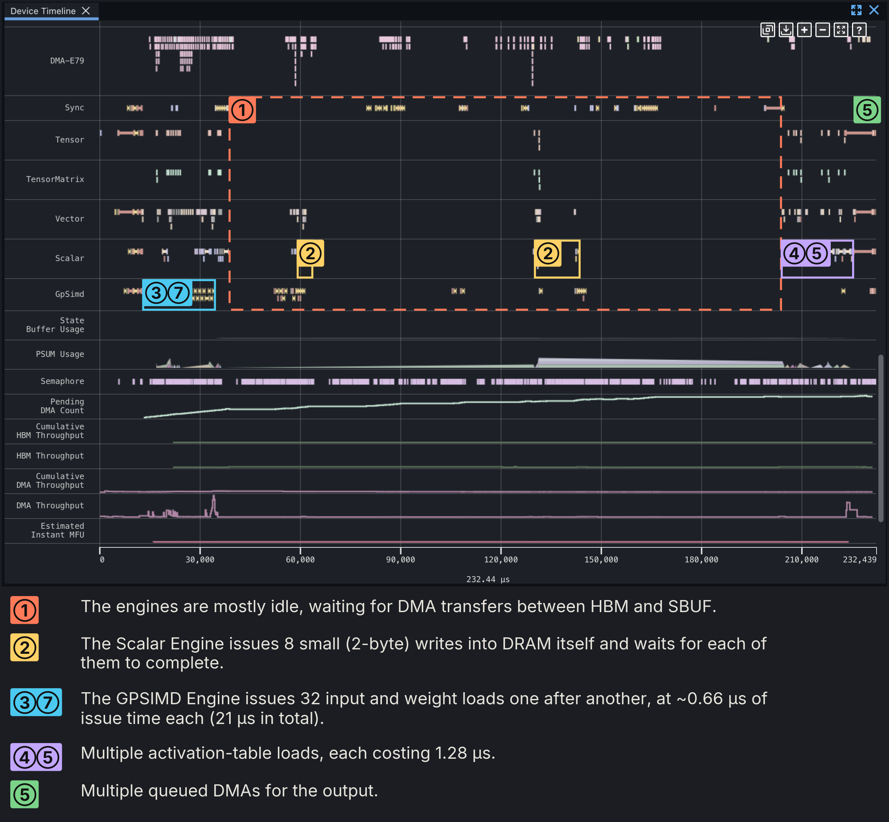
*Figure 9. The baseline profile trace in Neuron Explorer.*

We optimized the GDN kernel at the NEFF level in seven steps, achieving a 4.9x speedup. Figure 10 illustrates the optimization trajectory across steps.

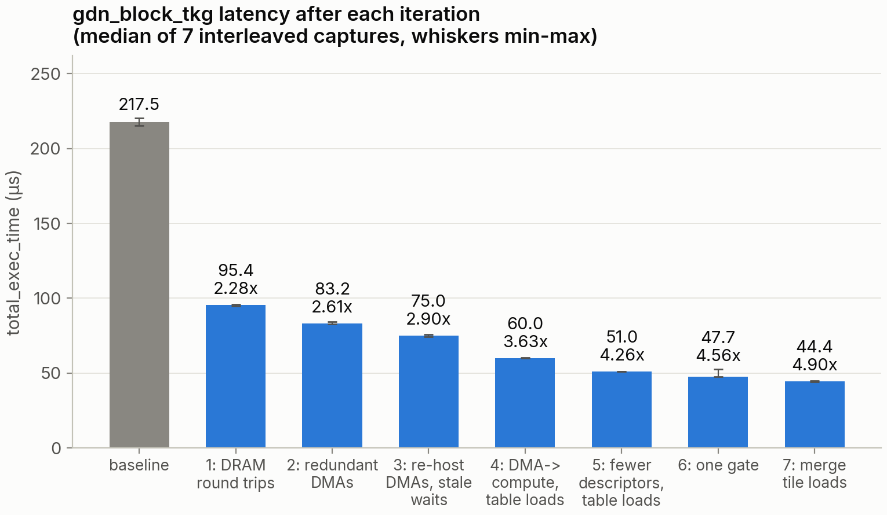
*Figure 10. Latency after each step of optimization.*

<!-- 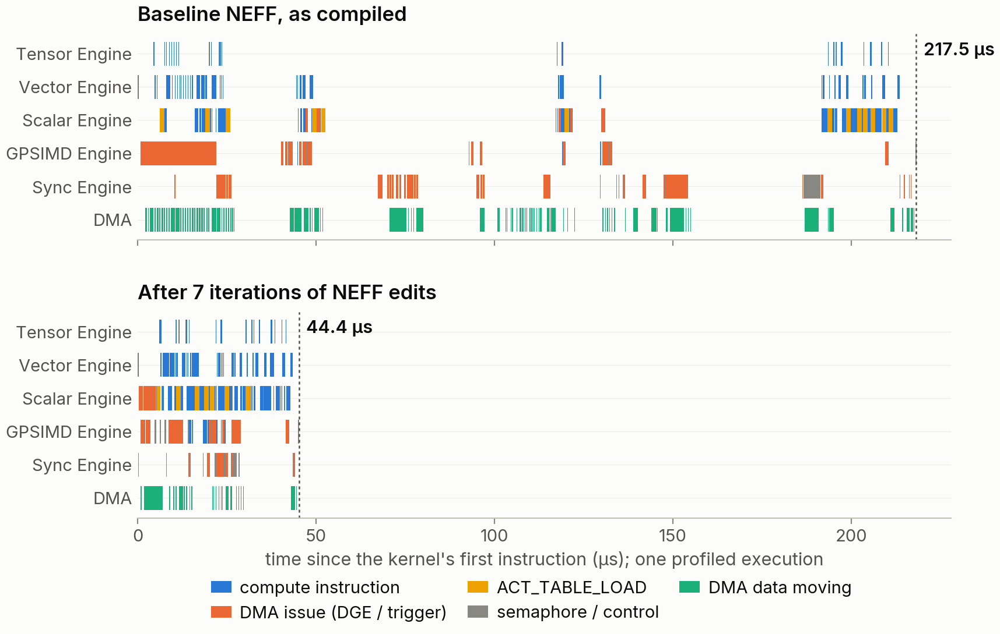
*(unused) One profiled execution before and after, on the same time axis. Orange = DMA issue, yellow = table loads, green = DMA data in flight.* -->

#### Step 1: Reduce the SBUF-HBM round trips for data access (217.5 µs to 95.4 µs, 2.28x)

<!-- 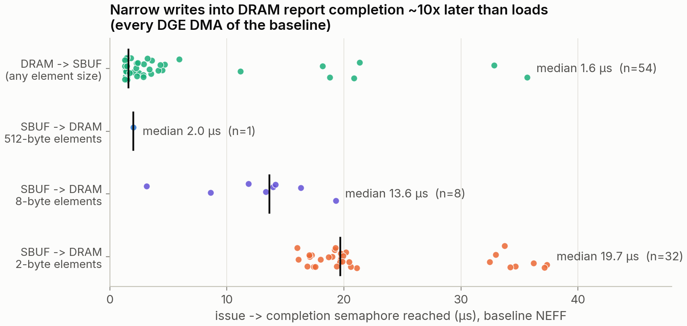
*(unused) Every DGE DMA of the baseline: time from issue until its completion semaphore is reached, from one profiled execution. The bar marks the median.* -->

Our first step is to eliminate the long idle stretch in Figure 9. It is caused by DMA round trips between SBUF and HBM. Each stage of the kernel stores its result in an HBM tensor, and the next stage loads it back (Figure 7): the projected query, key and value vectors, the convolution output `conv_out`, and the per-head inputs of the GDN block (`q_bh`, `k_bh`, `v_bh` and `z_bh`). In the NEFF, each of these becomes a pair of DMAs through a small DRAM buffer: a writer that stores a few bytes from each of the 128 partitions, and a reader that loads them back into SBUF. The reads complete in about 1.6 µs, but each write takes 17 to 22 µs to report completion, and about 30 of these transfers run in 5 to 6 dependent rounds.

Instead, we remove the DRAM access at the NEFF level. Each writer and reader pair only copies data from one SBUF location to another, sometimes converting BF16 to FP32 on the way. It turns out that performing the SBUF copy and manipulation has significantly less wait time. The same result is possible in NKI with a careful rewrite of the kernel, but it breaks the reuse of `gdn_conv1d_decode` and `gdn_tkg` as standalone kernels that other kernels also call. It is also hard to tell which DMAs are redundant from the profile alone, because the trace does not map one-to-one onto the kernel source.

<!-- 
*(unused) A DRAM round trip becomes an SBUF→SBUF copy by swapping address fields between the two DMAs.* -->

#### Step 2: Remove DMAs that are duplicated or only signal completion (95.4 µs to 83.2 µs, 1.15x)

Step 1 left 21 DMAs that are no longer needed: 16 repeat a copy that another DMA has already made, and 5 move no useful data and only signal completion. Each still costs about 0.56 µs of engine time to issue, plus a 2 to 7 µs wait for its completion. We cannot simply delete them, because other instructions wait on their semaphores. A consumer waits until the DMA's semaphore reaches a given count, such as `S[62] >= 16`, and that count is reached only when the DMA completes and adds 16. Without the DMA, those waits would never be met, and the core would hang.

Instead, we overwrite each DMA slot with an `EVENT_SEMAPHORE`, an instruction that moves no data. It keeps the DMA's own wait, so it still runs only after the real copy has finished. When it completes, `SEM_ADD_IMM_COMPLETE` adds 16 to the DMA's semaphore to immediately unblock the waiting instructions. Every consumer therefore sees the same count as before, and no wait anywhere has to change, but the count now arrives 0.03 µs after the data is ready instead of several microseconds later. In bytes, only the opcode and two event fields change:

<!-- 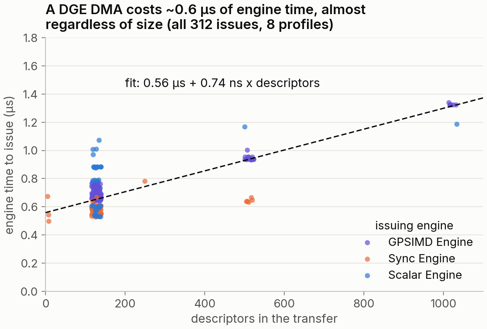
*(unused) Engine time to issue a DGE DMA against its descriptor count, all 312 issues in the 8 profiles.* -->

```text
// SP0.bin slot 13, bytes 0-11
before:  d4 10 00 00 05 48 00 00 10 00 00 00   PSEUDO_DMA_DIRECT2D  wait S[72] >= 16; its completion adds 16 to S[62]
after:   a0 10 00 00 05 48 15 3e 10 00 00 00   EVENT_SEMAPHORE      wait S[72] >= 16; then S[62] += 16 (SEM_ADD_IMM_COMPLETE)
```

<!-- 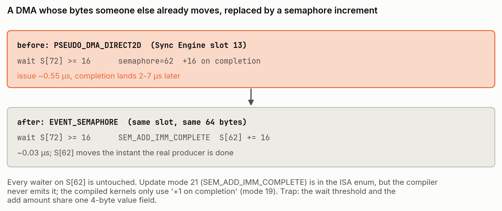
*(unused) Removing a DMA without touching any wait in the program.* -->

Together with merging 8 small tile loads into one DMA, this step saved 12 µs. This operation is not achievable directly through NKI.

#### Step 3: Balance DGE DMAs from the GPSIMD Engine onto the Scalar Engine's idle queues (83.2 µs to 75.0 µs, 1.11x)

The critical path now started with the GPSIMD Engine issuing 25 weight loads one after another (about 17 µs). The Scalar Engine owns 16 DGE queues, but only 8 of them are currently used. We moved 8 of the loads onto the unused queues by inserting copies of their DMA slots into the Scalar Engine's stream. Each vacated GPSIMD slot becomes an `EVENT_SEMAPHORE` relay that keeps all later waits unchanged, and waits that no longer guarded anything were removed. The Scalar Engine's work now starts earlier, and the kernel ends 8.4 µs sooner (Figure 11).


*Figure 11. Profile trace of Step 2 and 3. Eight of the DGE DMA for serial weight loads (orange) move to the Scalar Engine, so the Scalar Engine's work starts earlier and this run ends 8.4 µs sooner.*

Such an operation is hard to manage at the NKI level. Although NKI can assign a DMA to a specific engine, it cannot pin the DMA queue in a fine-grained way or allocate queues so that instructions share them. The NEFF, on the other hand, can easily be modified by updating `def.json` and the engine instruction stream.

#### Step 4: Reduce activation-table loading (75.0 µs to 60.0 µs, 1.25x)

The Scalar Engine switched between the silu and rsqrt tables for every head: 7 table loads at 1.3 µs each (Figure 12). A table load can be removed if its table is already loaded and no instruction ends up using a different table. Moving one silu `ACTIVATE` and giving another instruction its own output buffer removed 4 loads and saved 3.3 µs. In the same step, three small DMAs became `CAST` instructions, and one over-constrained wait was split.

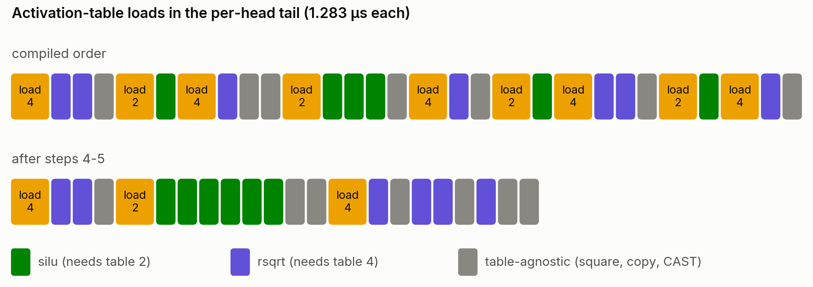
*Figure 12. Loading the activation tables for each head. The default sequence in NEFF generated from the neuron compiler requires frequent swapping of activation tables since it switches the activation function running very frequently.*

NKI has no API for table loads, so it can only reorder activations and hope that the compiler merges the loads.

#### Step 5: Data packing for aggregated SBUF access (60.0 µs to 51.0 µs, 1.18x)

Four vectors for each head have to be transposed into rows of partition 0. The clearest case is the keys of the four heads. In the state update, each head computes `S += outer(k, delta)` on the Tensor Engine, as a separate matmul per head. The Tensor Engine sums over the partition axis of its inputs, so for an outer product, which sums over a single element, `k` and `delta` must both be rows in the same partition. `delta` is computed from the previous matmul, `kv = k^T @ S`, whose result is a single row in partition 0, so every head's key must also be a row in partition 0. The kernel therefore keeps the four keys side by side in partition 0, each at its own offset. A detailed explanation of how the Tensor Engine works in Trainium is in Figure 13. The DMA does this transpose with one descriptor per value, 512 in total, and processes them one at a time. We first use 4 `CAST` instructions, which here simply copy values within each partition, to place each partition's four values next to each other in 8 contiguous bytes. A single DMA of 128 descriptors, one 8-byte block per partition, then moves everything (Figure 14). The four rows arrive interleaved, so instead of separating them again, the consumers read each vector with a stride of 4. Applied to two such transposes, this saved 4.2 µs. Two more table loads were also removed, and the 9 queued DMAs for the output became one 1 KB store.

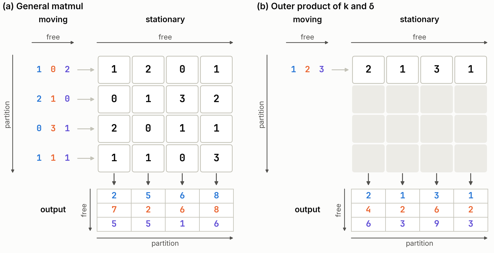
*Figure 13. Example of how the Tensor Engine in Trainium works. This figure shows a 4x4 systolic array example. Tensor engine will consume data one-by-one sequentially along the free axis, parallel across the partition axis, and accumulate on the partition axis. In outer product with two vectors, since there is no accumulation, the moving input should not be in different partitions.*

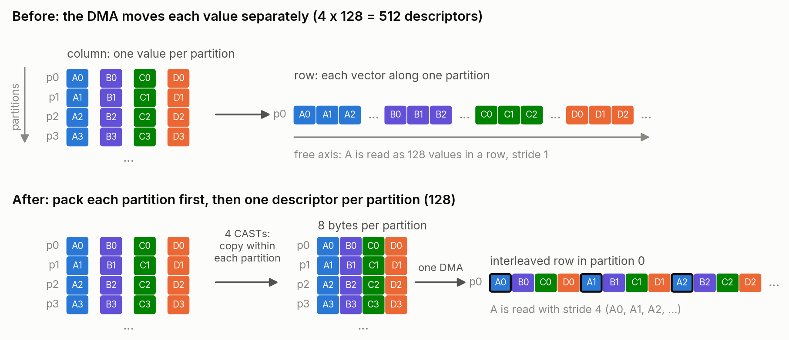
*Figure 14. Transposing the four vectors (`k`) of each head to partition 0 in state update. In step 5, we reduce the number of descriptors to issue DMA by packing 4 heads' vectors together. When reading the data back, each vector is accessed with a stride of 4.*

#### Step 6: Modify the semaphore wait condition in the Scalar Engine (51.0 µs to 47.7 µs, 1.07x)

The Scalar Engine is idle for 3.7 µs waiting on S[28], the semaphore of a dummy DMA left over from step 1. That DMA starts only after the real transfer (S[67]) finishes, so it reports 2.6 µs late. Waiting on S[67] instead changes one byte and saves 2.4 µs:

```text
// Activation0.bin slot 54, bytes 0-11
before:  a0 10 00 00 05 1c 00 00 10 00 00 00   EVENT_SEMAPHORE  wait S[28] >= 16   // the dummy transfer
after:   a0 10 00 00 05 43 00 00 10 00 00 00   EVENT_SEMAPHORE  wait S[67] >= 16   // the real transfer
```

<!-- 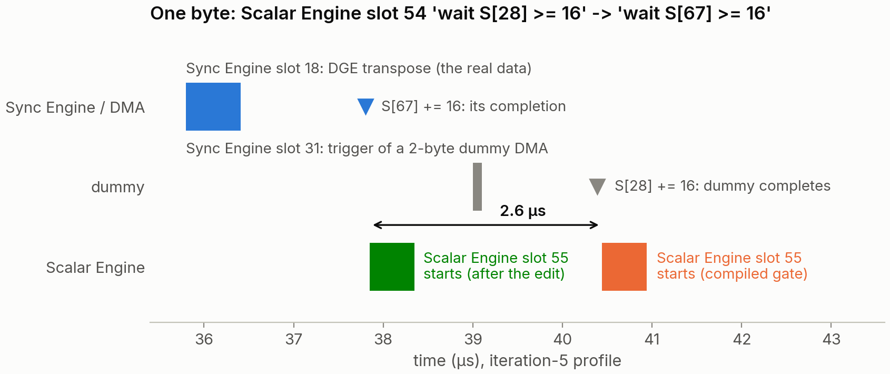
*(unused) The gate waited on a dummy transfer that is always triggered after the real one completes.* -->

#### Step 7: Merge the DMAs for projection weights and reorder instructions (47.7 µs to 44.4 µs, 1.07x)

The 8 tiles of the projection weights (`W_in_qkv`) were loaded by 8 separate DMAs, and so were the 8 tiles of the convolution state (`conv_state`). Merging each group into one DMA cuts the issue time of the projection weights from about 5.2 µs to 1.3 µs, and 8 `EVENT_SEMAPHORE` relays keep the semaphore counts unchanged. The merge alone made the kernel 0.6 µs slower, because the bottleneck moved to the Sync Engine. We then split the merged `conv_state` load again at the point where the instructions that read the tiles change, since the Vector Engine needs tiles 2 and 3 early, while tiles 4 to 7 are read much later. As one DMA, all 8 tiles complete together, so the early readers wait for the whole transfer. As two DMAs of 4 tiles each, the first half completes about 1.2 µs earlier, which saved 0.5 µs. Moving a few independent `CAST` instructions and a table load earlier saved another 2.0 µs. Such reordering and splitting of DMAs are not manageable at the NKI level.

<!-- 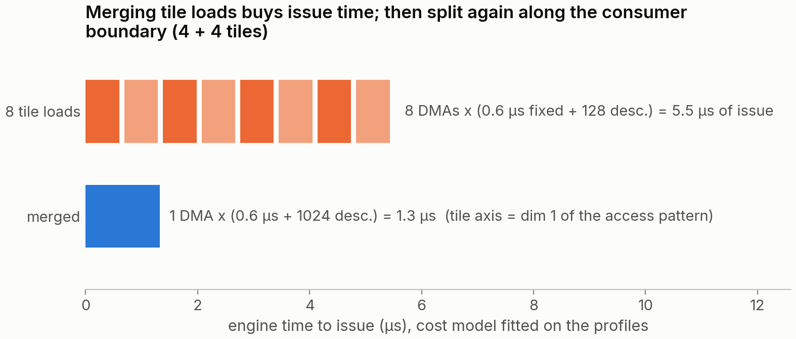
*(unused) Issue-time cost model for the 8 tile loads.* -->

#### Profile of the optimized NEFF

Figure 15 shows the profile of the optimized NEFF, with each change marked by the step that made it. The long idle stretch is gone, because the hand-offs between stages no longer go through HBM (step 1), and the Sync Engine's remaining transfers are SBUF-to-SBUF copies with packed descriptors (steps 1 and 5). The Scalar Engine now issues the weight loads itself, as merged DMAs on its own queues (steps 3 and 7). The GPSIMD Engine mostly runs short semaphore relays in place of the removed DMAs (steps 2 and 3), plus the `CAST` instructions that pack columns before each transpose (steps 4 and 5). The Scalar Engine starts its scaling work as soon as the real transfer finished (step 6). At the same time, it reduces the number of table loads to two instead of seven (steps 4 and 5), and the output leaves in a single store (step 5).

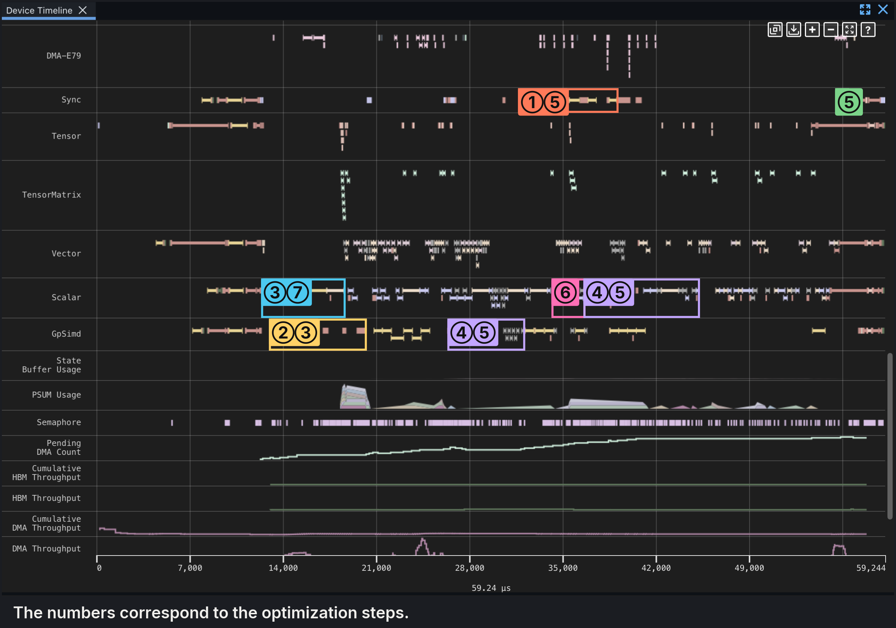
*Figure 15. The optimized NEFF in Neuron Explorer. The profile trace timeline lasts for 59 µs, including the runtime's prologue and epilogue, and the kernel itself takes 44.4 µs.*

Figure 16 compares Neuron Explorer's utilization panels. In the baseline, each of the 16 DMA engines is only about 5% busy, because the kernel moves very little data and spends its time waiting for completion reports. After optimization, they are 8% to 41% busy. The compute engines are busier too (Tensor Engine 3% to 11%, Vector Engine 8% to 31%, Scalar Engine 18% to 60%, GPSIMD Engine 15% to 31%), because roughly the same instructions now run in a quarter of the time.

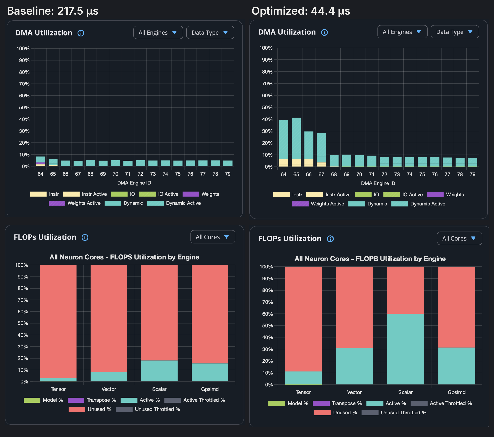
*Figure 16. Neuron Explorer's DMA utilization (per DMA engine) and FLOPs utilization (per compute engine). Left: baseline. Right: optimized.*

#### Contribution of NEFF-only and NEFF-friendly optimizations

To analyze how much of the speedup comes from NEFF-only optimizations, NEFF-friendly optimizations (those difficult to achieve in NKI), and optimizations achievable in NKI, Figure 17 shows how much latency each kind removed, using the per-edit measurements from the optimization loop, scaled to the re-measured total of each step. For NEFF-friendly optimizations, we include the updates that do not have direct NKI API support but can possibly be achieved through trial and error with different NKI writing styles. The NEFF-only optimizations removed 17.5 µs, 40% of the total 43.1 µs saved. The NEFF-friendly optimizations removed 10.6 µs, 25% of the total. The remaining 15.0 µs, 35% of the total, could be achieved in NKI by a significant rewrite of the kernel.

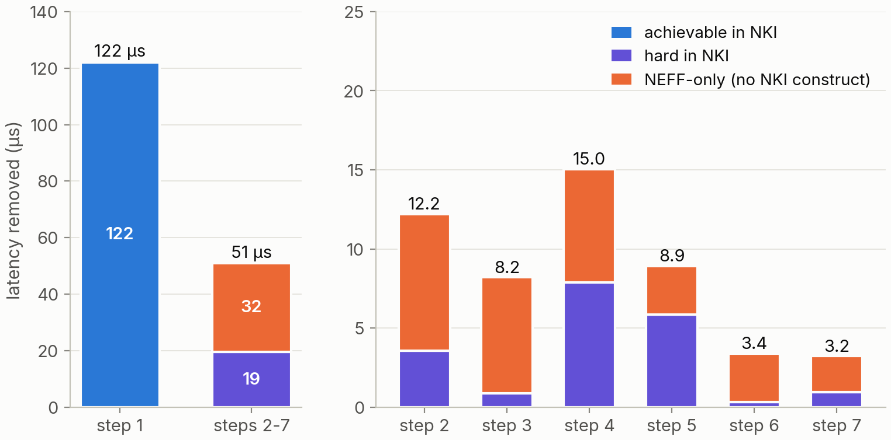
*Figure 17. Latency reduced by each step. Blue: achievable in NKI by significant code rewrite. Purple: hard in NKI, code rewrite may not help due to lack of exposure of the compiler. Orange: NEFF-only, NKI does not offer sufficient granularity of adjustment.*

---

### What Still Limits the Optimized Kernel

Even after the 4.9x speedup, the optimized NEFF runs 20x below the memory roof (Figure 18). Moving the 955 KB of weights and inputs over HBM would take only 2.2 µs at 435 GB/s, and the Tensor Engine work would take only 0.01 µs. However, the kernel takes 44.4 µs. The bottleneck is the **Scalar Engine**, which is busy for 35.6 µs, or 80% of the run. This time is spent on 48 activations (15.9 µs), 7 activation-table loads (9.0 µs), 24 casts (5.8 µs) and issuing 3 weight-load DMAs (4.6 µs). This caps performance at 22 GFLOP/s, as shown in the orange line in Figure 18.


*Figure 18. The baseline and the optimized NEFF on the roofline of Figure 8. Each horizontal line limits the kernel to its Tensor Engine FLOPs divided by one engine's busy time in the optimized NEFF: 22 GFLOP/s for the Scalar Engine (35.6 µs) and 42 GFLOP/s for the GPSIMD Engine (18.6 µs, with the Vector Engine similar at 18.3 µs).*

The root cause is that the Scalar Engine's time does not grow proportionally with the amount of data it processes. Its 76 compute instructions (48 activations, 24 casts and 4 copies) read 822 KB from on-chip memory. Only 12 of them cover a full 128x128 FP32 tile to fill the bandwidth of SBUF. The other 64 instructions read smaller tiles. In a one-token decode, most vectors are too small to fill the engine. Many vectors only occupy a single partition due to the outer product issue mentioned in Figure 13, so 32 of the 76 instructions leave 127 of the 128 lanes idle. As a result, the 64 smaller instructions read only 36 KB in 18.5 µs, about 2 GB/s. Over its whole 35.6 µs of busy time, the Scalar Engine consumes data at only 23 GB/s, whereas at full bandwidth, one FP32 element per lane per cycle with 128 lanes at 1.2 GHz, it could consume about 614 GB/s, 27x faster.

The Tensor Engine sums over the partition axis, so the outer product in the state update, `S += outer(k, delta)`, needs `k` and `delta` as rows in the same partition (Figure 13), and the kernel therefore keeps every head's vectors as rows in partition 0. As a result, every element-wise step on these vectors, including the SiLU gate, the RMS normalization, the scaling and the casts, uses 1 of the 128 lanes, and these 28 instructions take 10.0 µs. Software cannot fix this on current hardware: keeping the vectors as columns would use all 128 lanes, but each head would then need a column-to-row transpose before every outer product, which brings back the per-value DMA transposes that step 5 worked to reduce. Future Trainium versions need a Tensor Engine that computes an outer product directly from two column vectors (changing the accumulation to free axis), or a cheap way to broadcast a row to all partitions so that the Vector Engine can apply the update efficiently.

---

### Generalizing to Other Kernels

Nothing in this method is specific to GDN. We ran the same automated loop of editing, verifying and measuring on 12 kernel configurations from the NKI Library: Gated DeltaNet decode and prefill, Mamba-2 SSD and selective scan, with baselines from about 50 µs to 15 ms. Without changing a line of NKI source, every configuration got faster, by 1.05x to 4.9x (Figure 1). The gains are largest where latency is set by data movement and synchronization, as in small decode kernels, and smallest where an engine is already saturated by the computation itself, as in long scans.

#### Acknowledgement & References

This work is supported by the AWS Build on Trainium program at UCLA. We used [AutoHelix](https://github.com/awslabs/AutoHelix) as the agentic loop harness to optimize the kernel, with special modifications to add constraints based on human experts. We would like to thank Ellen Hermansen from the Amazon Research Initiative team for providing AWS access and promotional credits, Amit Kachroo for providing technical insights in the Amazon Science Hub program, and James Hamilton for the continuous support on providing latest Trainium instances. The full NEFF documentation behind this post is in this repository.

References:

[1] AWS Neuron documentation: [Trainium2 Architecture](https://awsdocs-neuron.readthedocs-hosted.com/en/latest/about-neuron/arch/neuron-hardware/trainium2.html), [Trainium2 Architecture Guide for NKI](https://awsdocs-neuron.readthedocs-hosted.com/en/latest/nki/guides/architecture/trainium2_arch.html) and [About NKI](https://awsdocs-neuron.readthedocs-hosted.com/en/latest/nki/get-started/about/index.html), the sources of Figures 1 and 2.

[2] [NKI Library](https://github.com/aws-neuron/nki-library) ([documentation](https://awsdocs-neuron.readthedocs-hosted.com/en/latest/nki/library/about/index.html)), the kernels optimized in this post.

[3] [Neuron Explorer](https://awsdocs-neuron.readthedocs-hosted.com/en/latest/tools/neuron-explorer/index.html), the profiler used for every measurement.

