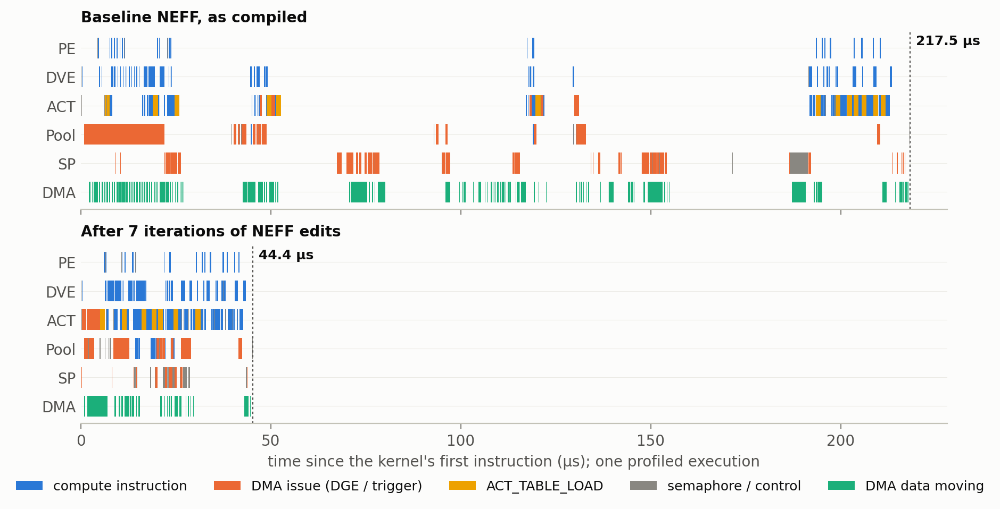
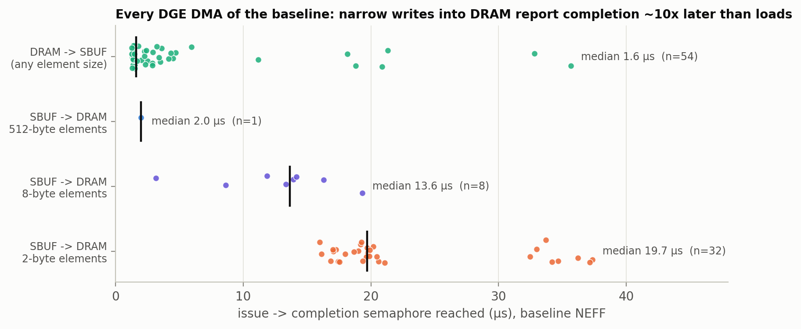
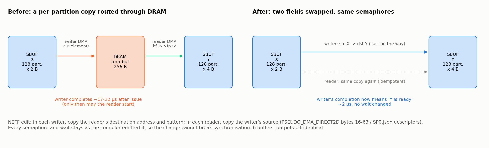
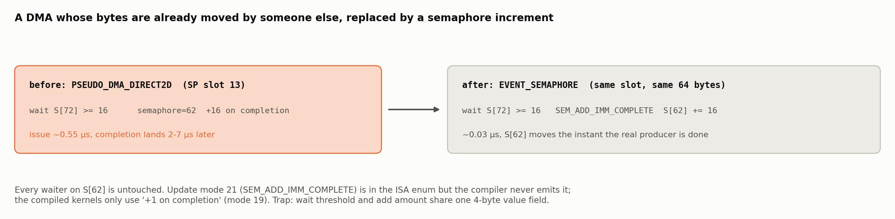
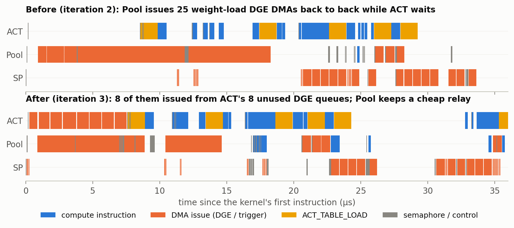
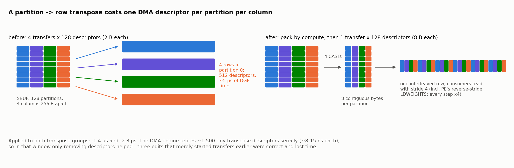
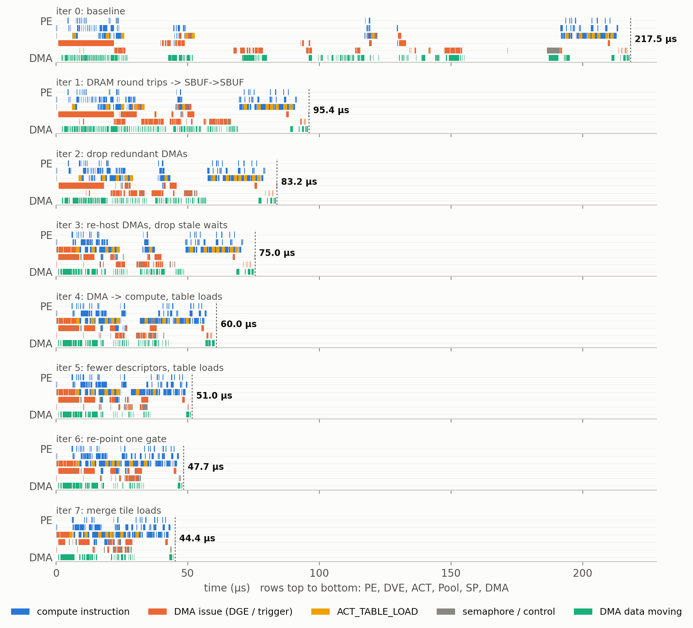
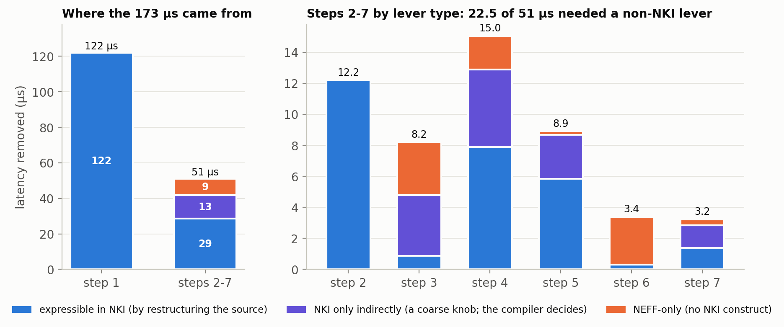

## Accelerate Below Kernel Level: NEFF-based Performance Optimization on AWS Trainium

> Disclaimer: Every conclusion and experiment in this blog comes from the Neuron SDK 2.32.0 toolchain and open-source AWS Neuron repositories, run and measured on a single trn2.3xlarge instance. Part of the information was inferred by reverse engineering, so treat all of it as reference only. It does not necessarily reflect how AWS implements things internally.
>
> Component versions: neuronx-cc 2.27.5334, NKI 0.6.0, Neuron runtime 2.34.10, neuron-explorer 2.32.0. Kernels come from nkilib (`experimental/gdn`, `experimental/scan`).

#### High-level Summary

- **We treat the compiled program as source code.** A NEFF (Neuron Executable File Format) is the file neuronx-cc hands to the Neuron runtime. We decoded it end to end: we can unpack and repack it byte for byte, decode and re-encode every 64-byte instruction using AWS's own ISA definitions (pulled out of `neuron-dbg`), and edit instructions, DMA descriptors and synchronisation before running the result on the device.
- **Editing only the NEFF made 12 nkilib kernels 1.05x to 4.92x faster.** There was no source change and no recompile. An automated loop checked every iteration on the device against the PyTorch reference. In 10 of the 12 kernels the outputs did not change in any printed digit.
- **Case study: Gated DeltaNet decode (`gdn_block_tkg`) went from 217.5 µs to 44.4 µs (4.90x), and its outputs are bit-identical to the baseline's.** We re-measured all 8 versions back to back on the device for this post.
- **The big wins came from data movement and synchronisation, not arithmetic.** Typical finds were SBUF→DRAM→SBUF round trips that only change data layout, DMAs whose issue cost (about 0.56 µs each, almost regardless of size) dominates their payload, semaphore waits stricter than the real data dependency, and redundant activation-table reloads (1.28 µs each).
- **NKI is necessary, but not sufficient.** NKI 0.6.0 gives you no say over which semaphore an instruction waits on, which DMA queue a transfer uses, how queued DMA blocks are triggered, or where activation-table loads go. All of these are visible and editable in the NEFF. In the case study, after the first step (which an NKI author could also reach, but only by rewriting three composed kernels), **44% of the remaining speed-up came from levers NKI cannot express directly**. Reverting **a single byte** of the final NEFF costs **+3.0 µs (+6.8%)**.
- **What we learned about the format** is written up chapter by chapter in [`docs/`](docs/): the container, the definition file, the instruction encoding, the pseudo-instructions the runtime rewrites, the two kinds of DMA, and the semaphore model with tested rules for editing it.

---

### Introduction: Trainium, NKI, Neuron Compiler, and NEFF

**Trainium2.** A trn2.3xlarge has one Trainium2 chip. Its physical NeuronCores are grouped into Logical NeuronCores (LNC=2 by default). The case study runs on a single physical core (LNC=1). Each NeuronCore has five independent instruction processors, called *engines*, plus on-chip memory and a set of DMA engines:

| Engine (NEFF name) | Profiler name | Does |
|---|---|---|
| PE | Tensor | 128x128 systolic array: `LDWEIGHTS` + `MATMUL` into PSUM |
| Activation (ACT) | Scalar | `ACTIVATE` = func(x·scale + bias) from piecewise-polynomial tables; copies and casts; can issue DMAs |
| DVE | Vector | element-wise ops, reductions, shuffles |
| Pool | GpSimd | general-purpose ops, register arithmetic, software-generated DMAs, collectives |
| SP | Sync | starts DMA transfers and waits on semaphores |

On-chip memory has two parts. The **state buffer (SBUF)** has 128 *partitions*, and each partition is a separate address window. **PSUM** is where matmuls accumulate. HBM (DRAM) can only be reached through DMA. The five engines run their own instruction streams in parallel, and the **only** thing that orders work between them is a set of hardware counters called **semaphores**.

**NKI** (Neuron Kernel Interface) is a Python-embedded kernel language. A `nki.isa.*` call corresponds closely to one engine instruction (`nc_matmul`, `activation`, `tensor_tensor`, `dma_copy`, …), and `nl.ndarray(..., buffer=nl.sbuf | nl.psum | nl.shared_hbm)` decides where a tensor lives. **nkilib** is AWS's library of NKI kernels. Every kernel in this post comes from it, compiled with `@nki.jit` at default settings.

**From NKI to NEFF** (Figure 1). `@nki.jit` traces the kernel into MLIR (the `nisa` dialect; for our kernel 122 `dma_copy`, 28 `matmul`, 28 `activation`, …). neuronx-cc then runs the pipeline `HLOToTensorizer → Frontend → StaticIOTranspose → WalrusDriver → NeffWrapper`. For an NKI kernel the frontend (Tensorizer) does very little: only 6 of its 126 passes changed anything. The real work happens in the **Walrus backend**, about 110 passes over BIR (the backend IR). They allocate memory, build dependencies, lower DMAs into queues and descriptors, allocate semaphores and insert waits, place activation-table loads, and finally emit per-engine instruction streams. For nkilib kernels, instruction order and SBUF placement largely follow NKI's own scheduling and allocation. **NeffWrapper** packs the result into a single `.neff` file, which the runtime loads, patches and runs.


*Figure 1. The compile pipeline for an NKI kernel, with the backend pass names from `log-neuron-cc.txt`. Everything below the NKI source line is decided by the compiler. This post edits the artefact at the orange box.*

**Why edit below the kernel level?** Much of what decides latency on Trainium (which engine waits for which event, which DMA queue a transfer uses, when an activation table is swapped) is decided by the backend, after the NKI source is fixed. The NEFF is the first place where all of these decisions are written down concretely, and the last place you can still change them.

---

### NEFF Container Structure

A NEFF is a **1024-byte header followed by a gzip-compressed tar archive** (the payload). Figure 2 shows what is inside and which parts matter for performance.


*Figure 2. Left: the members of a NEFF (the GDN kernel has 46). Right: where each performance-relevant decision is stored.*

The parts of the header that matter in practice:

| Offset | Field | Notes |
|---|---|---|
| 0x010 | `data_size` | must equal the payload length |
| 0x0AC / 0x0CC | `hash` / `uuid` | both are the MD5 of the payload |
| 0x0DC | `network_name` | the compile working directory |
| 0x220 | feature word | one bit per runtime capability the program uses (`dge`, `coalesced-cc`, `vector-dge`, …) |
| 0x228 | `pcore_count_per_lnc` | physical cores per logical core |

The payload is an ordinary POSIX ustar archive with fixed metadata (mode 0644, uid 0, mtime 0, no directory entries), compressed at deflate level 1. Our `tools/neff.py unpack/pack` rebuilds every NEFF we studied **byte for byte**. Two findings simplify editing:

- **The runtime does not check the MD5.** A NEFF with a zeroed hash loads and runs, and the output is bit-exact. Our packer still rewrites both MD5 copies, because neuron-explorer uses the UUID to pair a NEFF with its profile (NTFF): every edited NEFF needs a fresh profile.
- **Debug info is optional.** Removing every `debug_info_*.dbg` file does not change loading, results or profiling. When the files are present, they let you map each instruction slot back to its BIR instruction and its NKI source line.

---

### Graph and Subgraph Metadata

The small JSON files at the top of the payload describe the program from the outside:

- **`neff.json`**: a TVM-style graph listing the inputs, the outputs and one kernel node. Shapes are flattened to 2-D, and input numbering follows the compiler, not the kernel's parameter order.
- **`kelf-0.json`**: the list of **subgraphs**, one per physical NeuronCore of the logical core (`sg00`, `sg01` at LNC=2), and the target name: `"cayman"` is Trainium2.
- **`sgNN/tensor_map.json`**: maps `inputN` back to the NKI kernel parameter it came from.

Each subgraph directory is a complete program for one physical core. Its **definition file `def.json`** declares everything the instructions refer to:

```json
"var": {
  "SB":            {"type": "state-buffer", "var_id": 0},
  "W_in_qkv":      {"type": "input",  "var_id": 2, "size": 262144},
  "inst__I-16-0:_mem_6_1_sg0000": {"type": "tmp-buf", "var_id": 15, "size": 2048},
  "DGETable0":     {"type": "dge-table", "var_id": 25, "list": [2, 1, 7, 6, 4, 3, 5, 11, 13, 14]}, ...
},
"dma_queue": {
  "qActDynamicHW":   {"type": "dynamic", "owner": "act",  "num_queues": 16, "semaphore_set": [72, ..., 87]},
  "qPoolDynamic":    {"type": "dynamic", "owner": "pool", "num_queues": 16, "semaphore_set": [8, ..., 23]},
  "qSPDynamicHW":    {"type": "dynamic", "owner": "sp",   "num_queues": 16, "semaphore_set": [56, ..., 71]},
  "qSPIO0":          {"type": "in",      "owner": "sp",   "num_queues": 16, "semaphore_set": [40, ..., 55]},
  "qSPSpillReload0": {"type": "data",    "owner": "sp",   "num_queues": 16, "semaphore_set": [24, ..., 39]}
}
```

Instructions name memory by `var_id`. The state buffer is always variable 0. Inputs and outputs are DRAM. `tmp-buf` (or `virtual`) variables are DRAM scratch that the compiler created. The `dge-table` lists the variables that DMA instructions index by position. Each **DMA queue is owned by one engine and comes with its own 16 semaphores**, which become important in the case study. The rest of the subgraph holds:

- one **engine stream** per engine (`PE0.bin`, `DVE0.bin`, `Activation0.bin`, `Pool0.bin`, `SP0.bin`), all made of 64-byte instruction slots;
- engine descriptions (`SP0.json` holds the list of queued DMA transfers);
- **activation table sets** (`silu_and_others`, `reciprocal_sqrt_and_small`, …), which are byte copies of files shipped with the compiler. The ACT engine can hold only one set at a time;
- the DVE microcode tables, and the debug info.

---

### Instruction and Pseudo Instruction

**Every instruction is one 64-byte slot.** Byte 0 is the opcode, which selects one of ~190 layouts. We recovered the layouts from the vendor's own definitions rather than by guessing: `neuron-dbg` ships the ISA as Go structs with DWARF debug info, plus one compiled C accessor per field. We extract field offsets from both, then check every decoded field against the profiler's own disassembly over 2 million slots: every non-pseudo opcode matches. `tools/isa.py` decodes and re-encodes slots by vendor field name.


*Figure 3. Two of the layouts. Bytes 4-11 (the events block) are the same for every instruction: one semaphore wait, one semaphore update, and **one** shared 32-bit value.*

A compute instruction is an opcode, its ALU ops and dtypes, and tensor operands. Each operand is a 32-bit **address** plus an **access pattern** (`step[]`, `num[]` per dimension, in elements). The partition axis is not part of the pattern: `num_active_channels` gives the number of partitions. The NKI-to-ISA mapping is mostly one to one:

| NKI call | Instructions |
|---|---|
| `nisa.nc_matmul` | PE `LDWEIGHTS` + `MATMUL` |
| `nisa.activation` | ACT `ACTIVATE` (+ `ACTIVATION_TABLE_LOAD` inserted by the compiler) |
| `nisa.tensor_tensor` / `tensor_scalar` | DVE / Pool / ACT `TENSOR_TENSOR_ARITH_OP` / `TENSOR_SCALAR_ARITH_OP` |
| `nisa.tensor_copy` | `COPY` / `CAST` on DVE, ACT or Pool |
| `nisa.dma_copy` | a queued DMA (SP trigger + `SP0.json` entry) or a DGE DMA (`PSEUDO_DMA_DIRECT2D`) |
| every call with more than one dependency | extra `EVENT_SEMAPHORE` slots, because a slot holds only one wait |

**Pseudo-instructions** (opcode names starting with `PSEUDO_`) are slots the runtime rewrites at load time, because the NEFF cannot know physical addresses, DMA ring registers or the rank id:

| Pseudo-instruction | Becomes at load time | Purpose |
|---|---|---|
| `PSEUDO_DMATRIGGER` | `WRITE`s to DMA ring registers | start queued transfer *k* of a queue |
| `PSEUDO_DMA_DIRECT2D` (+ `PSEUDO_EXTENSION`) | `DMA_DIRECT2D` / `DMA_INDIRECT` | a DMA whose descriptors hardware generates at run time |
| `PSEUDO_SYNC_BARRIER` / `PSEUDO_CORE_BARRIER` | `DRAIN` + `EVENT_SEMAPHORE` (+ `WRITE` to the other core) | barrier between engines / between cores |
| `PSEUDO_GID_LOAD` | `MOVE $R[61] = rank` | rank-dependent code |
| `PSEUDO_BRANCH_LABEL`, `..._PREFETCH_HINT` | nothing / hint | loops: branch targets are label ids |

Because the expansion happens at load time, you edit pseudo-instructions like any other slot. The runtime also adds its own prologue and epilogue, which synchronise the engines and zero the semaphores for the next run. That is why the profiler shows instructions with no `compiler_pc` before slot 0 of each stream.

---

### Memory Management and DMA

**Addresses.** An SBUF operand address is `partition * 0x40000 + offset`. Kernels use offsets from 0x4000 upward; the runtime reserves 8 bytes at 0x37FF8; start partitions are multiples of 32. PSUM addresses are `0x2000000 + offset`, handed out in 2 KiB banks, 16 KiB per partition. Compute instructions never address DRAM. One detail that mattered later: **source and destination addresses each carry their own partition**, so a compute instruction can read partition 0 and write partition 32.

**Two kinds of DMA** (Figure 4):


*Figure 4. Queued DMAs are described in JSON and turned into hardware descriptors when the NEFF is loaded. DGE DMAs are single instructions whose descriptors hardware generates at run time.*

- **Queued DMA.** `SP0.json` lists every transfer: queue, block id, semaphore, and descriptors (source and destination variable, byte offset, byte-based `sizes`/`steps`, and `copy`/`cast`/`add`). A `PSEUDO_DMATRIGGER` on SP starts block *k*. Completion adds 16 to `semaphore_set[k % 16]` of the queue.
- **DGE DMA** (descriptor-generation engine). A `PSEUDO_DMA_DIRECT2D` slot on SP, ACT or Pool carries a 2-D source/destination pattern in bytes, element sizes and dtypes (so it can cast), and the semaphore to add 16 to when it finishes. **That semaphore *is* its queue**, and it must belong to the issuing engine's queue group in `def.json`.

What these cost, measured on the case-study profiles (Figures 11a and 12a below):

| Item | Cost |
|---|---|
| issuing a DGE DMA | **0.56 µs + 0.74 ns × descriptors** of engine time (fit over 312 issues) |
| issuing a queued trigger | 0.09–0.12 µs |
| DGE completion reported after the data lands | ~1.3–4 µs, fixed latency (halving the bytes did not change it) |
| SBUF→DRAM DGE write of 128 **2-byte** elements | completion after **17–22 µs** (~135 ns per element), and everything queued behind it waits too |
| a partition→row transpose by DMA | one descriptor per partition per column |
| `ACTIVATION_TABLE_LOAD` | 1.283 µs |

Rules we confirmed on the device: descriptors inside one queued transfer run in order; **the blocks of a queue must be triggered as a prefix of block-id order** (skipping a middle block hangs the device, skipping trailing blocks is fine); concurrent DMA writes less than a word apart corrupt each other; and SBUF scratch above the compiler's highest offset only works up to about 245 KB per partition.

---

### Synchronization

Figure 5 shows the whole model.


*Figure 5. Engines and DMAs add to semaphores; instructions wait for thresholds. A threshold counts producers since the start of the kernel.*

- A NeuronCore has 256 semaphores; S[0..2] belong to the runtime. **S[3], S[4], S[5], S[6]** are the completion counters of Pool, ACT, PE and DVE: an instruction with update mode `SEM_INC_COMPLETE` adds 1 when it finishes. DMA queue semaphores get **+16** per finished transfer.
- A wait `S[i] >= v` means "**the v-th increment** of S[i] has happened". It is never a delta. Within one engine, instructions complete in program order, and the compiler relies on that.
- **One wait and one update per slot.** When an instruction depends on two producers, the compiler emits extra `EVENT_SEMAPHORE` slots that only wait. Wait threshold and add amount share one value field.
- The compiler uses exactly one wait mode (`>=`) and one update mode (`+1 on completion`). The ISA defines more. **`SEM_ADD_IMM_COMPLETE` (+N on completion) works on the device but is never emitted.** It turned out to be one of our most useful tools.

Editing rules, all tested on the device with bit-exact predicted outputs:
1. **Think in producers, not numbers.** Before an edit, write down which instruction or DMA produces each increment a wait counts. After the edit, recompute the thresholds.
2. **Removing an instruction:** replace it with an `EVENT_SEMAPHORE` that keeps its wait and update, or delete it and lower every later threshold that counted it, in all five engines.
3. **Adding an instruction** raises later thresholds, *and* its consumer must now wait for it.
4. **Never remove waits on an engine's own completion semaphore.** Engines start the next instruction before the previous one finishes writing. Removing DVE self-waits gave wrong numbers; removing Pool self-waits gave out-of-bounds DMAs.
5. **A single compiler wait often guarantees several things.** Before deleting a DMA, check what its semaphore was *transitively* ordering, and which other thresholds can now be reached early.

A wait that can never be met hangs the core (`NRT_TIMEOUT`). A wait that is met too early does not hang: it gives wrong numbers, sometimes only under the profiler's timing. So we verify with several runs **and** profile with repeats before trusting an edit.

---

### What can we do in NEFF but not NKI?

Writing better NKI is always the first step, and much of what we did *could* be expressed in NKI by restructuring the source. But a whole class of decisions is made by the compiler **after** the NKI source, and NKI 0.6.0 has no construct for them. Figure 6 compares the two levels.


*Figure 6. What NKI 0.6.0 lets you express, what the compiler decides, and what a NEFF edit controls. Red = no handle at that level.*

| Decision | NKI 0.6.0 | NEFF |
|---|---|---|
| ISA op, operands, dtypes, tile shapes | ✅ `nki.isa` calls | ✅ slot fields |
| Where a tensor lives, SBUF address | ✅ `buffer=`, `address=`, but kernel-call boundaries force HBM tensors | ✅ any address |
| Which engine runs a compute op | ✅ `engine=` on most ops | ✅ any engine that implements the opcode |
| Which engine issues a DMA | ⚠️ `dge_mode` + `engine=sync\|scalar` (HWDGE) or gpsimd (SWDGE) | ✅ plus *where* in that engine's stream |
| Which DMA queue / semaphore a transfer uses | ❌ | ✅ `semaphore` field, `def.json` queues |
| Queued-DMA descriptors and block triggering | ⚠️ access pattern only | ✅ `SP0.json`, trigger slots |
| Instruction order on one engine | ⚠️ program order (`nl.no_reorder`), not relative to compiler-inserted instructions | ✅ exact |
| **Which semaphore each instruction waits on, and the threshold** | ❌ derived by the compiler from dependencies | ✅ events block, bytes 4-11 |
| **Signal "done" without moving data** (`SEM_ADD_IMM_COMPLETE`) | ❌ never emitted | ✅ |
| **Activation-table loads: how many, where** | ❌ inserted by `optimize_act_control` | ✅ delete or move `ACTIVATION_TABLE_LOAD` |
| Compiler-inserted barriers, queue-guard waits, dummy transfers | ❌ | ✅ |

**The NEFF-only rows are not academic.** Across the 12 kernels in this study they include some of the best edits per byte changed:
- **gdn_tkg (LNC=2):** 12 PE waits were re-pointed at the ACT cast that actually produces each operand. 4 of the 12 producers did not signal the semaphore PE waited on, so PE sat up to 2 µs past its data. No instruction moved; only waits were renumbered.
- **gdn_tkg (LNC=1):** deleting 18 do-nothing `EVENT_SEMAPHORE` slots (no wait, no update) on DVE's critical cycle saved 0.72 µs. Even a slot that synchronises nothing costs queue time.
- **selective_scan:** 170 redundant self-waits stripped after moving adds from DVE to Pool.
- **gdn_cte (b1 s128):** output stores moved onto **new DMA queues added to `def.json`**.
- **gdn_block_tkg:** activation-table loads cut from 13 to 7, and one gate re-pointed in a single byte (3.0 µs, see the case study).

NKI-level changes and NEFF-level changes also **depend on each other**. Several NKI-expressible edits in the case study paid nothing until a NEFF-only edit removed the gate in front of them. In step 3, converting DMAs to compute was worth exactly 0.0 µs on its own and 3.6 µs together with the queue move.

---

### Design Scope: What should we modify for better performance

**Find the binder first.** Latency is set by the busiest unit *and* by the waits on the critical path. Engine utilisation tells you where to look, not how much there is to gain. `selective_scan` had DVE 99% busy and gained only 1.20x, because the busy work *was* the scan. `gdn_block_tkg` had no unit above 24% busy and gained 4.9x, because it was waiting on DMA completions. The tool that worked best was a **backward critical-path walk**. Start from the last instruction. For each instruction, decide whether it was gated by the previous instruction on its engine or by a semaphore wait (from the profiler's `SemaphoreUpdate` table). Jump to whichever was later, and repeat. The chain this prints has ~0.02 µs of slack at every step, and each long hop is a candidate edit.

**The playbook.** These are the levers used across the 12 kernels, where each one lives in the NEFF, and whether NKI could express it:

| Lever | Where in the NEFF | Measured effect (examples) | In NKI? |
|---|---|---|---|
| Remove SBUF→DRAM→SBUF staging that only reshapes data | DGE slot bytes 16-63 or `SP0.json` descriptors | gdn_block_tkg −122 µs; gdn_cte b32 s64 1.36x in one step | by restructuring (kernel boundaries force HBM) |
| Replace a redundant DMA with a semaphore increment | events block of the DMA slot | ~0.6 µs issue + 2-7 µs completion hop → 0.03 µs | ❌ (`SEM_ADD_IMM` never emitted) |
| Turn a small DMA into a compute `CAST`/`COPY` (also across partitions) | new slot from a template + waits | −1.5 to −2.9 µs each | ✅ `tensor_copy` |
| Move work to an idle engine (DGE issue, ACT→DVE, DVE→Pool) | move slots between streams; an `EVENT_SEMAPHORE` relay keeps counts | gdn_tkg: 36 scale ops ACT→DVE; selective_scan: 170 adds DVE→Pool | ⚠️ engine choice only |
| Re-point / relax / split semaphore waits | `events_wait_idx`, value | one byte = 3.0 µs; dropped stale waits −3.5 µs | ❌ |
| Delete no-op sync slots on the critical cycle | `EVENT_SEMAPHORE` slots | 18 slots −0.72 µs (gdn_tkg) | ❌ |
| Fewer activation-table loads | `ACTIVATION_TABLE_LOAD` + moving `ACTIVATE`s | 13→7 (gdn_block_tkg), 46→6 (gdn_tkg); ssd removed 1,266 of 1,531 reloads by computing `exp(-x)` instead of `1/exp(x)` | ⚠️ only by reordering or rewriting activations |
| Fewer, larger DMAs; fewer descriptors | DGE `num_elem`/`step_elem` dims; descriptors | 8 tile loads 5.5→1.3 µs of issue; 512→128 descriptors | mostly |
| Hoist work stuck behind unrelated instructions | permute slots, re-point waits by producer | −1.56 µs (CASTs above unrelated DMAs) | ⚠️ program order only |
| Wider instructions (merge runs of identical ops) | access-pattern dims | 993 runs merged (gdn_cte, −1.1%); 24 per-head silu → 1 (gdn_tkg) | ✅ |


*Figure 7. NEFF-only optimisation of 12 nkilib kernel configurations: 79 loop iterations, none rejected by the verifier.*

**What does not work** (each one measured): removing same-engine waits; relaxing a wait so a DMA can start earlier while the DMA engine is saturated (correct, and slower); merging transfers that already run on separate queues (the queues *were* the parallelism); splitting a big store (completion latency is fixed); overlapping two DGE transfers from SP (passes verification, then hangs the device); moving a DGE DMA into another engine's stream (wrong results); moving a dtype-converting ACT op across a table load (it reads the active table); the `dma_transpose_2d_tile` bit (inert); deleting 707 provably dominated waits in gdn_cte (correct, worth 0 µs, because they were not on the critical path).

**How we kept it correct.** Every iteration had to pass a verifier that runs the NEFF on the device with fixed inputs and requires each output within 1.2x of the *unedited* NEFF's own error against PyTorch. It also pins the launch shape (same core count, no collectives, same interface). Measurement was the device's own `total_exec_time`, median of several captures, with candidates **interleaved** (A B A B) because the device drifts by a few percent over minutes. Twice an edit passed the verifier and then hung under the profiler, so "profile with repeats" became part of the correctness check.

---

### Case Study: Optimize Gated DeltaNet (GDN) in NKILib

**The kernel.** `gdn_block_tkg` is a fused decode step (one token) of a Qwen3.5-style Gated DeltaNet layer. Here it is configured with hidden size 128, 2 key heads repeated to 4 value heads, and head dim 128 (`gdn_block_tkg_b1_h128_vh4`). It reuses two validated components **unchanged**, as nested `@nki.jit` calls: `gdn_conv1d_decode` and `gdn_tkg`. Data passes between the stages through HBM tensors (Figure 8).


*Figure 8. The four stages and the HBM tensors between them. In the compiled NEFF these hand-offs become ten small DRAM `tmp-buf` variables.*

**The baseline profile** is the opposite of compute-bound. The busiest unit (DMA) is active 24% of the time, ACT 19%, PE 3%. ~127 µs of the ~215 µs are spent with engines waiting on DMA completion semaphores. The baseline executes 95 DGE DMAs and 13 activation-table loads.

> 📸 **[Screenshot placeholder: baseline profile in neuron-explorer]**
> `figs/screenshot_profile_baseline.png`: neuron-explorer timeline of `gdn-block-tkg-0-baseline`, whole execution.
<!-- TODO(screenshot): replace with  -->

**The trajectory** (Figure 9). Seven iterations of an automated edit-verify-measure loop. An agent proposed and applied edits, and a second model reviewed each iteration and ranked the next candidates. The numbers below come from re-measuring all eight NEFFs for this post: 7 interleaved captures each, median.


*Figure 9. Latency after each iteration. Whiskers show min-max over 7 captures.*

| Step | Latency | Step gain | Cumulative | Main lever | Could NKI do it? |
|---|---|---|---|---|---|
| 0 | 217.5 µs | | 1.00x | as compiled | |
| 1 | 95.4 µs | 2.28x | 2.28x | DRAM round trips → SBUF→SBUF | only by un-composing the kernels |
| 2 | 83.2 µs | 1.15x | 2.61x | delete redundant DMAs, merge tiny tile loads | outcome yes; the mechanism is NEFF-only |
| 3 | 75.0 µs | 1.11x | 2.90x | re-host 8 DMAs on ACT's idle queues; drop stale waits | **partly / NEFF-only** |
| 4 | 60.0 µs | 1.25x | 3.63x | DMAs → compute `CAST`s; split a wait; delete 4 table loads | mixed |
| 5 | 51.0 µs | 1.18x | 4.26x | 512→128 transpose descriptors; delete 2 table loads | mixed |
| 6 | 47.7 µs | 1.07x | 4.56x | **one byte**: re-point a gate | **NEFF-only** |
| 7 | 44.4 µs | 1.07x | 4.90x | merge tile loads; hoist work past unrelated DMAs | mostly |

The final NEFF differs from the baseline in 6 of 46 members: `Activation0.bin` (105→114 slots), `DVE0.bin` (114→127), `Pool0.bin` (71→75), `PE0.bin`, `SP0.bin` and `SP0.json`. Its outputs are **bit-identical** to the baseline's (checked again on the device for this post).


*Figure 10. One profiled execution before and after, on the same time axis. Orange = DMA issue, yellow = table loads, green = DMA data in flight.*

#### Step 1 — Route the DRAM round trips through SBUF (217.5 → 95.4 µs, 2.28x)

*What we want.* Every HBM hand-off in Figure 8 became DRAM traffic in the NEFF. Small per-partition values are written into a DRAM `tmp-buf` by one DMA and read back by another. Joining each DGE DMA with the semaphore increments that report its completion (Figure 11a) shows the cost. Reads from DRAM complete in ~1.6 µs. **Writes of 128 two-byte elements into DRAM report completion after 17-22 µs**, and anything queued behind them waits as well (up to 38 µs). The bytes themselves land within ~0.6 µs; it is the completion report that is slow. With ~30 such transfers in 5-6 serial generations, most of the kernel was spent waiting.


*Figure 11a. Every DGE DMA of the baseline: issue to completion-semaphore latency.*

*Where and how in the NEFF* (Figure 11b). Each writer/reader pair is really a per-partition copy, sometimes with a bf16→fp32 cast. We give the **writer the reader's destination** and the **reader the writer's source**. Both now do the same SBUF→SBUF copy (a DGE DMA can cast), the writer's completion now means "the data is in place", and the reader becomes a harmless repeat. **Not a single semaphore or wait changes**, so the edit cannot break synchronisation. The fields edited are bytes 16-63 of `PSEUDO_DMA_DIRECT2D` slots in `SP0.bin`, `Pool0.bin` and `Activation0.bin`, plus the matching queued descriptors in `SP0.json`. One wait was re-pointed. No slot was inserted or deleted.


*Figure 11b. A DRAM round trip becomes an SBUF→SBUF copy by swapping address fields between the two DMAs.*

*Effect in the profile.* Engine busy times barely moved (ACT 42.0→42.3 µs, Pool 35.8→35.8 µs), but DMA activity fell from 53 to 35 µs, and **all 122 µs came out of idle time**. No DGE DMA now takes more than 6.6 µs from issue to completion (it was 37 µs).

*Could NKI do it?* Yes, but only by giving up composition. The round trips trace to specific source lines: `gdn_block_tkg.py:96` stores `mixed`, `gdn_conv1d.py:191/221` loads and stores, `gdn_block_tkg.py:325-336` splits per head, and `gdn_tkg.py:169-170` loads. They exist because nested kernels exchange HBM tensors. To avoid them in NKI you would have to inline `gdn_conv1d_decode` and `gdn_tkg` into one kernel that keeps intermediates in SBUF. The NEFF edit gets the same result and leaves the source modular. One pitfall: when a gather was first split across concurrent DMAs writing 2 bytes apart, the writes corrupted each other. Concurrent destinations must be at least a word (in practice 256 B) apart, or ordered inside one queued transfer.

#### Step 2 — Delete DMAs, not just shrink them (95.4 → 83.2 µs, 1.15x)

*What we want.* Step 1 left 16 DMAs that repeat a copy someone else already made, plus 5 "signal-only" DMAs. Shrinking them does not help: **a DGE DMA costs ~0.56 µs of engine time almost regardless of size** (Figure 12a). The 95 DGE DMAs added up to ~60 µs of issue time on Pool, SP and ACT.


*Figure 12a. Engine time to issue a DGE DMA against its descriptor count, all 312 issues in the 8 profiles.*

*Where and how.* Overwrite the DMA slot with an `EVENT_SEMAPHORE` that waits for the real producer and does **`SEM_ADD_IMM_COMPLETE` +16 on the DMA's own semaphore** (Figure 12b). Every waiter stays as it was. The cost drops from 0.55 µs plus a 2-7 µs completion hop to 0.03 µs, and the semaphore moves the moment the real data is ready. In the same iteration, 8 per-partition ACT DMAs became compute `CAST`s (0.25 µs, completion visible immediately), and the 8 tiny `conv_weight` tile loads (2 KB each) became one 2-D DMA with a negative tile stride.


*Figure 12b. Removing a DMA without touching any wait in the program.*

*Effect.* Pool busy 35.8→26.9 µs, SP 28.0→20.3 µs, DMA 34.6→29.1 µs. *Lesson:* merging only pays for small tiles. Merging the 32 KB `W_in_z`/`W_in_qkv` tiles was correct but **slower** (+0.9 to +1.5 µs), because it puts bytes that used to stream over N queues in parallel onto one queue.

*Could NKI do it?* An NKI rewrite would never emit these duplicate DMAs, and `tensor_copy` and a 3-D `dma_copy` exist. The **mechanism**, a semaphore increment that stands in for a transfer, has no NKI equivalent, and later steps reuse it constantly.

#### Step 3 — Re-host DMAs on idle queues, drop stale waits (83.2 → 75.0 µs, 1.11x)

*What we want.* The critical-path walk put **Pool's prologue of 25 back-to-back weight-load DMAs** (~17 µs of pure issue) at the head of the kernel, followed by ~27 µs of chained DMA-completion waits.

*Where and how.* `def.json` gives ACT 16 DGE queues (semaphores 72-87). The compiler used only 72-79. We **inserted** 8 slots into `Activation0.bin`. Inserting works: nothing records a stream's length and this kernel has no branches. Each new slot is a verbatim copy of a Pool DMA with only its `semaphore` field changed to 80-87. The vacated Pool slot becomes `EVENT_SEMAPHORE wait S[80+j] >= 16, SEM_ADD_IMM S[old] += 16`, so **every downstream wait stays byte-identical**. Then:
- the compiler's queue-guard waits (`own semaphore >= 16`) on the moved DMAs were vacuous and were dropped (−1.4 µs);
- the waits on 7 queued-DMA triggers whose blocks had become duplicates or dummies were dropped (−2.1 µs);
- the DMA whose completion gates the kernel's first instruction is now issued first.


*Figure 13. The first 36 µs of iterations 2 and 3. Pool's serial DMA issue (orange) is split with ACT, and ACT's dense head finishes ~5 µs earlier.*

*Lesson.* The `CAST` conversions in this step were worth exactly **0.0 µs alone** and 3.6 µs together with the queue move: the binder simply moved somewhere else. Where the inserted DMAs sit in ACT's stream matters more than how many move. Placing them in front of ACT's first `ACTIVATE` delayed the root of the whole dependency graph.

*Could NKI do it?* Only in part. `dma_copy(dge_mode=hwdge, engine=scalar)` can ask ACT to issue a DMA, but **queue/semaphore choice, the relay, dropping guard waits and dropping trigger waits are NEFF-only**. These levers make up about 3.4 of the 8.2 µs gained in this step; the engine move and the DMA issue order (NKI-indirect) another 3.9 µs.

#### Step 4 — DMAs become compute; activation tables stop thrashing (75.0 → 60.0 µs, 1.25x)

*What we want.* Between ~34 and ~50 µs, the DMA engine was a **serial bottleneck**: ~1,500 two-byte transpose descriptors retired at ~15 ns each. Three edits that let transfers *start earlier* were correct and all lost time. Only removing descriptors from the DMA engine could help.

*Where and how.*
- **Compute instead of DMA.** The compiler's own DVE slot 88 reads partition 0 and writes partition 32, which showed that a compute address carries its own partition. A queued p0→p32 cast became 4 ACT `CAST`s (−2.9 µs), a queued gather became 4 `CAST`s (−1.8 µs), and a 512-descriptor within-partition gather became 4 Pool `CAST`s (−1.5 µs).
- **Split a wait that carried four guarantees.** One gate waited for the *latest* of four DMAs. Only one consumer, ~9 µs later, needed that last DMA, so the late guarantee moved to that consumer as an inserted `EVENT_SEMAPHORE` (−1.3 µs).
- **Delete redundant activation-table loads** (Figure 14). ACT holds one table set at a time. The per-head tail alternated silu (table 2) and rsqrt (table 4): `4,2,4,2,4,2,4`, 1.283 µs per switch. An `ACTIVATION_TABLE_LOAD` whose table is already resident can be replaced by a no-op, provided **no instruction's resident table changes**. Moving one silu `ACTIVATE` into the previous table-2 region deleted 2 loads (−1.6 µs). Giving another op a private in-place destination deleted 2 more (−1.7 µs). Step 5 finished the job.
- The last DRAM round trips, including the output epilogue's, were made direct (−1.5 µs).


*Figure 14. Tail of the per-head loop, illustrative. Loads go 4,2,4,2,4,2,4 → 4,2,4; the kernel total goes 13 → 7.*

*Could NKI do it?* The `CAST`s, yes (`tensor_copy`). The table loads, **only indirectly**: NKI has no table-load API, so the best it can do is reorder activations and hope the backend's `optimize_act_control` pass coalesces them. Splitting a wait is **NEFF-only**.

#### Step 5 — Fewer descriptors, the last table loads (60.0 → 51.0 µs, 1.18x)

*What we want.* A partition→row transpose of 4 columns costs 4 × 128 descriptors, and the DMA engine retires them serially.

*Where and how* (Figure 15). First pack the 4 two-byte columns into **8 contiguous bytes per partition** with 4 compute `CAST`s, then move them with **one 128-descriptor DMA of 8-byte elements**. The consumers read the interleaved row with stride 4, including PE's reverse-stride `LDWEIGHTS`, which accepts all of its strides scaled by 4. Two transpose groups: −1.4 and −2.8 µs.


*Figure 15. 512 → 128 descriptors per transpose group.*

The biggest single win of the iteration (−2.9 µs) removed the last two redundant table loads. It had failed in step 4 for a subtle reason: an fp32 `[128,1]` result is 512 bytes and overlapped a 256-byte bf16 matmul operand that **PE reads with no semaphore in between**. Moving the op earlier made it overwrite live data. Static analysis cannot see this; scanning the profile's operand strings for the whole byte range can. A private destination fixed it. The 9 queued DMAs of the output epilogue also became a single 1 KB store (−1.7 µs).

*Hazard found here.* Replacing a DMA with a semaphore add can let a **third, untouched** wait pass early. A threshold of 32 became reachable from two `EVENT_SEMAPHORE` adds alone. The NEFF passed the verifier and then hung under the profiler.

*Could NKI do it?* Packing and the single store, yes. The table loads, only indirectly. Leaving trailing queue blocks untriggered is NEFF-only.

#### Step 6 — One byte (51.0 → 47.7 µs, 1.07x)

*What we want.* ACT sat idle for 3.7 µs in front of slot 54, an `EVENT_SEMAPHORE` waiting on `S[28]`. That semaphore belonged to a queued block that, after step 1, only writes 2 bytes into a dead buffer. It worked as a *proxy*: SP triggered it only after the real transfer (`S[67]`) had completed, so it landed ~2.6 µs after the data (Figure 16).

*Where and how.* `events_wait_idx` of that slot: **28 → 67**. Byte 5 of one 64-byte slot.


*Figure 16. The gate waited on a dummy transfer that is always triggered after the real one completes.*

*Effect:* −2.4 µs. The rest of the iteration moved 8 ACT `CAST`s to DVE (−0.3 µs) and hoisted 4 silu `ACTIVATE`s above two compiler barriers that only gate DVE's reads (−0.6 µs). One lesson from the `CAST` move: when same-shaped ACT ops already overlap (each starts 0.39 µs after the previous one starts), making them shorter buys nothing. Measure the *union* of instruction intervals, not the sum of durations.

*Could NKI do it?* No. NKI has no way to choose which semaphore an instruction waits on. To be fair, this particular proxy was a leftover of our own step 1, but the lever itself, choosing which event an instruction waits on, is exactly what NKI does not expose.

#### Step 7 — Merge for issue time, split for latency (47.7 → 44.4 µs, 1.07x)

*Where and how* (Figure 17). The 8 `in_proj` weight tiles were loaded by 8 DMAs of 128 descriptors each. With the measured cost model (≈0.6 µs fixed + 0.7 ns per descriptor), that is 5.5 µs of issue; **one DMA of 1024 descriptors** costs 1.3 µs. The tile index goes into dimension 1 of the DGE access pattern, and 8 relay `EVENT_SEMAPHORE`s restore the semaphore counts the dropped DMAs used to provide. Then:
- the merged table-2 tile load was **split again along its consumer boundary** (4 + 4 tiles), so DVE's tiles land 1.2 µs sooner (−0.5 µs);
- Pool's 8-`CAST` packing run was **hoisted above three DRAM spill DMAs it does not depend on**, which removed ACT's 2.2 µs wait on the transpose it feeds (−1.6 µs);
- the first table load was hoisted above a barrier, so it now runs during the stall (−0.4 µs).


*Figure 17. Issue-time cost model for the 8 tile loads.*

*Lessons.* The merge alone was a **+0.6 µs regression**: the binder moved to SP's transposes, whose completion reports got slower when issued back to back. A win can look like a loss until the next binder is fixed. Second, a merge can **silently drop a program-order dependency**. Merging two SP transposes made one read a buffer ~0.2 µs before ACT wrote it, and the verifier still passed (bit-identical, by luck of timing). Reverting that merge was both correct and 0.45 µs faster.

> 📸 **[Screenshot placeholder: optimized profile in neuron-explorer]**
> `figs/screenshot_profile_optimized.png`: neuron-explorer timeline of `gdn-block-tkg-7-optimized`, whole execution, same zoom as the baseline screenshot.
<!-- TODO(screenshot): replace with  -->


*Figure 18. All eight versions on one time axis.*

**Where it ends.** At 44.4 µs, ACT is the binder: 80% busy (union of intervals), with 6.2 µs of idle time left in 8 gaps, and the remaining 7 table loads are on the critical path. Five loads is the floor, since no shipped table set holds both silu and rsqrt. Per-engine active time, baseline → optimized: PE 7.6→6.6, ACT 42.0→35.6, DVE 19.1→18.3, Pool 35.8→18.6, SP 26.9→6.4, DMA 53.0→17.7 µs.

#### NKI vs NEFF in this case study

We tagged each of the 34 edit groups by whether NKI could express it. Figure 19 shows how much latency each kind removed, using the loop's own per-edit A/B measurements scaled to the re-measured per-step totals.


*Figure 19. Latency removed by lever type. Blue: expressible in NKI by restructuring the source. Purple: NKI has only a coarse or indirect knob. Orange: no NKI construct.*

- **Step 1 (122 µs) is NKI-expressible**, at the price of rewriting three composed kernels into one.
- **Of the 51 µs removed after step 1, 22.5 µs (44%) needed a lever NKI cannot express directly**: 9.3 µs NEFF-only (waits, semaphore adds, queue triggering, barrier placement) and 13.2 µs NKI-indirect (queue choice, table loads, order relative to compiler-inserted instructions).
- If these effects were simply additive, an NKI-only route would stop somewhere between ~53 and ~67 µs. The NEFF reaches 44.4 µs, another 1.2-1.5x. Edits interact, so read this as an estimate, not a bound.

To check that NEFF-only edits carry real weight in the *final* kernel, we reverted two of them in the optimized NEFF and measured again (7 interleaved captures each; all outputs bit-identical):

| NEFF | Change vs the optimized NEFF | Median | Min-max | Δ |
|---|---|---|---|---|
| optimized | — | 44.42 µs | 43.52-44.69 | — |
| step 6 reverted | **1 byte**: ACT slot 49 `events_wait_idx` 67 → 28 | 47.43 µs | 47.00-48.43 | **+3.01 µs (+6.8%)** |
| step 7 table-load hoist reverted | 2 slots swapped (ACT 4 ↔ 5) | 44.65 µs | 44.47-44.91 | +0.23 µs (+0.5%, marginal) |

One byte of synchronisation, invisible at the NKI level, is worth 7% of this kernel's latency.

#### Reproducing and browsing the profiles

Every NEFF in the trajectory and its profile (median capture) is in [`experiments/gdn_block_tkg_b1_h128_vh4_lnc1/blog_profiles/`](experiments/gdn_block_tkg_b1_h128_vh4_lnc1/blog_profiles/) (`iter0` = baseline … `iter7` = optimized, plus the one-byte ablation). Open any pair with `neuron-explorer view -n iterN.neff -s iterN.ntff`. The per-iteration notes, including every refuted lever and the measurement that closed it, are in [`experiments/gdn_block_tkg_b1_h128_vh4_lnc1/logs/`](experiments/gdn_block_tkg_b1_h128_vh4_lnc1/logs/). The figures are regenerated from [`figs/data/`](figs/data/) by the scripts in [`figs/src/`](figs/src/).
