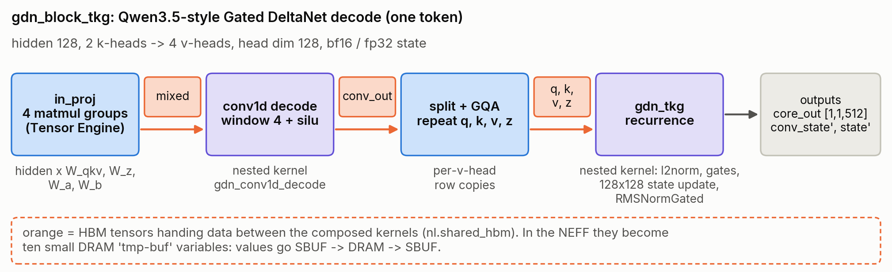
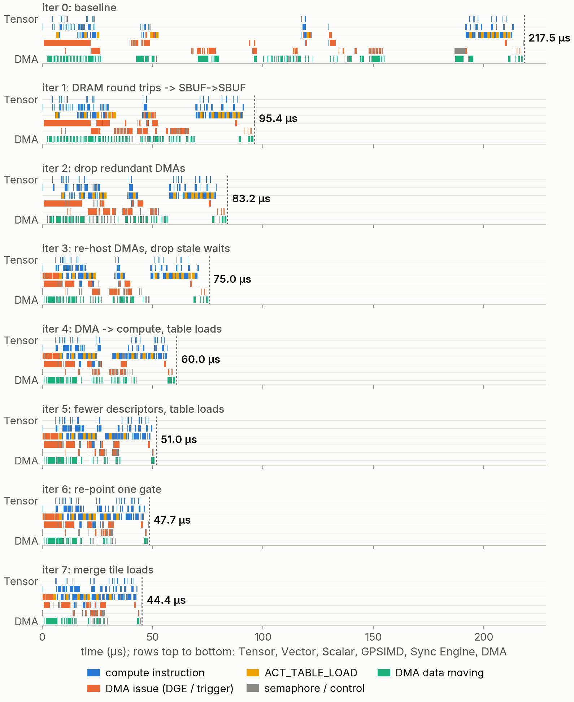

## Accelerate Below Kernel Level: NEFF-based Performance Optimization on AWS Trainium

> Disclaimer: Every conclusion and experiment in this blog comes from the Neuron SDK 2.32.0 toolchain and open-source AWS Neuron repositories, run and measured on a single trn2.3xlarge instance. Part of the information was inferred by reverse engineering, so treat all of it as reference only. It does not necessarily reflect how AWS implements things internally.

#### High-level Summary

- **NEFF is readable and modifiable.** Like SASS for NVIDIA GPUs, the NEFF holds the real instructions and their control information. Although not publically documented, NEFF is editable. A NEFF is a header plus a tar archive with one program per NeuronCore: one instruction stream of 64-byte slots per engine, DMA descriptors, and a definition of memory and DMA queues. The whole instruction schedules are also encoded by a sequence of semaphore waits and updates.
- **NKI is not enough for performance optimization.** Engineers can use NKI to control how the computations are implemented: which operator should be on which engine. However, the compiler decides how the engines coordinate. The schedule can be suboptimal, even with the recent Neuron SDK 2.32. Semaphore waits, DMA queue assignment and activation-table loads are out of NKI's reach but editable in the NEFF. Even for optimizations that are reachable from NKI, operating directly on NEFF can relief the burden of investigating the compiler behavior on NKI maps to NEFF.
- **NEFF-based optimization speeds up a GDN kernel by 4.9x.** With the same parallelization constraints, editing only the compiled NEFF of nkilib's Gated DeltaNet decode block took it from 217.5 us to 44.4 us. The gains came from optimizing data movement and synchronization at the NEFF level. The same method improves the performance of Mamba and Selective Scan nkilib kernels by 1.05x–2.52x.

---

### Introduction: Trainium, NKI, Neuron Compiler, and NEFF

Although GPUs still run most AI training and inference, the largest cloud providers increasingly build their own accelerators. One example is **AWS Trainium**, a family of AI chips designed by Annapurna Labs. The key advantage of Trainium is its cost-efficiency. For example, Trainium 2 has [30–40% better price performance](https://aws.amazon.com/ec2/instance-types/trn2/) than its GPU-based P5e instances. As a result, big AI companies, such as Anthropic, trains and serves its Claude models on Trainium 2 in [Project Rainier](https://www.aboutamazon.com/news/aws/aws-project-rainier-ai-trainium-chips-compute-cluster). Other customers AWS lists for Trainium include [Databricks, OpenAI and Uber](https://aws.amazon.com/ai/machine-learning/trainium/). 

A Trainium2 device has eight compute cores called **NeuronCore**. They are grouped in 2-core chips, each assigned a dedicated HBM stack shared across the cores. Cores in the 2-core chip are communicated through a die-to-die fast interconnect, and between chips communications are handled by NeuronLink. Unlike GPUs, Trainium NeuronCore is a heterogeneous NPU: **Tensor Engine** is a 128x128 systolic array that computes matrix multiplications; **Vector Engine** and **Scalar Engine** operates on vectors for vector and scalar operations, such as reduction and activation functions; and the **GPSIMD Engine** is a general-purpose SIMD core that can compute arbitrary operations, including DMA operations. Engines are communicated through two types of SRAMs: SBUF, used to store any intermediate data; and PSUM, which is dedicated for accumulation buffer of the Tensor Engine. Additionally, there is a **Sync Engine** that handles synchronization between instructions.


*Figure 1. Trainium 2 Device Diagram and the architecture of NeuronCore-v3, from the Neuron SDK Documentation.*

Most Trainium users can run a model without worry about the architecture. Trainium supports `torch_xla` to trace and compile the model graph from PyTorch code, convert into Neuron IR with the graph compiler, and generate the executable (i.e. the Neuron Executable File Format (NEFF)) with the Neuron Compiler backend (Figure 2). However, such directly deployment often leads to suboptimal performance. As a results, Trainium supports **Neuron Kernel Interface (NKI)**, which is a Pythonic kernel language to write optimized compute kernels for Trainium. It is similar to Triton or CUDA for GPUs, where you can define fine-grain instructions and memory access controls. To support the heterogeneity, many functions in NKI allows defining `engine=` to execute operations on different engines and `buffer=` to allocate different SRAM/HBM buffers.


*Figure 2. Model graphs enter through the graph compiler (left) and NKI kernels through the NKI compiler (right). Both meet in the compiler backend (Walrus), whose output is a NEFF file. Diagram from the AWS Neuron documentation ([About NKI](https://awsdocs-neuron.readthedocs-hosted.com/en/latest/nki/get-started/about/index.html)).*

NKI is powerful: the NKI compiler keeps the instructions, their order and the memory allocation that you write. What NKI does *not* let you control is how the engines/instructions actually coordinate: which semaphore each instruction waits on, which DMA queue carries a transfer, and when the Scalar Engine reloads its activation-function tables. The compiler backend makes these decisions and writes them into its output, the **NEFF**, alongside one instruction stream per engine, the DMA descriptors and the memory map. Because the NEFF is the program that the Neuron runtime actually loads and runs, editing it directly gives us the control that NKI lacks. Hardcore GPU optimizer will recognize this programing layering: as NKI is equivalent to Triton for GPU, NEFF resembles SASS for GPU.

| | NVIDIA GPU | AWS Trainium |
|---|---|---|
| Kernel language | CUDA C++, Triton | NKI |
| Intermediate representation | PTX | HLO/NKI IR |
| Executable | cubin (SASS) | NEFF |

This leaves real room for improvement. In a profile, the engines of an NKI kernel often sit idle for reasons the source does not show: an engine waiting on the wrong event, a transfer queued behind unrelated ones, a function table reloaded again and again. Fixing such problems in the NEFF alone made the NKI Library kernels we studied 1.05x–4.9x faster. In the case study, one change to a single semaphore wait is worth 3.0 µs (6.8%). Edits like these require knowing what a NEFF contains, so the following sections take it apart. We start with the container: how a NEFF is laid out on disk, and how to unpack, edit and repack it without the compiler.

---

### NEFF Container Structure and Metadata

A NEFF is a container for compiler artifacts: a 1024-byte header followed by the payload, a gzip-compressed tar archive. A NEFF has the following structure:

```text
kernel.neff
├── [header, 1024 B]          Basic metadata and flags of the NEFF
└── [payload, tar.gz]
    ├── neff.json             Top-level graph connecting inputs, kernel and outputs
    ├── kelf-0.json           List of subgraphs, one per physical NeuronCore
    ├── info.json             Compiler versions and configuration
    ├── sg00/                 Subgraph for physical core 0
    │   ├── def.json          Definition of the subgraph: memory, DMA queues, semaphores
    │   ├── tensor_map.json   Metadata of the input and output tensors (dtype, shape, layout)
    │   ├── PE0.bin           Tensor Engine instruction stream
    │   ├── Activation0.bin   Scalar Engine instruction stream
    │   ├── DVE0.bin          Vector Engine instruction stream
    │   ├── Pool0.bin         GPSIMD Engine instruction stream
    │   ├── SP0.bin           Sync Engine instruction stream
    │   ├── {PE0,Activation0,DVE0,Pool0,SP0}.json      Metadata of each engine
    │   ├── act_info.json     Catalogue of activation tables for polynomial approximation
    │   ├── silu_and_others.json, silu_and_others_bkt.bin, silu_and_others_ctrl.bin
    │   ├── ...               Lookup tables of the other activation functions used
    │   └── default_{opcode,datapath,control_fast,control_slow}_table.bin
    │                         Vector Engine microcode tables
    └── sg01/                 Subgraph for physical core 1 (LNC=2 only)
```

A kernel compiled with LNC=2 has two subgraph directories, `sg00` and `sg01`, one per physical core. On Trainium2 a logical core spans at most two physical cores, so such a NEFF never has more than two subgraphs.

The **header** holds what the runtime and tools need before they open the payload. That is the package version, the header size, the payload size, the number of logical cores and the number of physical cores per logical core. It also has feature flags, one bit per feature the program needs, such as `dge` (descriptor generation engine for issuing DMA requests) or `coalesced-cc` (coalesced collectives). Whenever the payload changes, the header must be updated to match.

In the unpacked payload, there are three top-level JSON files. The most important is **`neff.json`**, which describes the NEFF as a dataflow graph. Each node is either a placeholder for an input tensor (`"op": "null"`) or a compute node (`"op": "tvm_op"`). Usually, there is only one `tvm_op` node, which is your top NKI kernel. Each `tvm_op` node lists its input arguments in `inputs`, and the top-level `heads` lists the graph's outputs. Both are lists of `[node, output index, version]` triples. For each input and output, the NEFF records the data type, shape and storage id in `attrs`, and further metadata in `metadata`.

```jsonc
// neff.json
{"nodes": [
   {"op": "null", "name": "hidden",   "inputs": [], "output_names": ["hidden"]},      // node 0: input placeholder
   {"op": "null", "name": "W_in_qkv", "inputs": [], "output_names": ["W_in_qkv"]},    // node 1
   ...,                                                                               // nodes 2-10
   {"op": "tvm_op", "name": "sg_coreV10",                                             // node 11: the kernel
    "inputs": [[0, 0, 0], [1, 0, 0], ..., [10, 0, 0]],          // edges: [node, output index, version]
    "output_names": ["output_0", "output_1", "output_2"],
    "attrs": {"func_name": "__kelf", "kelf": "kelf-0.json", "num_inputs": "11", "num_outputs": "3"}}],
 "arg_nodes":    [0, 1, ..., 10],                               // the graph's inputs
 "heads":        [[11, 0, 0], [11, 1, 0], [11, 2, 0]],          // the graph's outputs
 "node_row_ptr": [0, 1, 2, ..., 11, 14],                        // node i produces entries ptr[i] .. ptr[i+1]-1
 "attrs": {                                                     // one value per entry
   "dltype":     ["list_str",   ["bfloat16", "bfloat16", ..., "float32"]],
   "shape":      ["list_shape", [[1, 128], [128, 1024], ..., [4, 16384]]],
   "storage_id": ["list_int",   [0, 1, ..., 13]]},
 "metadata": {"signatures": {"default": {"inputs": {"hidden": {"id": 0, "dtype": "bfloat16", "shape": [1, 128]}, ...}}}}}

// kelf-0.json
{"graphs": [{"definition": "sg00/def.json", "name": "sg00"}], "version": "0.5", "target": "cayman"} // cayman = Trainium 2

// info.json
{"tool_version": "2.27.5334.0+f702b353", "nki_version": "0.6.0+31049202112.g85070674", "num_tpb": 1, ...}
```

The other two are metadata that rarely change across kernels. **`kelf-0.json`** lists the kernel's subgraphs, each with the path of its definition file, and the target device. **`info.json`** records the compiler and NKI versions and the number of logical cores (`num_tpb`). Following the references from `neff.json` to `kelf-0.json` to each `sgNN/def.json` leads from the graph down to the programs.

Each **subgraph folder** holds the complete program for one physical core. **`tensor_map.json`** describes the program's interface, with one entry per input and output tensor. Unlike `neff.json`, it keeps each tensor's shape and layout as the framework passed it (`tf_shape`, `tf_format`). In NEFFs where the compiler renames the inputs (`input0`, `input1`, ...), each entry also records the kernel parameter it came from (`kernel_param_name`), which is how you find the tensor you care about.

```jsonc
// sg00/tensor_map.json
{"hidden":   {"kind": "input",  "dtype": "bfloat16", "tf_shape": [1, 1, 128], "tf_format": "NHC", ...},
 "output_0": {"kind": "output", "dtype": "bfloat16", "tf_shape": [1, 1, 512], "tf_format": "NHC", ...}, ...}
```

The definition file, `def.json`, declares everything the instructions refer to:

```jsonc
// sg00/def.json (abbreviated)
{"pe_instr": "PE0.bin", "act_instr": "Activation0.bin", ...,        // which stream belongs to which engine
 "runtime_semaphore_count": 3,                                       // S[0]..S[2] belong to the runtime
 "var": {
   "SB":        {"type": "state-buffer", "var_id": 0},
   "hidden":    {"type": "input",  "var_id": 1,  "size": 256},
   "W_in_qkv":  {"type": "input",  "var_id": 2,  "size": 262144},
   "output_0":  {"type": "output", "var_id": 12, "size": 1024},
   "inst__I-16-0:_mem_6_1_sg0000": {"type": "tmp-buf", "var_id": 15, "size": 2048},
   "DGETable0": {"type": "dge-table", "var_id": 25, "list": [2, 1, 7, 6, 4, 3, 5, 11, 13, 14]}, ...},
 "dma_queue": {
   "qActDynamicHW":   {"type": "dynamic", "owner": "act",  "num_queues": 16, "semaphore_set": [72, ..., 87]},
   "qPoolDynamic":    {"type": "dynamic", "owner": "pool", "num_queues": 16, "semaphore_set": [8, ..., 23]},
   "qSPDynamicHW":    {"type": "dynamic", "owner": "sp",   "num_queues": 16, "semaphore_set": [56, ..., 71]},
   "qSPIO0":          {"type": "in",      "owner": "sp",   "num_queues": 16, "semaphore_set": [40, ..., 55]},
   "qSPSpillReload0": {"type": "data",    "owner": "sp",   "num_queues": 16, "semaphore_set": [24, ..., 39]}}}
```

DMA instructions refer to memory buffers by `var_id`, e.g., a DMA that names `var_id=0` accesses SBUF. Variable 0 is always the SBUF, inputs and outputs live in HBM, and `tmp-buf` (or `virtual`) variables are HBM scratch buffers that the compiler created. The `dge-table` lists the variables that DMA instructions access. Each DMA queue is owned by one engine and comes with its own 16 semaphores, which signal when its transfers complete. Choosing a queue for a transfer is therefore also **choosing which engine issues it and which semaphore reports it**, and that choice becomes a lever in the case study.

After the definition, there are several instruction streams and description JSON files. Most descriptions are one line (`{"instr": "PE0.bin", "dma": []}`), but two carry real content. `Activation0.json` lists the activation-table sets the program uses. `SP0.json` lists every queued DMA transfer, described in advance and later started by the Sync Engine:

```jsonc
// sg00/Activation0.json
{"instr": "Activation0.bin", "act_info": "act_info.json",
 "activation_function_sets": ["softplus_and_others", "natural_log_exp_and_others", "silu_and_others",
                              "sigmoid_and_others", "reciprocal_sqrt_and_small"]}

// sg00/SP0.json: one entry per queued transfer
{"instr": "SP0.bin", "dma": [
  {"id": 5, "queue": "qSPIO0", "semaphore": 45,
   "desc": [{"op": "copy",
             "from": "SB",       "from_dtype": "bfloat16", "from_off": 25283328,    // partition 96, byte 117504
             "from_sizes": [256, 1], "from_steps": [1, 1],
             "to":   "output_0", "to_dtype": "bfloat16",   "to_off": 768,
             "to_sizes":   [256, 1], "to_steps":   [1, 1]}]},
  ...]}
```

The **activation tables** are how the Scalar Engine evaluates non-linear functions: as piecewise polynomials whose coefficients it reads from a loaded table set. `act_info.json` is a catalogue of all 21 sets the compiler knows, and each set bundles one or a few main functions with a dozen simple ones. `silu_and_others`, for example, also covers tanh, sin, ReLU, square, copy and identity. Each set the program uses is stored as three files: `<set>.json` with per-function parameters (input thresholds, symmetry, special values), `<set>_bkt.bin` with the polynomial coefficients, and `<set>_ctrl.bin` with the control table. These are fixed tables shipped with the compiler. The Scalar Engine holds one set at a time, and an `ACTIVATION_TABLE_LOAD` instruction switches the loaded table. Each switch costs about 1.3 µs.

```jsonc
// sg00/act_info.json: every table set and the functions it covers
{"act_func_sets": [..., {"name": "silu_and_others", "profile_json": "silu_and_others.json",
                         "bkt_bin": "silu_and_others_bkt.bin", "ctrl_bin": "silu_and_others_ctrl.bin",
                         "act": {"silu": 32, "tanh": 4, "sin": 4, "relu": 1, "square": 1, "copy": 1, ...}}, ...]}
```

We have not yet covered the most important part: the **instruction streams**. Each `<engine>0.bin` is plainly an array of 64-byte slots, one instruction per slot, in program order. Most of what the compiler decided about an engine's work, down to which semaphore each instruction waits on, is encoded in those slots. To read and edit them, we need to know what the 64 bytes of each slot mean, which is the subject of the next section.

---

### Instruction and Pseudo Instruction

Every instruction occupies one 64-byte slot, and byte 0 is its opcode, which selects one of about 190 layouts for the remaining bytes. The layouts are not publicly documented, but AWS's `neuron-dbg` tool ships the ISA definitions as Go structs with DWARF debug info, plus a compiled C accessor for every field, so we recovered every field offset from them. As a check, we decoded 2 million slots from 14 compiled kernels and compared every field with the profiler's own disassembly: every non-pseudo opcode matched. With these layouts, a slot reads like this (`tools/isa.py` decodes and re-encodes slots by field name):

```text
// Activation0.bin: one 64-byte slot, decoded
byte  0       opcode                ACTIVATE
bytes 4-11    events: wait          S[6] >= 3       // start once S[6] (Vector Engine completions) reaches 3
              events: update        S[4] += 1       // when done; S[4] counts Scalar Engine completions
bytes 16-31   src                   addr 20744, step [1, 1, 1], num [1, 1, 1]
bytes 33-35   out_dtype FP32, num_active_channels 128, activation_func 128
bytes 48-63   dst                   addr 20760, step [1, 1, 1], num [1, 1, 1]
```

The rest of a compute instruction is its operation, data types and tensor operands. Each operand is an address plus an access pattern (a step and a count per dimension, in elements), and `num_active_channels` gives the number of partitions. The most important part, however, is **bytes 4–11, the events block**. It has the same layout in every instruction (Figure 3): one semaphore wait, one semaphore update, and one shared 32-bit value. An instruction can therefore wait on only one semaphore. When it depends on several producers, the compiler inserts extra `EVENT_SEMAPHORE` slots that do nothing but wait.


*Figure 3. Two of the layouts. Bytes 4-11 (the events block) are the same for every instruction: one semaphore wait, one semaphore update, and **one** shared 32-bit value.*

Most NKI calls map one-to-one onto instructions. The exceptions are the instructions that the compiler adds on its own, which is where NKI's control ends:

| NKI call | Instructions in the NEFF |
|---|---|
| `nisa.nc_matmul` | Tensor Engine `LDWEIGHTS` + `MATMUL` |
| `nisa.activation` | Scalar Engine `ACTIVATE`, plus an `ACTIVATION_TABLE_LOAD` inserted by the compiler when the table changes |
| `nisa.tensor_tensor` / `tensor_scalar` | `TENSOR_TENSOR_ARITH_OP` / `TENSOR_SCALAR_ARITH_OP` on the chosen engine |
| `nisa.tensor_copy` | `COPY` / `CAST` on the Vector, Scalar or GPSIMD Engine |
| `nisa.dma_copy` | a queued DMA (Sync Engine trigger + `SP0.json` entry) or a DGE DMA (`PSEUDO_DMA_DIRECT2D`) |
| any call with more than one dependency | extra `EVENT_SEMAPHORE` slots, because a slot holds only one wait |

Some slots are **pseudo-instructions**, with opcodes that start with `PSEUDO_`. The runtime rewrites them when it loads the NEFF, because only then are physical addresses and DMA ring registers known. Two of them matter in this post: `PSEUDO_DMATRIGGER`, which starts a queued DMA transfer, and `PSEUDO_DMA_DIRECT2D`, which describes a DMA whose descriptors are generated at run time. Barriers and loop labels are pseudo-instructions too. Since the rewrite happens at load time, a pseudo-instruction can be edited like any other slot. The next two sections look at the two kinds of slots that dominate small kernels: DMAs and semaphore operations.

---

### Memory Management and DMA

Compute instructions only touch on-chip memory. An SBUF address is `partition × 0x40000 + offset`, and PSUM addresses start at `0x2000000`. The compiler writes these addresses directly into the instructions, so in a NEFF an SBUF buffer is nothing more than a range of addresses, and an edit can claim unused SBUF simply by writing new addresses into the slots. The source and destination operands also carry their own partitions, so a single compute instruction can read partition 0 and write partition 32. Everything else, including every access to HBM, is a **DMA**.

A DMA transfer is described by **descriptors**, each covering one contiguous run of bytes. A NEFF contains two kinds of DMA, which differ in when those descriptors are made (Figure 4). A **queued DMA** is listed in advance in an engine description (`SP0.json`, shown in the previous section), and the runtime turns it into hardware descriptors when it loads the NEFF. At run time, a `PSEUDO_DMATRIGGER` on the Sync Engine starts block *k* of a queue, and when the block finishes, the queue's semaphore `semaphore_set[k % 16]` grows by 16. A **DGE DMA** is a single `PSEUDO_DMA_DIRECT2D` instruction on the Sync, Scalar or GPSIMD Engine, and the descriptor generation engine (DGE) creates its descriptors at run time:

```text
// Pool0.bin: one DGE DMA slot, decoded
opcode       PSEUDO_DMA_DIRECT2D
src          dge-table[1] (an HBM input), offset 0, step [2, 1] B, num [128, 1], elem 2 B
dst          SBUF offset 229120, step [262144, 1] B, num [128, 1], elem 2 B    // one element per partition
dtype        BFLOAT16 -> BFLOAT16                                              // a DGE DMA can also cast
completion   S[9] += 16                                                        // S[9] belongs to a GPSIMD Engine queue
```

The completion semaphore also selects the DMA queue, so it must belong to one of the issuing engine's queues in `def.json`.


*Figure 4. Queued DMAs are described in JSON and turned into hardware descriptors when the NEFF is loaded. DGE DMAs are single instructions whose descriptors hardware generates at run time.*

What makes DMAs expensive in small kernels is not the bytes they move but their fixed costs. These are the costs we measured in our profiles:

| Item | Cost |
|---|---|
| issuing a DGE DMA | **0.56 µs + 0.74 ns per descriptor** of the issuing engine's time |
| issuing a queued trigger | 0.09–0.12 µs |
| completion report of a DGE DMA after its data lands | 1.3–4 µs |
| small write into DRAM (128 two-byte elements) | completion reported after **17–22 µs** |

Two rules constrain DMA edits. A queue's blocks must be triggered as a prefix of block-id order: skipping a block in the middle hangs the device. And concurrent DMA writes less than a word apart corrupt each other. Because of the fixed costs, the fastest DMA is often the one that is never issued. But every DMA is also a link in the program's synchronization, so removing one requires understanding semaphores.

---

### Synchronization

The five engines and the DMA queues all run independently. The only thing that orders them is **semaphores**, so the semaphore waits and updates in a NEFF are, in effect, the whole schedule of the program (Figure 5).


*Figure 5. Engines and DMAs add to semaphores; instructions wait for thresholds. A threshold counts producers since the start of the kernel.*

A NeuronCore has 256 semaphores, and the runtime reserves S[0..2]. S[3] to S[6] count finished instructions on the GPSIMD, Scalar, Tensor and Vector Engines: an instruction whose update mode is `SEM_INC_COMPLETE` adds 1 when it finishes. A DMA queue's semaphore grows by 16 per finished transfer. Waits are absolute. `S[i] >= v` means "the *v*-th increment of S[i] has happened since the start of the kernel", never a delta. Instructions on one engine also finish in program order, and the compiler relies on that.

The compiler uses this machinery conservatively: one wait mode (`>=`) and one kind of update (an increment on completion), although the ISA defines more. In particular, **`SEM_ADD_IMM_COMPLETE`, which adds an arbitrary amount when an instruction finishes, works on the device but is never emitted**. It lets a cheap `EVENT_SEMAPHORE` stand in for the completion of a DMA, and it became one of our most useful tools.

Because thresholds are absolute counts, every edit has to keep the counts consistent. We found it easiest to **think in producers, not numbers**: before an edit, write down which instruction or DMA produces each increment that a wait counts, and recompute the thresholds afterwards. Removing an instruction means either replacing it with an `EVENT_SEMAPHORE` that keeps its wait and update, or lowering every later threshold that counted it, in all five engines. Adding one raises later thresholds, and its consumer must now wait for it. Two traps are worth knowing. Waits on an engine's own completion semaphore must never be removed, because engines start the next instruction before the previous one has finished writing. And a single compiler wait often guarantees several things at once, so before deleting a DMA, check what its semaphore was ordering *transitively*.

Getting synchronization wrong fails in one of two ways. A wait that can never be met hangs the core (`NRT_TIMEOUT`). A wait that is met too early does not hang, but produces wrong numbers, sometimes only under the profiler's timing. That is why we verify every edit with several runs and profile it before trusting it. None of these waits appear in the NKI source, and that is the core of the gap between NKI and the NEFF.

---

### What can we do in NEFF but not NKI?

Writing better NKI is always the first step, and many of our optimizations could be expressed in NKI by restructuring the source. But a whole class of decisions is made by the compiler **after** the NKI source is written, and NKI 0.6.0 has no construct for them. Figure 6 and the table below compare the two levels.


*Figure 6. What NKI 0.6.0 lets you express, what the compiler decides, and what a NEFF edit controls. Red = no handle at that level.*

| Decision | NKI 0.6.0 | NEFF |
|---|---|---|
| ISA op, operands, dtypes, tile shapes | ✅ `nki.isa` calls | ✅ slot fields |
| Where a tensor lives, SBUF address | ✅ `buffer=`, `address=` | ✅ any address |
| Which engine runs a compute op | ✅ `engine=` on most ops | ✅ any engine that implements the opcode |
| Which engine issues a DMA | ⚠️ `dge_mode` + `engine=` | ✅ plus *where* in that engine's stream |
| Which DMA queue / semaphore a transfer uses | ❌ | ✅ `semaphore` field, `def.json` queues |
| Instruction order on one engine | ⚠️ program order, not relative to compiler-inserted instructions | ✅ exact |
| **Which semaphore each instruction waits on, and the threshold** | ❌ derived by the compiler | ✅ events block, bytes 4-11 |
| **Signal "done" without moving data** (`SEM_ADD_IMM_COMPLETE`) | ❌ never emitted | ✅ |
| **Activation-table loads: how many, where** | ❌ inserted by the compiler | ✅ delete or move `ACTIVATION_TABLE_LOAD` |
| Compiler-inserted barriers, guard waits, dummy transfers | ❌ | ✅ |

These NEFF-only levers matter in practice. Across the 12 kernels we studied, they include re-pointing a wait to the instruction that actually produces the data, deleting `EVENT_SEMAPHORE` slots that synchronize nothing, moving transfers onto unused DMA queues (or new queues added to `def.json`), and deleting activation-table loads whose table is already resident. They are often the best gains per byte changed: a single re-pointed wait can be worth several percent of a kernel's latency.

NKI does have an internal, unexported escape hatch, `inline_asm_bytes`, which emits a raw instruction body. Even there, you only declare the instruction's memory reads and writes, and the compiler still decides its semaphores. The synchronization rows of the table stay out of reach.

Finally, the two levels **depend on each other**. An NKI-expressible change often pays nothing until a NEFF-only change removes the gate in front of it, as the case study will show.

---

### Design Scope: What should we modify for better performance

A NEFF has thousands of slots, and most of them are not worth editing. The first job is to **find the binder**, whatever currently sets the latency: the busiest unit, or a chain of waits on the critical path. Engine utilization tells you where to look, not how much there is to gain. In our study, a scan kernel with its Vector Engine 99% busy gained only 1.20x, because that busy work *was* the scan. A decode kernel with no unit above 24% busy gained 4.9x, because it spent its time waiting for DMA completions.

The tool that worked best was a **backward critical-path walk** over the profile. Start from the last instruction. For each instruction, decide whether it was held up by the previous instruction on its engine or by a semaphore wait (the profiler records when each threshold was reached), jump to whichever came later, and repeat. Every long hop in the resulting chain is a candidate edit. These are the levers that worked across our 12 kernels:

| Lever | Where in the NEFF | Typical effect | In NKI? |
|---|---|---|---|
| Remove SBUF→HBM→SBUF staging that only reshapes data | DMA slot addresses, `SP0.json` descriptors | the largest single wins | only by restructuring the source |
| Replace a redundant DMA with a semaphore increment | events block of the DMA slot | ~0.6 µs issue + 2–7 µs completion → 0.03 µs | ❌ |
| Turn a small DMA into a compute `CAST` / `COPY` | new slot + waits | 1.5–2.9 µs each | ✅ `tensor_copy` |
| Move work or DMAs to an idle engine or queue | move slots; an `EVENT_SEMAPHORE` relay keeps the counts | removes serial issue time | ⚠️ engine only |
| Re-point, relax or split semaphore waits | events block | up to several µs per wait | ❌ |
| Delete no-op sync slots on the critical path | `EVENT_SEMAPHORE` slots | ~0.04 µs per slot | ❌ |
| Fewer activation-table loads | `ACTIVATION_TABLE_LOAD` + moving `ACTIVATE`s | ~1.3 µs per load | ⚠️ only indirectly |
| Fewer, larger DMAs; fewer descriptors | DGE access patterns | ~0.56 µs per DMA removed | mostly |
| Hoist work stuck behind unrelated instructions | slot order + waits | depends on the stall | ⚠️ program order only |


*Figure 7. NEFF-only optimization of 12 nkilib kernel configurations: 79 loop iterations, none rejected by the verifier.*

Some tempting edits do not pay, and we measured each of them. Removing an engine's waits on its own completion semaphore gives wrong results. Letting a DMA start earlier does not help when the DMA engine is already saturated. Merging transfers that already run on separate queues removes the parallelism. Deleting redundant waits that are not on the critical path is correct but worth nothing.

To keep every edit correct, each iteration had to pass a verifier that runs the NEFF on the device with fixed inputs and requires each output to stay within 1.2x of the *unedited* NEFF's own error against PyTorch, with the same core count and interface. Latency is the device's own `total_exec_time`, taken as the median of several captures, with candidates interleaved (A B A B) because the device drifts by a few percent over minutes. Twice an edit passed the verifier and then hung under the profiler, so profiling became part of the correctness check too. With the format, the costs and the levers in place, we can now walk through one kernel end to end.

---

### Case Study: Optimize Gated DeltaNet (GDN) in NKILib

`gdn_block_tkg` is a fused decode step (one token) of a Qwen3.5-style Gated DeltaNet layer, configured here with hidden size 128, 2 key heads repeated to 4 value heads, and head dimension 128 (`gdn_block_tkg_b1_h128_vh4`). It reuses two validated nkilib kernels unchanged, `gdn_conv1d_decode` and `gdn_tkg`, as nested `@nki.jit` calls, so data passes between its four stages through HBM tensors (Figure 8). We run it on one physical core (LNC=1).


*Figure 8. The four stages and the HBM tensors between them. In the compiled NEFF these hand-offs become ten small DRAM `tmp-buf` variables.*

The baseline is far from compute-bound. Its busiest unit, DMA, is active only 24% of the time, the Scalar Engine 19% and the Tensor Engine 3%, and about 127 µs of the 217.5 µs is spent with engines waiting on DMA completion semaphores. Figure 9 shows the baseline in neuron-explorer, with each region framed by the optimization step that later removes it. From 38 to 204 µs the engines are mostly idle (①), while small writes into DRAM wait 17–22 µs each for their completion reports. Before that, the GPSIMD Engine spends 21 µs issuing 32 load DMAs back to back (③⑦). After it, the Scalar Engine switches activation tables seven times (④⑤).


*Figure 9. The baseline in neuron-explorer. The axis covers the whole capture, 232 µs including the runtime's own prologue and epilogue (the bars before ~12 µs); the kernel itself takes 217.5 µs. Frame numbers are the optimization steps below.*

We optimized the kernel in seven iterations of an automated edit–verify–measure loop. An agent proposed and applied NEFF edits, the verifier checked each one on the device, and a second model reviewed every iteration. For this post we re-measured all eight NEFFs, with 7 interleaved captures each (Figure 10). The final NEFF differs from the baseline in only 6 of its 46 files, and its outputs are **bit-identical** to the baseline's.


*Figure 10. Latency after each step on one Trainium2 NeuronCore (trn2.3xlarge, LNC=1): median of 7 interleaved device captures, whiskers min-max; lower is better.*

| Step | Latency | Step gain | Cumulative | Main lever | Could NKI do it? |
|---|---|---|---|---|---|
| 0 | 217.5 µs | | 1.00x | as compiled | |
| 1 | 95.4 µs | 2.28x | 2.28x | DRAM round trips → SBUF→SBUF | only by un-composing the kernels |
| 2 | 83.2 µs | 1.15x | 2.61x | delete redundant DMAs, merge tiny tile loads | outcome yes; the mechanism is NEFF-only |
| 3 | 75.0 µs | 1.11x | 2.90x | re-host 8 DMAs on idle Scalar Engine queues; drop stale waits | **partly / NEFF-only** |
| 4 | 60.0 µs | 1.25x | 3.63x | DMAs → compute `CAST`s; split a wait; delete 4 table loads | mixed |
| 5 | 51.0 µs | 1.18x | 4.26x | 512→128 transpose descriptors; delete 2 table loads | mixed |
| 6 | 47.7 µs | 1.07x | 4.56x | **one byte**: re-point a gate | **NEFF-only** |
| 7 | 44.4 µs | 1.07x | 4.90x | merge tile loads; hoist work past unrelated DMAs | mostly |


*Figure 11. One profiled execution before and after, on the same time axis. Orange = DMA issue, yellow = table loads, green = DMA data in flight.*

#### Step 1 — Route the DRAM round trips through SBUF (217.5 → 95.4 µs, 2.28x)

Every HBM hand-off in Figure 8 became DRAM traffic in the NEFF: one DMA writes small per-partition values into a DRAM `tmp-buf`, and another reads them back. Reads from DRAM complete in about 1.6 µs. Writes of 128 two-byte elements, however, take **17–22 µs to report completion**, although the bytes land within 0.6 µs, and everything queued behind them waits too (Figure 12a). With about 30 such transfers in 5–6 serial rounds, the kernel spent most of its time waiting.


*Figure 12a. Every DGE DMA of the baseline: time from issue until its completion semaphore is reached, from one profiled execution. The bar marks the median.*

Each writer/reader pair is really a per-partition copy, sometimes with a bf16→fp32 cast. So we give the **writer the reader's destination** and the **reader the writer's source** (Figure 12b). Both now perform the same SBUF→SBUF copy, the writer's completion means "the data is in place", and the reader becomes a harmless repeat. In the NEFF, this only rewrites the address fields (bytes 16–63) of the DGE DMA slots and the matching queued descriptors in `SP0.json`. Only one wait had to be re-pointed, so the edit barely touches synchronization, and all 122 µs came out of idle time.


*Figure 12b. A DRAM round trip becomes an SBUF→SBUF copy by swapping address fields between the two DMAs.*

Could NKI do it? Yes, but only by giving up composition. The round trips exist because the block reuses `gdn_conv1d_decode` and `gdn_tkg` unchanged, and those kernels take and return HBM tensors. Avoiding them in NKI means rewriting both as helpers that pass SBUF tiles. The NEFF edit gets the same result and leaves the source modular.

#### Step 2 — Delete DMAs, not just shrink them (95.4 → 83.2 µs, 1.15x)

Step 1 left 16 DMAs that repeat a copy already made by another DMA, plus 5 that only signal completion. Shrinking them does not help, because a DGE DMA costs about 0.56 µs of engine time almost regardless of its size (Figure 13a).


*Figure 13a. Engine time to issue a DGE DMA against its descriptor count, all 312 issues in the 8 profiles.*

Instead, we overwrite each one with an `EVENT_SEMAPHORE` that waits for the same producer and then adds 16 to the DMA's own semaphore with `SEM_ADD_IMM_COMPLETE` (Figure 13b). Every waiter downstream stays as it was. In bytes, the change is the opcode and two event fields:

```text
// SP0.bin slot 13, bytes 0-11
before:  d4 10 00 00 05 48 00 00 10 00 00 00   PSEUDO_DMA_DIRECT2D  wait S[72] >= 16; its completion adds 16 to S[62]
after:   a0 10 00 00 05 48 15 3e 10 00 00 00   EVENT_SEMAPHORE      wait S[72] >= 16; then S[62] += 16 (SEM_ADD_IMM_COMPLETE)
```


*Figure 13b. Removing a DMA without touching any wait in the program.*

The cost drops from about 0.55 µs, plus a 2–7 µs completion hop, to 0.03 µs. In the same iteration, 8 per-partition Scalar Engine DMAs became compute `CAST`s, and 8 tiny tile loads became one 2-D DMA. Could NKI do it? An NKI rewrite would never emit these duplicate DMAs in the first place, but the mechanism, a semaphore increment that stands in for a transfer, has no NKI equivalent, and later steps reuse it constantly.

#### Step 3 — Re-host DMAs on idle queues, drop stale waits (83.2 → 75.0 µs, 1.11x)

The critical path now started with the GPSIMD Engine issuing 25 weight-load DMAs back to back, about 17 µs of pure issue time. `def.json` gives the Scalar Engine 16 DGE queues (semaphores 72–87), but the compiler used only 72–79. So we **inserted** 8 slots into `Activation0.bin`, each a copy of a GPSIMD Engine DMA with only its semaphore changed to 80–87. Nothing records a stream's length, so inserting slots works. Each vacated GPSIMD Engine slot becomes a cheap relay, `EVENT_SEMAPHORE wait S[80+j] >= 16; S[old] += 16`, which keeps every downstream wait byte-identical. With the DMAs moved, the compiler's guard waits on them, and the waits on 7 now-redundant queued triggers, guarded nothing, so we dropped them (Figure 14).


*Figure 14. The first 36 µs of iterations 2 and 3. The GPSIMD Engine's serial DMA issue (orange) is shared with the Scalar Engine, and the Scalar Engine's dense head finishes ~5 µs earlier.*

Could NKI do it? Only in part. `dma_copy(..., engine=scalar)` can ask the Scalar Engine to issue a DMA, but choosing the queue and semaphore, the relay, and dropping the guard waits are NEFF-only, and they account for about 3.4 of the 8.2 µs. This step also shows how the two levels depend on each other: the `CAST` conversions in it, which NKI could express, were worth exactly 0.0 µs on their own and 3.6 µs together with the queue move.

#### Step 4 — DMAs become compute; activation tables stop thrashing (75.0 → 60.0 µs, 1.25x)

Between ~34 and ~50 µs, the DMA engine was a serial bottleneck, retiring about 1,500 two-byte transpose descriptors one after another. Edits that let transfers start earlier were correct but slower, so the only way forward was to take work away from the DMA engine. Since a compute instruction's source and destination carry their own partitions, small cross-partition copies became Scalar or GPSIMD Engine `CAST`s (1.5–2.9 µs each). One wait that carried four guarantees was also split, moving the late guarantee to the only consumer that needed it (−1.3 µs).

The Scalar Engine's tail had a second problem: it alternated silu (table 2) and rsqrt (table 4) per head, `4,2,4,2,4,2,4`, at 1.3 µs per switch (Figure 15). An `ACTIVATION_TABLE_LOAD` whose table is already resident can be removed, as long as no instruction's resident table changes. Moving one silu `ACTIVATE` into the previous table-2 region and giving another op a private destination deleted 4 loads (−3.3 µs).


*Figure 15. Tail of the per-head loop, illustrative. Loads go 4,2,4,2,4,2,4 → 4,2,4; the kernel total goes 13 → 7.*

Could NKI do it? The `CAST`s, yes (`tensor_copy`). The table loads only indirectly: NKI has no table-load API, so the best it can do is reorder activations and hope that the compiler coalesces the loads. Splitting a wait is NEFF-only.

#### Step 5 — Fewer descriptors, the last table loads (60.0 → 51.0 µs, 1.18x)

A partition→row transpose of 4 columns costs 4 × 128 descriptors, retired one after another. We first pack the 4 two-byte columns into **8 contiguous bytes per partition** with 4 compute `CAST`s, then move them with **one 128-descriptor DMA of 8-byte elements**, and the consumers read the interleaved row with a stride of 4 (Figure 16). Applied to two transpose groups, this saved 4.2 µs. In the same iteration, two more redundant table loads were removed (−2.9 µs), and the 9 queued DMAs of the output became a single 1 KB store (−1.7 µs).


*Figure 16. 512 → 128 descriptors per transpose group.*

Could NKI do it? The packing and the single store, yes. The table loads, again, only indirectly.

#### Step 6 — One byte (51.0 → 47.7 µs, 1.07x)

The Scalar Engine sat idle for 3.7 µs in front of slot 54, an `EVENT_SEMAPHORE` waiting on S[28]. That semaphore belonged to a queued block that, after step 1, only writes 2 bytes into a dead buffer. The Sync Engine triggered it only after the real transfer had completed (S[67]), so it reported about 2.6 µs after the data was already in place (Figure 17). The fix is one byte, the wait index:

```text
// Activation0.bin slot 54, bytes 0-11
before:  a0 10 00 00 05 1c 00 00 10 00 00 00   EVENT_SEMAPHORE  wait S[28] >= 16   // the dummy transfer
after:   a0 10 00 00 05 43 00 00 10 00 00 00   EVENT_SEMAPHORE  wait S[67] >= 16   // the real transfer
```


*Figure 17. The gate waited on a dummy transfer that is always triggered after the real one completes.*

That byte saved 2.4 µs, and the rest of the iteration moved 8 `CAST`s from the Scalar Engine to the Vector Engine and hoisted 4 silu `ACTIVATE`s above two barriers that only gate the Vector Engine (−0.9 µs). Could NKI do it? No. NKI has no way to choose which semaphore an instruction waits on. To be fair, this particular proxy was a leftover of our own step 1, but the lever itself is exactly what NKI does not expose.

#### Step 7 — Merge for issue time, split for latency (47.7 → 44.4 µs, 1.07x)

The 8 `in_proj` weight tiles were loaded by 8 DMAs of 128 descriptors each. By the cost model, that is 5.5 µs of issue time, against 1.3 µs for **one DMA of 1,024 descriptors** (Figure 18). We merged them by moving the tile index into dimension 1 of the DGE access pattern, and 8 relay `EVENT_SEMAPHORE`s restore the semaphore counts that the dropped DMAs used to provide.


*Figure 18. Issue-time cost model for the 8 tile loads.*

On its own, the merge was a +0.6 µs regression, because the binder moved to the Sync Engine. Two follow-ups turned it into a win. The merged load was split again at its consumer boundary, so the Vector Engine's tiles land 1.2 µs sooner (−0.5 µs). A GPSIMD Engine `CAST` run was hoisted above three DRAM spill DMAs that it does not depend on (−1.6 µs). The first table load was also hoisted above a barrier, so it now runs during a stall (−0.4 µs). A win can look like a loss until the next binder is fixed.

#### Before and after in neuron-explorer

Figure 19 shows the optimized NEFF in the same view, with each step framed where it shows up; note that its time axis is about four times shorter than in Figure 9. The long idle stretch is gone (①). The Scalar Engine now issues the weight loads itself, as three merged DMAs (③⑦), while the GPSIMD Engine mostly runs cheap semaphore relays (②③) and `CAST`s that pack columns for the transposes (④⑤). The one-byte gate releases the Scalar Engine as soon as the transpose lands (⑥), the tail needs two table loads instead of seven (④⑤), and the output leaves in a single store (⑤).


*Figure 19. The optimized NEFF in neuron-explorer. The capture is 59 µs, including the runtime's prologue and epilogue; the kernel takes 44.4 µs.*

Figure 20 compares neuron-explorer's utilization panels. In the baseline, each of the 16 DMA engines is only about 5% busy: the kernel moves very little data and spends its time waiting for completion reports. After optimization, they are 8–41% busy, and the compute engines' active share rises as well (Tensor 3→11%, Vector 8→31%, Scalar 18→60%, GPSIMD 15→31%), because roughly the same instructions now run in a quarter of the time. The Scalar Engine ends up as the binder, 80% busy and with its remaining table loads on the critical path.


*Figure 20. neuron-explorer's DMA-utilization (per DMA engine) and FLOPs-utilization (per compute engine) panels. Left: baseline. Right: optimized.*


*Figure 21. All eight versions on one time axis.*

#### NKI vs NEFF in this case study

We tagged each of the 34 edit groups by whether NKI could express it. Figure 22 shows how much latency each kind removed, using the loop's own per-edit A/B measurements scaled to the re-measured per-step totals.


*Figure 22. Latency removed by lever type. Blue: expressible in NKI by restructuring the source. Purple: NKI has only a coarse or indirect knob. Orange: no NKI construct.*

Step 1 (122 µs) is NKI-expressible, at the price of rewriting three composed kernels into one. Of the 51 µs removed after step 1, however, **22.5 µs (44%) needed a lever that NKI cannot express directly**: 9.3 µs were NEFF-only (waits, semaphore adds, queue triggering, barrier placement), and 13.2 µs NKI-indirect (queue choice, table loads, order relative to compiler-inserted instructions). If these effects simply added up, an NKI-only route would stop somewhere between ~53 and ~67 µs, while the NEFF reaches 44.4 µs. Edits interact, so read this as an estimate rather than a bound.

To check that NEFF-only edits carry real weight in the *final* kernel, we reverted two of them in the optimized NEFF and measured again (7 interleaved captures each; all outputs bit-identical):

| NEFF | Change vs the optimized NEFF | Median | Min-max | Δ |
|---|---|---|---|---|
| optimized | — | 44.42 µs | 43.52-44.69 | — |
| step 6 reverted | **1 byte**: Scalar Engine slot 49 `events_wait_idx` 67 → 28 | 47.43 µs | 47.00-48.43 | **+3.01 µs (+6.8%)** |
| step 7 table-load hoist reverted | 2 slots swapped (Scalar Engine slots 4 ↔ 5) | 44.65 µs | 44.47-44.91 | +0.23 µs (+0.5%, marginal) |

One byte of synchronization, invisible at the NKI level, is worth 7% of this kernel's latency.

#### Reproducing and browsing the profiles

Every NEFF in the trajectory and its profile (median capture) is in [`experiments/gdn_block_tkg_b1_h128_vh4_lnc1/blog_profiles/`](experiments/gdn_block_tkg_b1_h128_vh4_lnc1/blog_profiles/) (`iter0` = baseline … `iter7` = optimized, plus the one-byte ablation). Open any pair with `neuron-explorer view -n iterN.neff -s iterN.ntff`. The per-iteration notes, including every refuted lever and the measurement that closed it, are in [`experiments/gdn_block_tkg_b1_h128_vh4_lnc1/logs/`](experiments/gdn_block_tkg_b1_h128_vh4_lnc1/logs/). The figures are regenerated from [`figs/data/`](figs/data/) by the scripts in [`figs/src/`](figs/src/).
