## Accelerate Below Kernel Level: NEFF-based Performance Optimization on AWS Trainium

> Disclaimer: Every conclusion and experiment in this blog comes from the Neuron SDK 2.32.0 toolchain and open-source AWS Neuron repositories, run and measured on a single trn2.3xlarge instance. Part of the information was inferred by reverse engineering, so treat all of it as reference only. It does not necessarily reflect how AWS implements things internally.

#### High-level Summary

- **NEFF is readable and modifiable.** Like SASS for NVIDIA GPUs, the NEFF holds the real instructions and their control information. Although not publically documented, NEFF is editable. A NEFF is a header plus a tar archive with one program per NeuronCore: one instruction stream of 64-byte slots per engine, DMA descriptors, and a definition of memory and DMA queues. The whole instruction schedules are also encoded by a sequence of semaphore waits and updates.
- **NKI is not enough for performance optimization.** Engineers can use NKI to control how the computations are implemented: which operator should be on which engine. However, the compiler decides how the engines coordinate. The schedule can be suboptimal, even with the recent Neuron SDK 2.32. Semaphore waits, DMA queue assignment and activation-table loads are out of NKI's reach but editable in the NEFF. Even for optimizations that are reachable from NKI, operating directly on NEFF can relief the burden of investigating the compiler behavior on NKI maps to NEFF.
- **NEFF-based optimization speeds up a GDN kernel by 4.9x.** With the same parallelization constraints, editing only the compiled NEFF of nkilib's Gated DeltaNet decode block took it from 217.5 us to 44.4 us. The gains came from optimizing data movement and synchronization at the NEFF level. The same method improves the performance of Mamba and Selective Scan nkilib kernels by 1.05x–2.52x.

---

### Introduction: Trainium, NKI, Neuron Compiler, and NEFF

Although GPUs still run most AI training and inference, the largest cloud providers increasingly build their own accelerators. One example is **AWS Trainium**, a family of AI chips designed by Annapurna Labs. The key advantage of Trainium is its cost-efficiency. For example, Trainium 2 has [30–40% better price performance](https://aws.amazon.com/ec2/instance-types/trn2/) than its GPU-based P5e instances. As a result, big AI companies, such as Anthropic, trains and serves its Claude models on Trainium 2 in [Project Rainier](https://www.aboutamazon.com/news/aws/aws-project-rainier-ai-trainium-chips-compute-cluster). Other customers AWS lists for Trainium include [Databricks, OpenAI and Uber](https://aws.amazon.com/ai/machine-learning/trainium/). 

A Trainium2 device has eight compute cores called **NeuronCore**. They are grouped in 2-core chips, each assigned a dedicated HBM stack shared across the cores. Cores in the 2-core chip are communicated through a die-to-die fast interconnect, and between chips communications are handled by NeuronLink. Unlike GPUs, Trainium NeuronCore is a heterogeneous NPU: **Tensor Engine** is a 128x128 systolic array that computes matrix multiplications; **Vector Engine** and **Scalar Engine** operates on vectors for vector and scalar operations, such as reduction and activation functions; and the **GPSIMD Engine** is a general-purpose SIMD core that can compute arbitrary operations, including DMA operations. Engines are communicated through two types of SRAMs: SBUF, used to store any intermediate data; and PSUM, which is dedicated for accumulation buffer of the Tensor Engine. Additionally, there is a **Sync Engine** that handles synchronization between instructions.

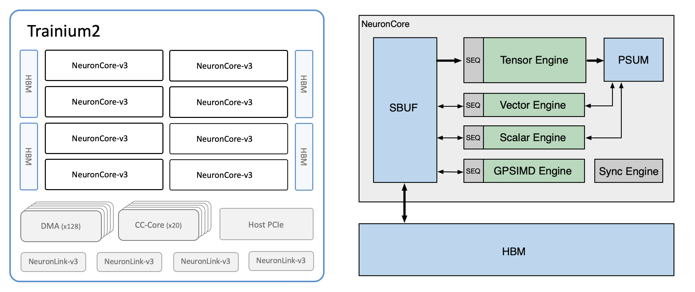
*Figure 1. Trainium 2 Device Diagram and the architecture of NeuronCore-v3, from the Neuron SDK Documentation.*

Most Trainium users can run a model without worry about the architecture. Trainium supports `torch_xla` to trace and compile the model graph from PyTorch code, convert into Neuron IR with the graph compiler, and generate the executable (i.e. the Neuron Executable File Format (NEFF)) with the Neuron Compiler backend (Figure 2). However, such directly deployment often leads to suboptimal performance. As a results, Trainium supports **Neuron Kernel Interface (NKI)**, which is a Pythonic kernel language to write optimized compute kernels for Trainium. It is similar to Triton or CUDA for GPUs, where you can define fine-grain instructions and memory access controls. To support the heterogeneity, many functions in NKI allows defining `engine=` to execute operations on different engines and `buffer=` to allocate different SRAM/HBM buffers.

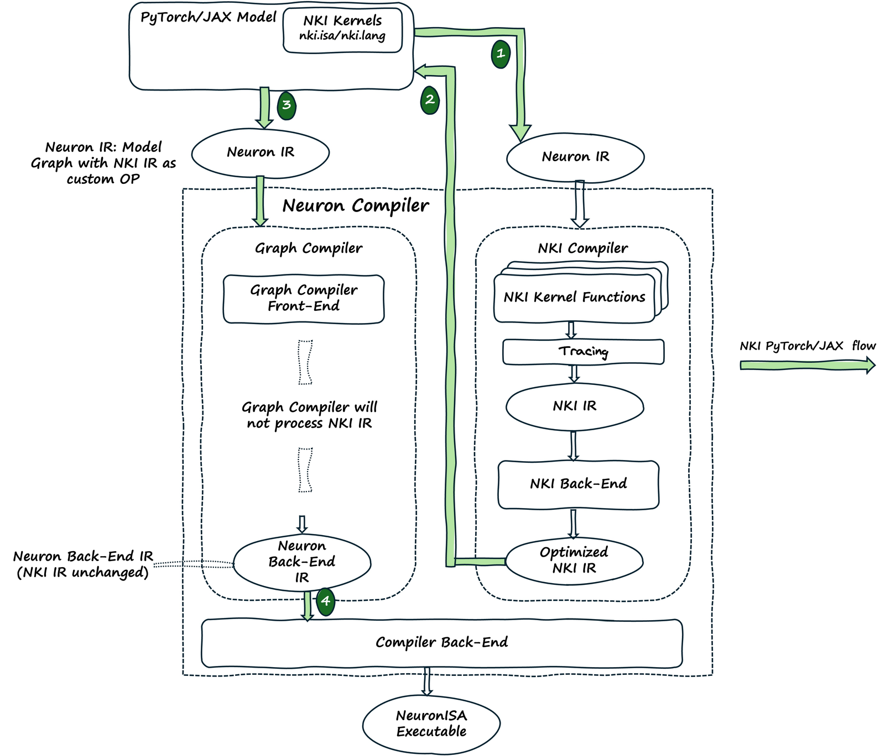
*Figure 2. Model graphs enter through the graph compiler (left) and NKI kernels through the NKI compiler (right). Both meet in the compiler backend (Walrus), whose output is a NEFF file. Diagram from the AWS Neuron documentation ([About NKI](https://awsdocs-neuron.readthedocs-hosted.com/en/latest/nki/get-started/about/index.html)).*

NKI is powerful: the NKI compiler keeps the instructions, their order and the memory allocation that you write. What NKI does *not* let you control is how the engines/instructions actually coordinate: which semaphore each instruction waits on, which DMA queue carries a transfer, and when the Scalar Engine reloads its activation-function tables. The compiler backend makes these decisions and writes them into its output, the **NEFF**, alongside one instruction stream per engine, the DMA descriptors and the memory map. Because the NEFF is the program that the Neuron runtime actually loads and runs, editing it directly gives us the control that NKI lacks. Hardcore GPU optimizer will recognize this programing layering: as NKI is equivalent to Triton for GPU, NEFF resembles SASS for GPU.

| | NVIDIA GPU | AWS Trainium |
|---|---|---|
| Kernel language | CUDA C++, Triton | NKI |
| Intermediate representation | PTX | HLO/NKI IR |
| Executable | cubin (SASS) | NEFF |

This leaves real room for improvement. In a profile, the engines of an NKI kernel often sit idle for reasons the source does not show: an engine waiting on the wrong event, a transfer queued behind unrelated ones, a function table reloaded again and again. Fixing such problems in the NEFF alone made the NKI Library kernels we studied 1.05x–4.9x faster. In the case study, one change to a single semaphore wait is worth 3.0 µs (6.8%). Edits like these require knowing what a NEFF contains, so the following sections take it apart. We start with the container: how a NEFF is laid out on disk, and how to unpack, edit and repack it without the compiler.

---

### NEFF Container Structure and Metadata

A NEFF is a container for compiler artifacts: a 1024-byte header followed by the payload, a gzip-compressed tar archive. A NEFF has the following structure:

```text
kernel.neff
├── [header, 1024 B]          Basic metadata and flags of the NEFF
└── [payload, tar.gz]
    ├── neff.json             Top-level graph connecting inputs, kernel and outputs
    ├── kelf-0.json           List of subgraphs, one per physical NeuronCore
    ├── info.json             Compiler versions and configuration
    ├── sg00/                 Subgraph for physical core 0
    │   ├── def.json          Definition of the subgraph: memory, DMA queues, semaphores
    │   ├── tensor_map.json   Metadata of the input and output tensors (dtype, shape, layout)
    │   ├── PE0.bin           Tensor Engine instruction stream
    │   ├── Activation0.bin   Scalar Engine instruction stream
    │   ├── DVE0.bin          Vector Engine instruction stream
    │   ├── Pool0.bin         GPSIMD Engine instruction stream
    │   ├── SP0.bin           Sync Engine instruction stream
    │   ├── {PE0,Activation0,DVE0,Pool0,SP0}.json      Metadata of each engine
    │   ├── act_info.json     Catalogue of activation tables for polynomial approximation
    │   ├── silu_and_others.json, silu_and_others_bkt.bin, silu_and_others_ctrl.bin
    │   ├── ...               Lookup tables of the other activation functions used
    │   └── default_{opcode,datapath,control_fast,control_slow}_table.bin
    │                         Vector Engine microcode tables
    └── sg01/                 Subgraph for physical core 1 (LNC=2 only)
```

A kernel compiled with LNC=2 has two subgraph directories, `sg00` and `sg01`, one per physical core. On Trainium2 a logical core spans at most two physical cores, so such a NEFF never has more than two subgraphs.

The **header** holds what the runtime and tools need before they open the payload. That is the package version, the header size, the payload size, the number of logical cores and the number of physical cores per logical core. It also has feature flags, one bit per feature the program needs, such as `dge` (descriptor generation engine for issuing DMA requests) or `coalesced-cc` (coalesced collectives). Whenever the payload changes, the header must be updated to match.

In the unpacked payload, there are three top-level JSON files. The most important is **`neff.json`**, which describes the NEFF as a dataflow graph. Each node is either a placeholder for an input tensor (`"op": "null"`) or a compute node (`"op": "tvm_op"`). Usually, there is only one `tvm_op` node, which is your top NKI kernel. Each `tvm_op` node lists its input arguments in `inputs`, and the top-level `heads` lists the graph's outputs. Both are lists of `[node, output index, version]` triples. For each input and output, the NEFF records the data type, shape and storage id in `attrs`, and further metadata in `metadata`.

```jsonc
// neff.json
{"nodes": [
   {"op": "null", "name": "hidden",   "inputs": [], "output_names": ["hidden"]},      // node 0: input placeholder
   {"op": "null", "name": "W_in_qkv", "inputs": [], "output_names": ["W_in_qkv"]},    // node 1
   ...,                                                                               // nodes 2-10
   {"op": "tvm_op", "name": "sg_coreV10",                                             // node 11: the kernel
    "inputs": [[0, 0, 0], [1, 0, 0], ..., [10, 0, 0]],          // edges: [node, output index, version]
    "output_names": ["output_0", "output_1", "output_2"],
    "attrs": {"func_name": "__kelf", "kelf": "kelf-0.json", "num_inputs": "11", "num_outputs": "3"}}],
 "arg_nodes":    [0, 1, ..., 10],                               // the graph's inputs
 "heads":        [[11, 0, 0], [11, 1, 0], [11, 2, 0]],          // the graph's outputs
 "node_row_ptr": [0, 1, 2, ..., 11, 14],                        // node i produces entries ptr[i] .. ptr[i+1]-1
 "attrs": {                                                     // one value per entry
   "dltype":     ["list_str",   ["bfloat16", "bfloat16", ..., "float32"]],
   "shape":      ["list_shape", [[1, 128], [128, 1024], ..., [4, 16384]]],
   "storage_id": ["list_int",   [0, 1, ..., 13]]},
 "metadata": {"signatures": {"default": {"inputs": {"hidden": {"id": 0, "dtype": "bfloat16", "shape": [1, 128]}, ...}}}}}

// kelf-0.json
{"graphs": [{"definition": "sg00/def.json", "name": "sg00"}], "version": "0.5", "target": "cayman"} // cayman = Trainium 2

// info.json
{"tool_version": "2.27.5334.0+f702b353", "nki_version": "0.6.0+31049202112.g85070674", "num_tpb": 1, ...}
```

The other two are metadata that rarely change across kernels. **`kelf-0.json`** lists the kernel's subgraphs, each with the path of its definition file, and the target device. **`info.json`** records the compiler and NKI versions and the number of logical cores (`num_tpb`). Following the references from `neff.json` to `kelf-0.json` to each `sgNN/def.json` leads from the graph down to the programs.

Each **subgraph folder** holds the complete program for one physical core. **`tensor_map.json`** describes the program's interface, with one entry per input and output tensor. Unlike `neff.json`, it keeps each tensor's shape and layout as the framework passed it (`tf_shape`, `tf_format`). In NEFFs where the compiler renames the inputs (`input0`, `input1`, ...), each entry also records the kernel parameter it came from (`kernel_param_name`), which is how you find the tensor you care about.

```jsonc
// sg00/tensor_map.json
{"hidden":   {"kind": "input",  "dtype": "bfloat16", "tf_shape": [1, 1, 128], "tf_format": "NHC", ...},
 "output_0": {"kind": "output", "dtype": "bfloat16", "tf_shape": [1, 1, 512], "tf_format": "NHC", ...}, ...}
```

The definition file, `def.json`, declares everything the instructions refer to:

```jsonc
// sg00/def.json (abbreviated)
{"pe_instr": "PE0.bin", "act_instr": "Activation0.bin", ...,        // which stream belongs to which engine
 "runtime_semaphore_count": 3,                                       // S[0]..S[2] belong to the runtime
 "var": {
   "SB":        {"type": "state-buffer", "var_id": 0},
   "hidden":    {"type": "input",  "var_id": 1,  "size": 256},
   "W_in_qkv":  {"type": "input",  "var_id": 2,  "size": 262144},
   "output_0":  {"type": "output", "var_id": 12, "size": 1024},
   "inst__I-16-0:_mem_6_1_sg0000": {"type": "tmp-buf", "var_id": 15, "size": 2048},
   "DGETable0": {"type": "dge-table", "var_id": 25, "list": [2, 1, 7, 6, 4, 3, 5, 11, 13, 14]}, ...},
 "dma_queue": {
   "qActDynamicHW":   {"type": "dynamic", "owner": "act",  "num_queues": 16, "semaphore_set": [72, ..., 87]},
   "qPoolDynamic":    {"type": "dynamic", "owner": "pool", "num_queues": 16, "semaphore_set": [8, ..., 23]},
   "qSPDynamicHW":    {"type": "dynamic", "owner": "sp",   "num_queues": 16, "semaphore_set": [56, ..., 71]},
   "qSPIO0":          {"type": "in",      "owner": "sp",   "num_queues": 16, "semaphore_set": [40, ..., 55]},
   "qSPSpillReload0": {"type": "data",    "owner": "sp",   "num_queues": 16, "semaphore_set": [24, ..., 39]}}}
```

DMA instructions refer to memory buffers by `var_id`, e.g., a DMA that names `var_id=0` accesses SBUF. Variable 0 is always the SBUF, inputs and outputs live in HBM, and `tmp-buf` (or `virtual`) variables are HBM scratch buffers that the compiler created. The `dge-table` lists the variables that DMA instructions access. Each DMA queue is owned by one engine and comes with its own 16 semaphores, which signal when its transfers complete. Choosing a queue for a transfer is therefore also **choosing which engine issues it and which semaphore reports it**, and that choice becomes a lever in the case study.

After the definition, there are several instruction streams and description JSON files. Most descriptions are one line (`{"instr": "PE0.bin", "dma": []}`), but two carry real content. `Activation0.json` lists the activation-table sets the program uses. `SP0.json` lists every queued DMA transfer, described in advance and later started by the Sync Engine:

```jsonc
// sg00/Activation0.json
{"instr": "Activation0.bin", "act_info": "act_info.json",
 "activation_function_sets": ["softplus_and_others", "natural_log_exp_and_others", "silu_and_others",
                              "sigmoid_and_others", "reciprocal_sqrt_and_small"]}

// sg00/SP0.json: one entry per queued transfer
{"instr": "SP0.bin", "dma": [
  {"id": 5, "queue": "qSPIO0", "semaphore": 45,
   "desc": [{"op": "copy",
             "from": "SB",       "from_dtype": "bfloat16", "from_off": 25283328,    // partition 96, byte 117504
             "from_sizes": [256, 1], "from_steps": [1, 1],
             "to":   "output_0", "to_dtype": "bfloat16",   "to_off": 768,
             "to_sizes":   [256, 1], "to_steps":   [1, 1]}]},
  ...]}
```

The **activation tables** are how the Scalar Engine evaluates non-linear functions: as piecewise polynomials whose coefficients it reads from a loaded table set. `act_info.json` is a catalogue of all 21 sets the compiler knows, and each set bundles one or a few main functions with a dozen simple ones. `silu_and_others`, for example, also covers tanh, sin, ReLU, square, copy and identity. Each set the program uses is stored as three files: `<set>.json` with per-function parameters (input thresholds, symmetry, special values), `<set>_bkt.bin` with the polynomial coefficients, and `<set>_ctrl.bin` with the control table. These are fixed tables shipped with the compiler. The Scalar Engine holds one set at a time, and an `ACTIVATION_TABLE_LOAD` instruction switches the loaded table. Each switch costs about 1.3 µs.

```jsonc
// sg00/act_info.json: every table set and the functions it covers
{"act_func_sets": [..., {"name": "silu_and_others", "profile_json": "silu_and_others.json",
                         "bkt_bin": "silu_and_others_bkt.bin", "ctrl_bin": "silu_and_others_ctrl.bin",
                         "act": {"silu": 32, "tanh": 4, "sin": 4, "relu": 1, "square": 1, "copy": 1, ...}}, ...]}
```

We have not yet covered the most important part: the **instruction streams**. Each `<engine>0.bin` is plainly an array of 64-byte slots, one instruction per slot, in program order. Most of what the compiler decided about an engine's work, down to which semaphore each instruction waits on, is encoded in those slots. To read and edit them, we need to know what the 64 bytes of each slot mean, which is the subject of the next section.

---

### Instruction and Pseudo Instruction

Based on the `neuron-dbg` disassembler tool, Trainium 2 has 128 instruction opcodes that share 82 instruction layouts. All of them follow a similar general pattern (Figure 3). Bytes 0–3 are a header whose first byte is the opcode, which decides how the rest of the slot is read. Bytes 4–11 are the events block, and bytes 12–63 hold the operands and the settings of the specific operation.

The **events** block is how an instruction synchronizes with the rest of the core. It contains the semaphore that this instruction waits for, the condition under which it may start (the semaphore must reach a threshold), and the semaphore that it updates when it finishes. The **operands** are tensors, each described by an address and an access pattern, the hardware form of NKI's `.ap(pattern=[[stride, count], ...], offset=...)`. The address encodes the start partition and the offset within it (`partition × 0x40000 + offset` for SBUF), and up to three `[step, count]` pairs (`step[3] num[3]` in Figure 3) walk the free dimensions, in elements. The partition dimension is not part of the pattern: the number of partitions is a separate field, such as `num_active_channels` in `ACTIVATE`. DMA instructions use the same idea with byte-based patterns and addresses that can also point into HBM. The meaning of the remaining bytes varies by opcode: [`docs/generated/opcodes.md`](docs/generated/opcodes.md) lists every opcode and its layout, and [`docs/generated/structs.md`](docs/generated/structs.md) gives the byte offset of every field in each layout.

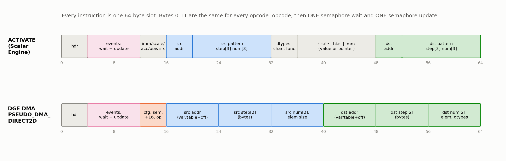
*Figure 3. Three of the 82 layouts: a Tensor Engine `MATMUL`, a Scalar Engine `ACTIVATE` and a DGE DMA. Bytes 4-11 (the events block) are the same for every instruction: one semaphore wait, one semaphore update, and **one** shared 32-bit value.*

Most NKI calls map one-to-one onto instructions. However, some NKI calls become several instructions, and the scheduling and synchronization between them are not controlled by NKI:

| NKI call | Instructions in the NEFF |
|---|---|
| `nisa.nc_matmul` | Tensor Engine `LDWEIGHTS` + `MATMUL` |
| `nisa.activation` | Scalar Engine `ACTIVATE`, plus an `ACTIVATION_TABLE_LOAD` inserted by the compiler when the table changes |
| `nisa.tensor_tensor` / `tensor_scalar` | `TENSOR_TENSOR_ARITH_OP` / `TENSOR_SCALAR_ARITH_OP` on the chosen engine |
| `nisa.tensor_copy` | `COPY` / `CAST` on the Vector, Scalar or GPSIMD Engine |
| `nisa.dma_copy` | a queued DMA or a DGE DMA (`PSEUDO_DMA_DIRECT2D`) |
| any call with more than one dependency | extra `EVENT_SEMAPHORE` slots, because a slot holds only one wait |

Some instructions are **pseudo-instructions**, with opcodes that start with `PSEUDO_`. A regular instruction is executed exactly as it is stored. A pseudo-instruction is a placeholder that still contains symbolic information, such as a queue name or a variable id, because physical addresses, DMA ring registers, and the rank id are known only at runtime. The Neuron runtime therefore rewrites every pseudo-instruction into regular instructions at load time.

---

### Memory Management and DMA

Compute instructions only touch on-chip memory. An SBUF address is `partition × 0x40000 + offset`, and PSUM addresses start at `0x2000000`. The compiler writes these addresses directly into the instructions, so in a NEFF an SBUF buffer is nothing more than a range of addresses, and an edit can claim unused SBUF simply by writing new addresses into the slots. The source and destination operands also carry their own partitions, so a single compute instruction can read partition 0 and write partition 32. Everything else, including every access to HBM, is a **DMA**.

A DMA transfer is described by **descriptors**, each covering one contiguous run of bytes. A NEFF contains two kinds of DMA, which differ in when those descriptors are made (Figure 4). A **queued DMA** is listed in advance in an engine description (`SP0.json`, shown in the previous section), and the runtime turns it into hardware descriptors when it loads the NEFF. At run time, a `PSEUDO_DMATRIGGER` on the Sync Engine starts block *k* of a queue, and when the block finishes, the queue's semaphore `semaphore_set[k % 16]` grows by 16. A **DGE DMA** is a single `PSEUDO_DMA_DIRECT2D` instruction on the Sync, Scalar or GPSIMD Engine, whose descriptors are created at run time by descriptor generation (DGE): a hardware block for the Sync and Scalar Engines, and software for the GPSIMD Engine. Its completion semaphore also selects the DMA queue, so it must belong to one of the issuing engine's queues in `def.json`.

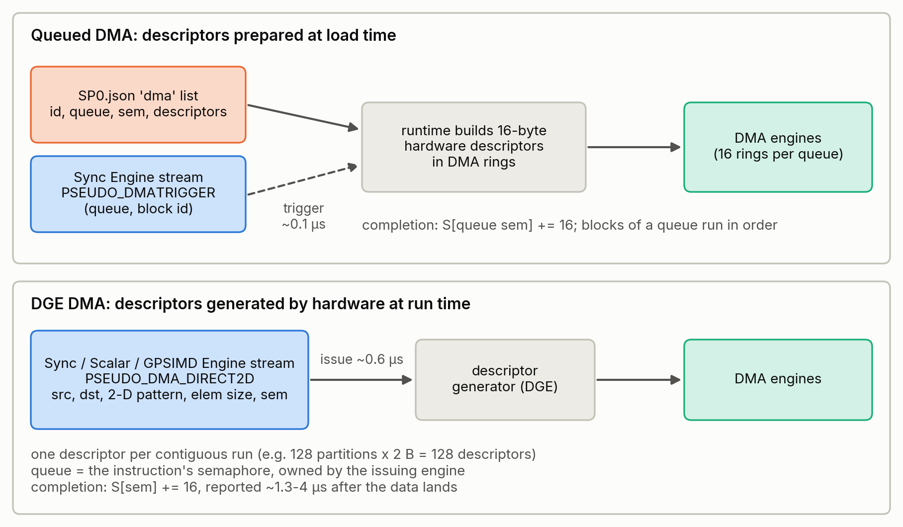
*Figure 4. Queued DMAs are described in JSON and turned into hardware descriptors when the NEFF is loaded. DGE DMAs are single instructions whose descriptors are generated at run time.*

What makes DMAs expensive in small kernels is not the bytes they move but their fixed costs. These are the costs we measured in our profiles:

| Item | Cost |
|---|---|
| issuing a DGE DMA | **0.56 µs + 0.74 ns per descriptor** of the issuing engine's time |
| issuing a queued trigger | 0.09–0.12 µs |
| completion of a queued DMA, from its trigger | ~1.2 µs (median) |
| completion of a DGE DMA, from its issue | 1.3–4 µs (median 1.6 µs) |

Which kind of DMA to use depends on what is known at compile time and on which engine has time to spare. A queued DMA is the cheaper choice for a transfer that is fully known when the kernel is compiled. Its descriptors are generated before the kernel runs, so at run time it costs only a ~0.1 µs trigger on the Sync Engine, whatever its size, and one transfer can carry many descriptors with complex patterns, casts or accumulation. But it is rigid: its addresses are fixed, and only the Sync Engine can start it. A DGE DMA costs about 0.6 µs of the issuing engine's time per transfer, but it is flexible. Its addresses can depend on values computed at run time, the GPSIMD Engine's software DGE can gather and scatter with a list of indices, and it can be issued by the Sync, Scalar or GPSIMD Engine. That last point matters more than it seems: a DGE DMA can sit in the stream of the engine that produces or consumes the data, which saves a semaphore hop to another engine, and it can use the queues of an engine that is idle. In NKI, this choice is the `dge_mode` argument of `nisa.dma_copy` (`none` for queued, `hwdge` for the Sync or Scalar Engine, `swdge` for the GPSIMD Engine). In the NEFF, it can still be changed after compilation, as the case study does when it moves weight loads onto the Scalar Engine's idle queues.

Two rules constrain DMA edits. A queue's blocks must be triggered as a prefix of block-id order: skipping a block in the middle hangs the device. And concurrent DMA writes less than a word apart corrupt each other. Because of the fixed costs, the fastest DMA is often the one that is never issued. But every DMA is also a link in the program's synchronization, so removing one requires understanding semaphores.

---

### Synchronization

The five engines and the DMA queues all run independently. The only thing that orders them is **semaphores**, so the semaphore waits and updates in a NEFF are, in effect, the whole schedule of the program (Figure 5).

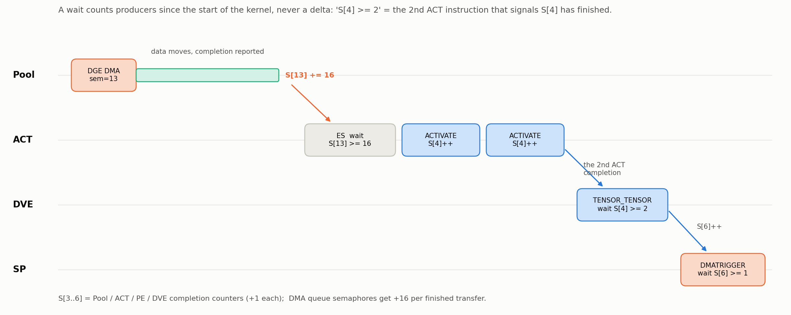
*Figure 5. Engines and DMAs add to semaphores; instructions wait for thresholds. A threshold counts producers since the start of the kernel.*

A NeuronCore has 256 semaphores, and the runtime reserves S[0..2]. S[3] to S[6] count finished instructions on the GPSIMD, Scalar, Tensor and Vector Engines: an instruction whose update mode is `SEM_INC_COMPLETE` adds 1 when it finishes. A DMA queue's semaphore grows by 16 per finished transfer. Waits are absolute. `S[i] >= v` means "the *v*-th increment of S[i] has happened since the start of the kernel", never a delta. Instructions on one engine also finish in program order, and the compiler relies on that.

The compiler uses this machinery conservatively: one wait mode (`>=`) and one kind of update (an increment on completion), although the ISA defines more. In particular, **`SEM_ADD_IMM_COMPLETE`, which adds an arbitrary amount when an instruction finishes, works on the device but is never emitted**. It lets a cheap `EVENT_SEMAPHORE` stand in for the completion of a DMA, and it became one of our most useful tools.

Because thresholds are absolute counts, every edit has to keep the counts consistent. We found it easiest to **think in producers, not numbers**: before an edit, write down which instruction or DMA produces each increment that a wait counts, and recompute the thresholds afterwards. Removing an instruction means either replacing it with an `EVENT_SEMAPHORE` that keeps its wait and update, or lowering every later threshold that counted it, in all five engines. Adding one raises later thresholds, and its consumer must now wait for it. Two traps are worth knowing. Waits on an engine's own completion semaphore must never be removed, because engines start the next instruction before the previous one has finished writing. And a single compiler wait often guarantees several things at once, so before deleting a DMA, check what its semaphore was ordering *transitively*.

Getting synchronization wrong fails in one of two ways. A wait that can never be met hangs the core (`NRT_TIMEOUT`). A wait that is met too early does not hang, but produces wrong numbers, sometimes only under the profiler's timing. That is why we verify every edit with several runs and profile it before trusting it. None of these waits appear in the NKI source, and that is the core of the gap between NKI and the NEFF.

---

### What can we do in NEFF but not NKI?

Writing better NKI is always the first step, and many of our optimizations could be expressed in NKI by restructuring the source. But a whole class of decisions is made by the compiler **after** the NKI source is written, and NKI 0.6.0 has no construct for them. Figure 6 and the table below compare the two levels.
<!-- 
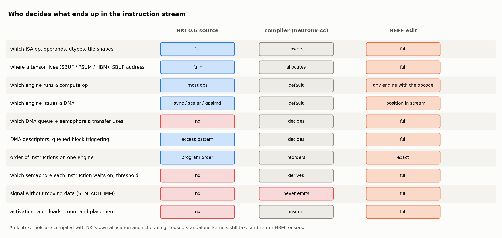
*Figure 6. What NKI 0.6.0 lets you express, what the compiler decides, and what a NEFF edit controls. Red = no handle at that level.* -->

| Decision | NKI 0.6.0 | NEFF |
|---|---|---|
| ISA op, operands, dtypes, tile shapes | ✅ `nki.isa` calls | ✅ slot fields |
| Where a tensor lives, SBUF address | ✅ `buffer=`, `address=` | ✅ any address |
| Which engine runs a compute op | ✅ `engine=` on most ops | ✅ any engine that implements the opcode |
| Which engine issues a DMA | ⚠️ `dge_mode` + `engine=` | ✅ plus *where* in that engine's stream |
| Which DMA queue / semaphore a transfer uses | ❌ | ✅ `semaphore` field, `def.json` queues |
| Instruction order on one engine | ⚠️ program order, not relative to compiler-inserted instructions | ✅ exact |
| **Which semaphore each instruction waits on, and the threshold** | ❌ derived by the compiler | ✅ events block, bytes 4-11 |
| **Signal "done" without moving data** (`SEM_ADD_IMM_COMPLETE`) | ❌ never emitted | ✅ |
| **Activation-table loads: how many, where** | ❌ inserted by the compiler | ✅ delete or move `ACTIVATION_TABLE_LOAD` |
| Compiler-inserted barriers, guard waits, dummy transfers | ❌ | ✅ |

These NEFF-only levers matter in practice. Across the 12 kernels we studied, they include re-pointing a wait to the instruction that actually produces the data, deleting `EVENT_SEMAPHORE` slots that synchronize nothing, moving transfers onto unused DMA queues (or new queues added to `def.json`), and deleting activation-table loads whose table is already resident. They are often the best gains per byte changed: a single re-pointed wait can be worth several percent of a kernel's latency.

NKI does have an internal, unexported escape hatch, `inline_asm_bytes`, which emits a raw instruction body. Even there, you only declare the instruction's memory reads and writes, and the compiler still decides its semaphores. The synchronization rows of the table stay out of reach.

Finally, the two levels **depend on each other**. An NKI-expressible change often pays nothing until a NEFF-only change removes the gate in front of it, as the case study will show.

---

### Design Scope: What should we modify for better performance

A NEFF has thousands of slots, and most of them are not worth editing. The first job is to **find the binder**, whatever currently sets the latency: the busiest unit, or a chain of waits on the critical path. Engine utilization tells you where to look, not how much there is to gain. In our study, a scan kernel with its Vector Engine 99% busy gained only 1.20x, because that busy work *was* the scan. A decode kernel with no unit above 24% busy gained 4.9x, because it spent its time waiting for DMA completions.

The tool that worked best was a **backward critical-path walk** over the profile. Start from the last instruction. For each instruction, decide whether it was held up by the previous instruction on its engine or by a semaphore wait (the profiler records when each threshold was reached), jump to whichever came later, and repeat. Every long hop in the resulting chain is a candidate edit. These are the levers that worked across our 12 kernels:

| Lever | Where in the NEFF | Typical effect | In NKI? |
|---|---|---|---|
| Remove SBUF→HBM→SBUF staging that only reshapes data | DMA slot addresses, `SP0.json` descriptors | the largest single wins | only by restructuring the source |
| Replace a redundant DMA with a semaphore increment | events block of the DMA slot | ~0.6 µs issue + 2–7 µs completion → 0.03 µs | ❌ |
| Turn a small DMA into a compute `CAST` / `COPY` | new slot + waits | 1.5–2.9 µs each | ✅ `tensor_copy` |
| Move work or DMAs to an idle engine or queue | move slots; an `EVENT_SEMAPHORE` relay keeps the counts | removes serial issue time | ⚠️ engine only |
| Re-point, relax or split semaphore waits | events block | up to several µs per wait | ❌ |
| Delete no-op sync slots on the critical path | `EVENT_SEMAPHORE` slots | ~0.04 µs per slot | ❌ |
| Fewer activation-table loads | `ACTIVATION_TABLE_LOAD` + moving `ACTIVATE`s | ~1.3 µs per load | ⚠️ only indirectly |
| Fewer, larger DMAs; fewer descriptors | DGE access patterns | ~0.56 µs per DMA removed | mostly |
| Hoist work stuck behind unrelated instructions | slot order + waits | depends on the stall | ⚠️ program order only |

Some tempting edits do not pay, and we measured each of them. Removing an engine's waits on its own completion semaphore gives wrong results. Letting a DMA start earlier does not help when the DMA engine is already saturated. Merging transfers that already run on separate queues removes the parallelism. Deleting redundant waits that are not on the critical path is correct but worth nothing.

To keep every edit correct, each iteration had to pass a verifier that runs the NEFF on the device with fixed inputs and requires each output to stay within 1.2x of the *unedited* NEFF's own error against PyTorch, with the same core count and interface. Latency is the device's own `total_exec_time`, taken as the median of several captures, with candidates interleaved (A B A B) because the device drifts by a few percent over minutes. Twice an edit passed the verifier and then hung under the profiler, so profiling became part of the correctness check too. With the format, the costs and the levers in place, we can now walk through one kernel end to end.

---

### Case Study: Optimize Gated DeltaNet (GDN) in NKI Library

In this case study, we will illustrate optimizing a GDN token generation kernel (`gdn_block_tkg`) from NKI Library by updating NEFF. This is a fused kernel for Qwen3.5-style Gated DeltaNet layer, with hidden dimension 128 and batch size 1. For fair comparison, we follow the parallelization in the original kernel (if `gdn_block_tkg` uses one physical core, we will also evaluated on one physical core for the optimized NEFF). The numerical correctness is evaluated with a script that reuse the unittest in NKI Library Github Repo. 

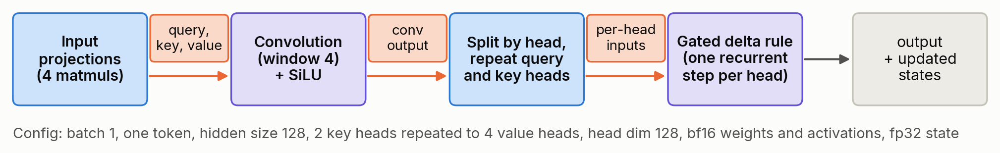
*Figure 7. `gdn_block_tkg` for one decode token. Purple blocks are kernels inherited from other functions in NKI Library. Orange blocks are intermediate data tensors*


On the roofline in Figure 8, we can see that the GDN kernel is highly memory-bound, with the arithmetic intensity at 0.9 FLOPs/byte, yet it runs 97x below the memory roof. Where slows down the kernel? Figure 9 shows the profile trace in neuron-explorer. From 38 to 204 µs the engines are mostly idle (1), while small writes into DRAM wait 17–22 µs each for their completion reports. Before that, the GPSIMD Engine spends 21 µs issuing 32 load DMAs back to back (3, 7). After it, the Scalar Engine switches activation tables seven times (4, 5).

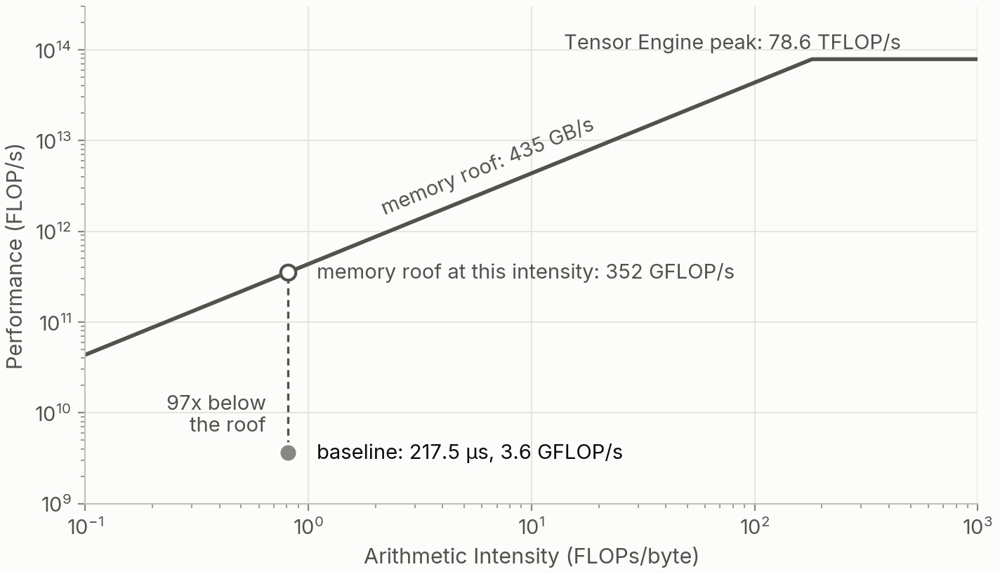
*Figure 8. The baseline on a roofline for one NeuronCore, with the Tensor Engine peak (78.6 TFLOP/s) and the DMA bandwidth (435 GB/s).*

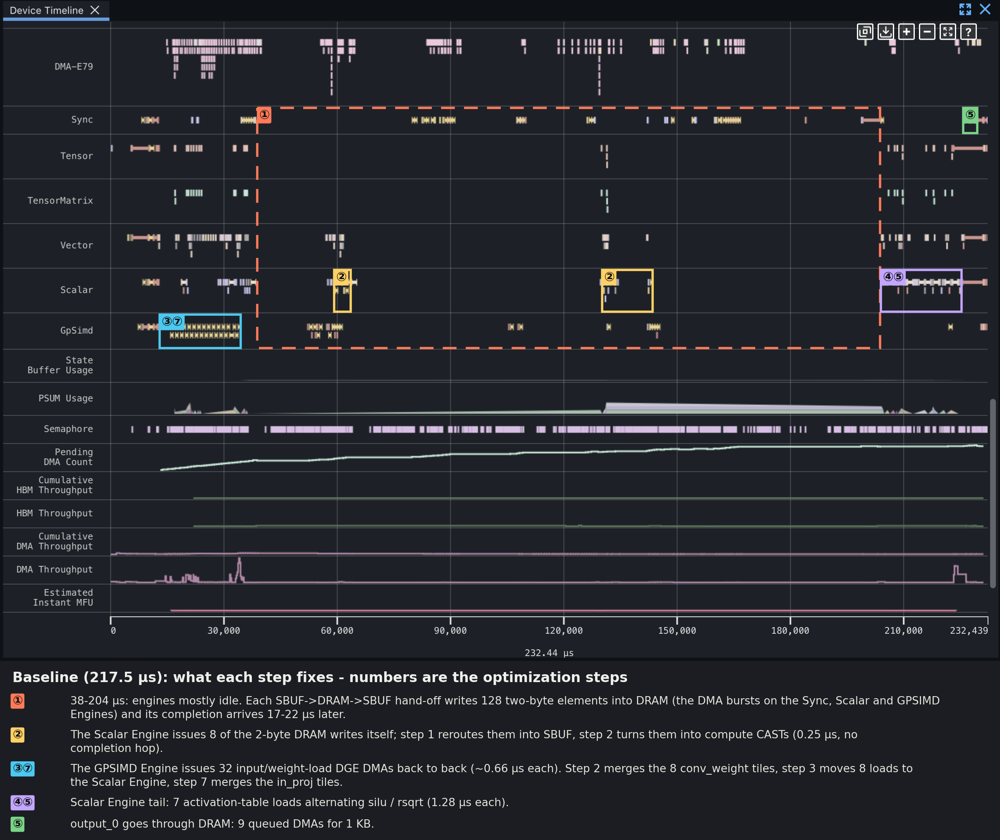
*Figure 9. The baseline profile trace in neuron-explorer.*

We optimized the GDN kernel at NEFF level with seven steps, achieving 4.9x speedup. Figure 10 illustrate the optimization trajectory across steps.


*Figure 10. Latency after each step of optimization*

<!-- 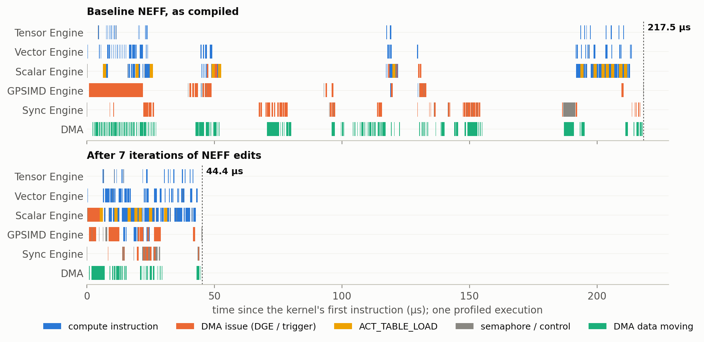
*Figure 11. One profiled execution before and after, on the same time axis. Orange = DMA issue, yellow = table loads, green = DMA data in flight.* -->

#### Step 1: Reduce the SBUF-HBM round trips for data access (217.5 µs to 95.4 µs, 2.28x)

<!-- 
*Figure 12a. Every DGE DMA of the baseline: time from issue until its completion semaphore is reached, from one profiled execution. The bar marks the median.* -->

Our first step is to eliminate the long idle stretch in Figure 9. It is caused by DMA round trips between SBUF and HBM. Each stage of the kernel stores its result in an HBM tensor, and the next stage loads it back (Figure 7): the projected query, key and value vector, the convolution output `conv_out`, and the per-head inputs of GDN block (`q_bh`, `k_bh`, `v_bh` and `z_bh`). In the NEFF, each of these becomes a pair of DMAs through a small DRAM buffer: a writer that stores a few bytes from each of the 128 partitions, and a reader that loads them back into SBUF. The reads complete in about 1.6 µs, but each write takes 17 to 22 µs to report completion, and about 30 of these transfers run in 5 to 6 dependent rounds.

Instead, we remove the DRAM access at the NEFF level. Each writer and reader pair only copies data from one SBUF location to another, sometimes converting bf16 to fp32 on the way. It turns out that performing SBUF copy and manipulation has significantly less wait time, and all 122 µs saved come from idle time. The same result is possible in NKI with a careful rewrite of the kernel, but it breaks the reuse of `gdn_conv1d_decode` and `gdn_tkg` as standalone kernels that other kernels also call. It is also hard to tell which DMAs are redundant from the profile alone, because the trace does not map one-to-one onto the kernel source.

<!-- 
*Figure 12b. A DRAM round trip becomes an SBUF→SBUF copy by swapping address fields between the two DMAs.* -->

#### Step 2: Remove DMAs that are duplicated or only signal completion (95.4 µs to 83.2 µs, 1.15x)

Step 1 left 21 DMAs that are no longer needed: 16 repeat a copy that another DMA has already made, and 5 move no useful data and only signal completion. Each still costs about 0.56 µs of engine time to issue, plus a 2 to 7 µs wait for its completion. We cannot simply delete them, because other instructions wait on their semaphores. A consumer waits until the DMA's semaphore reaches a given count, such as `S[62] >= 16`, and that count is reached only when the DMA completes and adds 16. Without the DMA, those waits would never be met, and the core would hang.

Instead, we overwrite each DMA slot with an `EVENT_SEMAPHORE`, an instruction that moves no data. It keeps the DMA's own wait, so it still runs only after the real copy has finished. When it completes, `SEM_ADD_IMM_COMPLETE` adds 16 to the DMA's semaphore, the same increment that the DMA's completion would have made. Every consumer therefore sees the same count as before, and no wait anywhere has to change, but the count now arrives 0.03 µs after the data is ready instead of several microseconds later. In bytes, only the opcode and two event fields change:

<!-- 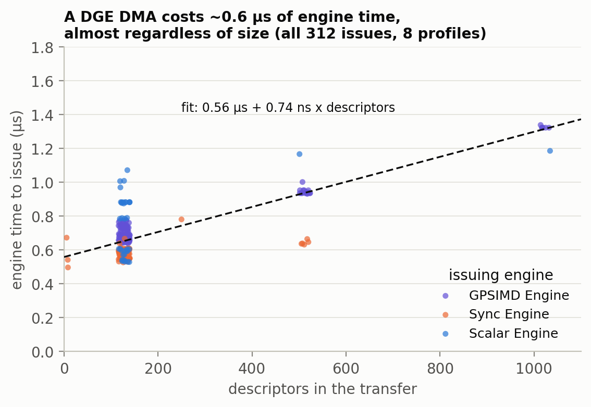
*Figure 13a. Engine time to issue a DGE DMA against its descriptor count, all 312 issues in the 8 profiles.* -->

```text
// SP0.bin slot 13, bytes 0-11
before:  d4 10 00 00 05 48 00 00 10 00 00 00   PSEUDO_DMA_DIRECT2D  wait S[72] >= 16; its completion adds 16 to S[62]
after:   a0 10 00 00 05 48 15 3e 10 00 00 00   EVENT_SEMAPHORE      wait S[72] >= 16; then S[62] += 16 (SEM_ADD_IMM_COMPLETE)
```

<!-- 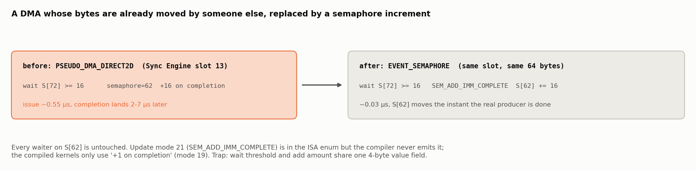
*Figure 13b. Removing a DMA without touching any wait in the program.* -->

Together with merging 8 small tile loads into one DMA, this step saved 12 µs. This operation is not achievable directly through NKI.

#### Step 3: Balance DGE DMAs from the GPSIMD Engine onto the Scalar Engine's idle queues (83.2 µs to 75.0 µs, 1.11x)

The critical path now started with the GPSIMD Engine issuing 25 weight loads one after another (about 17 µs). The Scalar Engine owns 16 DGE queues, but only 8 of them are currently used. We moved 8 of the loads onto the unused queues by inserting copies of their DMA slots into the Scalar Engine's stream. Each vacated GPSIMD slot becomes an `EVENT_SEMAPHORE` relay that keeps all later waits unchanged, and waits that no longer guarded anything were removed. The Scalar Engine's work now starts earlier, and the kernel ends 8.4 µs sooner (Figure 14).

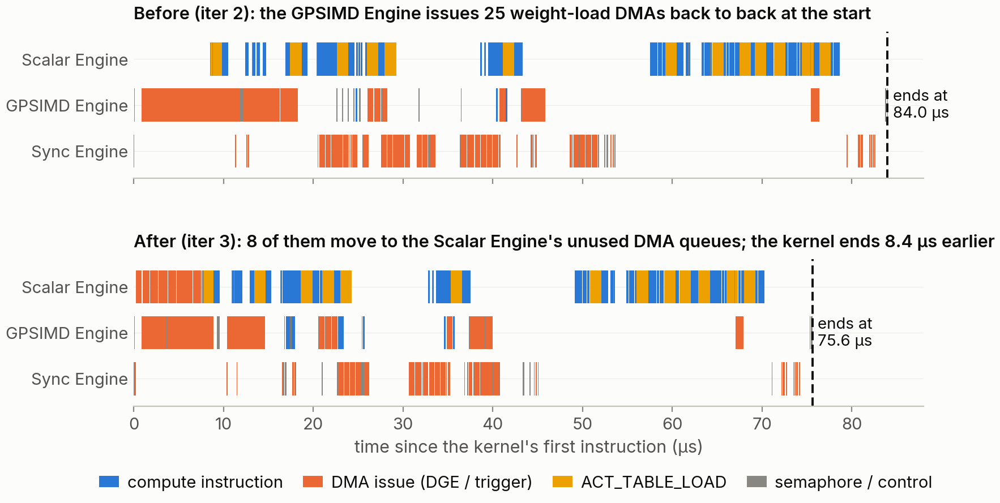
*Figure 14. One profiled run of iterations 2 and 3, from the first instruction to the end of the kernel. Eight of the GPSIMD Engine's serial weight loads (orange) move to the Scalar Engine, so the Scalar Engine's work starts earlier and this run ends 8.4 µs sooner.*

Such operation is hard to manage at NKI level. Although NKI can assign DMA to the specific engine, it cannot control in fine-grain to pin the DMA queue and allocate to let them share between instructions. On the other hand, NEFF can easily modify them by updating the `def.json` and the engine instruction stream.

#### Step 4: Reduce activation-table loading (75.0 µs to 60.0 µs, 1.25x)

The Scalar Engine switched between the silu and rsqrt tables for every head: 7 table loads at 1.3 µs each (Figure 15). A table load can be removed if its table is already loaded and no instruction ends up using a different table. Moving one silu `ACTIVATE` and giving another instruction its own output buffer removed 4 loads and saved 3.3 µs. In the same step, three small DMAs became `CAST` instructions, and one over-constrained wait was split.

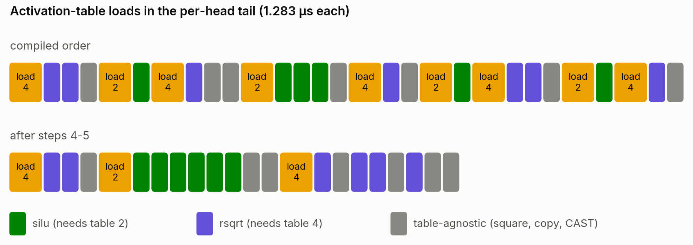
*Figure 15. Tail of the per-head loop, illustrative. The table loads go from 4, 2, 4, 2, 4, 2, 4 to 4, 2, 4, and the kernel's total from 13 to 7.*

NKI has no API for table loads, so it can only reorder activations and hope that the compiler merges the loads.

#### Step 5: Data packing for aggregated SBUF access (60.0 µs to 51.0 µs, 1.18x)

Four vectors for each head have to be transposed into rows of partition 0. The clearest case is the keys of the four heads. In the state update, each head computes `S += outer(k, delta)` on the Tensor Engine, as a separate matmul per head. The Tensor Engine sums over the partition axis of its inputs, so for an outer product, which sums over a single element, `k` and `delta` must both be rows in the same partition. `delta` is computed from the previous matmul, `kv = k^T @ S`, whose result is a single row in partition 0, so every head's key must also be a row in partition 0. The kernel therefore keeps the four keys side by side in partition 0, each at its own offset. The DMA does this transpose with one descriptor per value, 512 in total, and processes them one at a time. We first use 4 `CAST` instructions, which here simply copy values within each partition, to place each partition's four values next to each other in 8 contiguous bytes. A single DMA of 128 descriptors, one 8-byte block per partition, then moves everything (Figure 16). The four rows arrive interleaved, so instead of separating them again, the consumers read each vector with a stride of 4. Applied to two such transposes, this saved 4.2 µs. Two more table loads were also removed, and the 9 queued DMAs for the output became one 1 KB store.


*Figure 16. Four vectors (A to D) arrive one value per partition but are needed as rows in partition 0. Packing each partition's four values first cuts this transpose from 512 DMA descriptors to 128, and the consumers then read each vector with a stride of 4.*

#### Step 6: Modify the semaphore wait condition in the Scalar Engine (51.0 µs to 47.7 µs, 1.07x)

The Scalar Engine is idle for 3.7 µs waiting on S[28], the semaphore of a dummy DMA left over from step 1. That DMA starts only after the real transfer (S[67]) finishes, so it reports 2.6 µs late. Waiting on S[67] instead changes one byte and saves 2.4 µs:

```text
// Activation0.bin slot 54, bytes 0-11
before:  a0 10 00 00 05 1c 00 00 10 00 00 00   EVENT_SEMAPHORE  wait S[28] >= 16   // the dummy transfer
after:   a0 10 00 00 05 43 00 00 10 00 00 00   EVENT_SEMAPHORE  wait S[67] >= 16   // the real transfer
```

<!-- 
*Figure 17. The gate waited on a dummy transfer that is always triggered after the real one completes.* -->

#### Step 7: Merge the DMAs for projection weights and reorder instructions (47.7 µs to 44.4 µs, 1.07x)

The 8 tiles of the projection weights (`W_in_qkv`) were loaded by 8 separate DMAs, and so were the 8 tiles of the convolution state (`conv_state`). Merging each group into one DMA cuts the issue time of the projection weights from about 5.2 µs to 1.3 µs, and 8 `EVENT_SEMAPHORE` relays keep the semaphore counts unchanged. The merge alone made the kernel 0.6 µs slower, because the bottleneck moved to the Sync Engine. We then split the merged `conv_state` load again at the point where the instructions that read the tiles change, since the Vector Engine needs tiles 2 and 3 early, while tiles 4 to 7 are read much later. As one DMA, all 8 tiles complete together, so the early readers wait for the whole transfer. As two DMAs of 4 tiles each, the first half completes about 1.2 µs earlier, which saved 0.5 µs. Moving a few independent `CAST`s and a table load earlier saved another 2.0 µs. Such reordering and spliting of DMA are not managable in NKI level.

<!-- 
*Figure 18. Issue-time cost model for the 8 tile loads.* -->

#### Before and after in neuron-explorer

Figure 19 shows the optimized NEFF in the same view, with each step framed where it shows up; note that its time axis is about four times shorter than in Figure 9. The long idle stretch is gone (①). The Scalar Engine now issues the weight loads itself, as three merged DMAs (③⑦), while the GPSIMD Engine mostly runs cheap semaphore relays (②③) and `CAST`s that pack columns for the transposes (④⑤). The one-byte gate releases the Scalar Engine as soon as the transpose lands (⑥), the tail needs two table loads instead of seven (④⑤), and the output leaves in a single store (⑤).

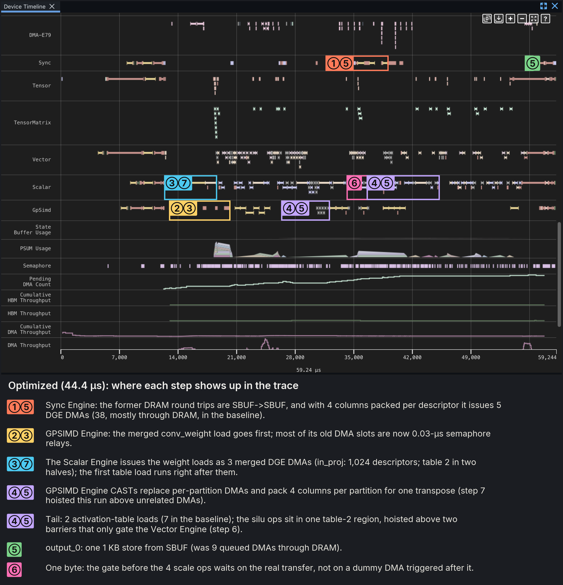
*Figure 19. The optimized NEFF in neuron-explorer. The capture is 59 µs, including the runtime's prologue and epilogue; the kernel takes 44.4 µs.*

Figure 20 compares neuron-explorer's utilization panels. In the baseline, each of the 16 DMA engines is only about 5% busy: the kernel moves very little data and spends its time waiting for completion reports. After optimization, they are 8–41% busy, and the compute engines' active share rises as well (Tensor 3→11%, Vector 8→31%, Scalar 18→60%, GPSIMD 15→31%), because roughly the same instructions now run in a quarter of the time. The Scalar Engine ends up as the binder, 80% busy and with its remaining table loads on the critical path.

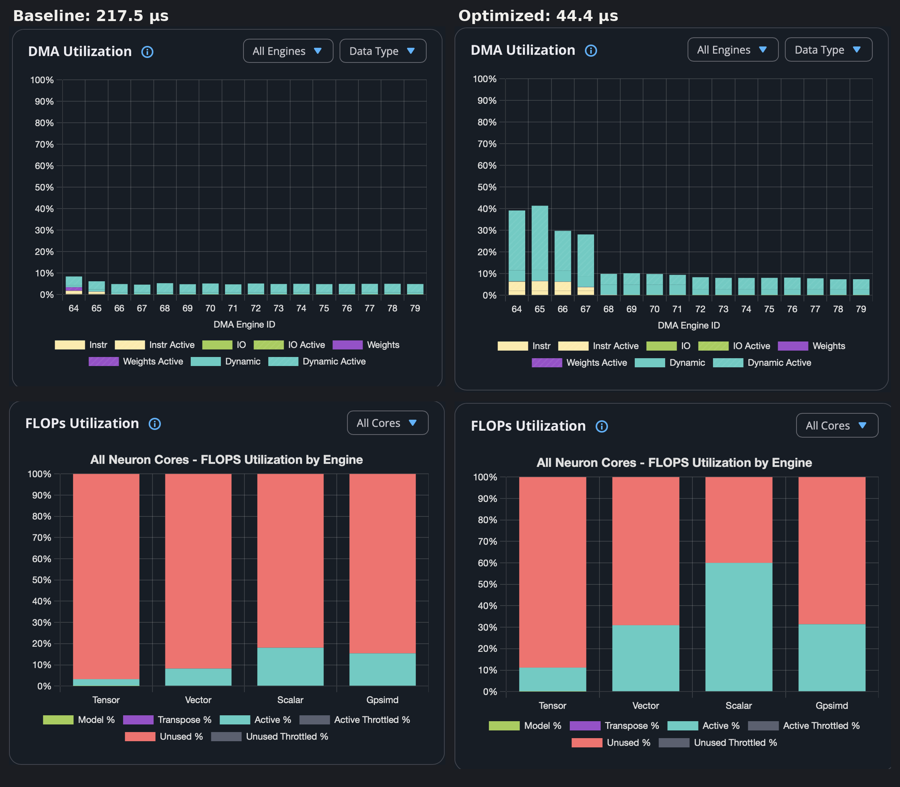
*Figure 20. neuron-explorer's DMA-utilization (per DMA engine) and FLOPs-utilization (per compute engine) panels. Left: baseline. Right: optimized.*

#### NKI vs NEFF in this case study

We tagged each of the 34 edit groups by how hard it would be to make the same change in NKI. An edit is *easy in NKI* if it is a local change to the block's own source. It is *hard* if it would mean rewriting the reused kernels (`gdn_conv1d_decode`, `gdn_tkg`), or if NKI can influence it only indirectly through the compiler. It is *NEFF-only* if NKI has no construct for it at all. Figure 21 shows how much latency each kind removed, using the loop's own per-edit A/B measurements scaled to the re-measured per-step totals.

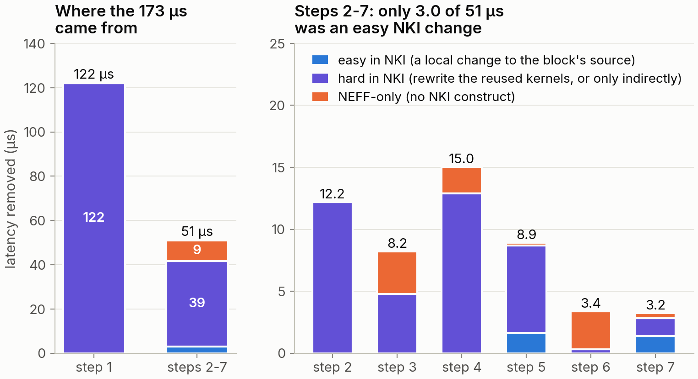
*Figure 21. Latency removed by how hard each edit would be in NKI. Blue: a local change to the block's NKI source. Purple: possible in NKI only by rewriting the reused kernels, or only indirectly through the compiler. Orange: no NKI construct.*

Step 1 (122 µs) is possible in NKI only by rewriting the three composed kernels into one. Of the 51 µs removed after step 1, only **3.0 µs** came from changes that are easy in NKI: merging stores, tile loads and transposes in the block's own code. Another 38.7 µs would need a rewrite of the reused kernels, or a lever that NKI controls only indirectly (queue choice, table loads, order relative to compiler-inserted instructions), and 9.3 µs were NEFF-only (waits, semaphore adds, queue triggering, barrier placement). Put differently, of the 173 µs we removed, only about 3 µs could have been removed in NKI without rewriting the validated kernels.

To check that NEFF-only edits carry real weight in the *final* kernel, we reverted two of them in the optimized NEFF and measured again (7 interleaved captures each; all outputs bit-identical):

| NEFF | Change vs the optimized NEFF | Median | Min-max | Δ |
|---|---|---|---|---|
| optimized | — | 44.42 µs | 43.52-44.69 | — |
| step 6 reverted | **1 byte**: Scalar Engine slot 49 `events_wait_idx` 67 → 28 | 47.43 µs | 47.00-48.43 | **+3.01 µs (+6.8%)** |
| step 7 table-load hoist reverted | 2 slots swapped (Scalar Engine slots 4 ↔ 5) | 44.65 µs | 44.47-44.91 | +0.23 µs (+0.5%, marginal) |

One byte of synchronization, invisible at the NKI level, is worth 7% of this kernel's latency.

#### What still limits the optimized kernel

Even after the 4.9x speed-up, the optimized NEFF runs 20x below the memory roof (Figure 22). Moving its 955 KB over HBM would take only 2.2 µs at 435 GB/s, and its Tensor Engine work only 0.01 µs, yet the kernel takes 44.4 µs. The bottleneck is the **Scalar Engine**, which is busy for 35.6 µs, 80% of the run: 48 activations (15.9 µs), 7 activation-table loads (9.0 µs), 24 casts (5.8 µs) and the issue of 3 weight-load DMAs (4.6 µs). A kernel cannot finish before its busiest engine, so this work alone caps it at 22 GFLOP/s, the orange line in Figure 22.

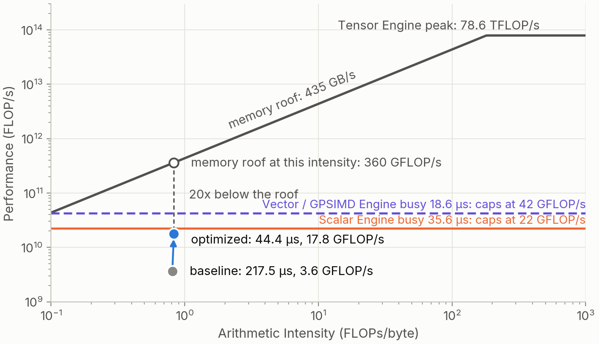
*Figure 22. The baseline and the optimized NEFF on the roofline of Figure 8 (one LNC). Each horizontal line caps the kernel at its Tensor Engine FLOPs divided by one engine's busy time in the optimized NEFF: the Scalar Engine (35.6 µs) caps it at 22 GFLOP/s, and the GPSIMD Engine (18.6 µs; the Vector Engine is similar at 18.3 µs) at 42 GFLOP/s.*

The root cause is a mismatch between how fast data arrives and how fast the Scalar Engine consumes it. Its compute instructions read 822 KB, almost as much as the whole kernel moves over HBM, but over its busy time it gets through them at only about 23 GB/s, while the DMA engines can deliver data at 435 GB/s, 19x faster. Its peak is not the problem: 128 lanes at 1.2 GHz could stream fp32 data at about 614 GB/s. In a one-token decode, however, a typical activation touches only 4 elements per partition and still takes about 0.3 µs, so the time goes to fixed per-instruction costs and table loads rather than to data.

To keep pace with the DMA at the memory roof, the Scalar Engine would have to finish its work in 2.2 µs instead of 35.6 µs, which means about **16x more effective throughput**, for example from several Scalar Engines working on independent heads in parallel, or from a much lower fixed cost per instruction. The Vector and GPSIMD Engines, at about 18 µs each (the dashed line), would be next and would need about 8x. Only with all of them aligned with the DMA, and with transfers large enough to run near peak bandwidth, could this kernel approach the memory roof. Today a NeuronCore pairs one Scalar Engine with 16 DMA engines, a balance that suits large tiles, where each instruction streams enough data to hide its fixed cost. Decode kernels like this one need a different balance. We therefore think that the ratio of compute units between engines in future Trainium generations should be modeled and optimized on the workloads the chip will run, including small-batch decode, rather than fixed for the large-tile case.

#### Generalizing to other kernels

Nothing in this method is specific to GDN. We ran the same automated edit–verify–measure loop on 12 nkilib kernel configurations: Gated DeltaNet decode and prefill, Mamba-2 SSD and selective scan, with baselines from about 50 µs to 15 ms. Without changing a line of NKI source, every configuration got faster, from 1.05x to 4.9x (Figure 23), in 79 iterations of which the verifier rejected none. The gains are largest where latency is set by data movement and synchronization, as in small decode kernels, and smallest where an engine is already saturated by the computation itself, as in long scans.


*Figure 23. NEFF-only optimization of 12 nkilib kernel configurations: 79 loop iterations, none rejected by the verifier.*

#### Acknowledgement & References

This work is supported by the AWS Build on Trainium program at UCLA.

The full NEFF documentation behind this post is in this repository. The [README](README.md) is the entry point to the chapters in [`docs/`](docs/), which cover the container, the definition file, the instruction format, DMA, synchronization and a step-by-step editing guide. The tools to unpack, decode, edit and repack a NEFF are in [`tools/`](tools/). Every experiment is reproducible from [`experiments/`](experiments/), with one folder per kernel configuration for all 12 kernels in Figure 23. Each folder holds the NKI source, the baseline and optimized NEFFs, the measurements, and the per-iteration notes and reviews of the optimization loop. For the case study, [`experiments/gdn_block_tkg_b1_h128_vh4_lnc1/blog_profiles/`](experiments/gdn_block_tkg_b1_h128_vh4_lnc1/blog_profiles/) holds all eight NEFFs of the trajectory with their profiles, which open with `neuron-explorer view -n iterN.neff -s iterN.ntff`. The figures are regenerated by the scripts in [`figs/src/`](figs/src/).

References:

[1] AWS Neuron documentation: [Trainium2 Architecture](https://awsdocs-neuron.readthedocs-hosted.com/en/latest/about-neuron/arch/neuron-hardware/trainium2.html), [Trainium2 Architecture Guide for NKI](https://awsdocs-neuron.readthedocs-hosted.com/en/latest/nki/guides/architecture/trainium2_arch.html) and [About NKI](https://awsdocs-neuron.readthedocs-hosted.com/en/latest/nki/get-started/about/index.html), the sources of Figures 1 and 2.

[2] [NKI Library](https://github.com/aws-neuron/nki-library) ([documentation](https://awsdocs-neuron.readthedocs-hosted.com/en/latest/nki/library/about/index.html)), the kernels optimized in this post.

[3] [Neuron Explorer](https://awsdocs-neuron.readthedocs-hosted.com/en/latest/tools/neuron-explorer/index.html), the profiler used for every measurement.

